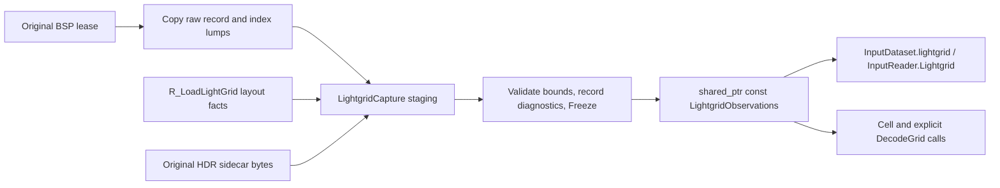

# Original BSP lightgrid observations

`shared/rd-rend2/lightrecon/lightgrid.h/.cpp` provides a C++11 CPU snapshot of
JA lightgrid evidence. SP, MP and standalone tools link the same
`rend2_lightrecon_core`. This input is separate from reconstructed assets,
physical emitters, renderer grid textures and entity probes. It does not fit
lights, estimate sun, classify geometry, interpolate, smooth or flood-fill.

## Storage, identity and indexing

`LightgridObservations` owns three compact arrays:

| Array | Representation and indexing |
| --- | --- |
| `Records()` | Original `LUMP_LIGHTGRID` bytes. Each JA `mgrid_t` is 30 bytes: ambient RGB8 `[4][3]`, directed RGB8 `[4][3]`, four style bytes, two lat/long bytes. Trailing malformed bytes are preserved and reported. |
| `Indices()` | Original `LUMP_LIGHTARRAY` bytes, two little-endian bytes per logical cell. References can repeat. An incomplete trailing index is retained, never dereferenced. |
| `Hdr()` | Original host IEEE binary32 representation from `maps/<map>/lightgrid.raw`: six floats per **logical** cell, ambient RGB followed by directed RGB. It is not indexed through `mgrid_t`, and has no per-style channels. |

No permanent array of expanded/decoded `GridCell` objects is allocated.
`Cell(ordinal, out)` performs a bounded O(1) read into caller-owned storage;
it does no I/O, allocation, renderer access or reconstruction. `Records()`,
`Indices()` and `Hdr()` return const references suitable for future offline
exports. Hold the snapshot lease for the entire lifetime of these views.

`Map()` reuses the existing `LightmapMapIdentity` structure: resolved BSP VFS
path, exact original BSP size and SHA256, before header byte swapping.
`RecordOffset()` / `IndexOffset()` identify the two source lumps in that file.
`HdrSource()` identifies the separate sidecar. The BSP hash does **not** include
sidecar contents; a future complete cache key must hash those separately.
The current production key remains explicitly `NotCacheable`.

Within a map hash and grid layout:

```text
ordinal = x + Nx * (y + Ny * z)
x = ordinal % Nx
y = (ordinal / Nx) % Ny
z = ordinal / (Nx * Ny)
centreWorld = originWorld + (x,y,z) * spacingWorld
```

These are lattice sample centres in unchanged BSP world coordinates, with
**no half-cell offset**, atlas offset or metre conversion. Bounds are unsigned
integer cell counts; spacing is finite and strictly positive. Origin/endpoints
must be finite and representable as float. The renderer adapter copies its
computed origin/spacing/bounds, including authored worldspawn `gridsize`.
Default JA spacing is `(64,64,128)` world units, not a universal assumption.
An all-zero shape represents an empty grid; a partially zero shape is invalid.
Logical identities are `(map hash, layout, x,y,z)`, not record indices or emitter
IDs. Rebuilding/changing map contents or layout invalidates that identity scope.

## Presence, style, geometry and quality are independent

Every in-bounds logical cell can be queried, including malformed/missing cells.
`Cell` returns `Ok` for an accessible cell with quality diagnostics; an ordinal
outside the layout returns `InvalidInput` and clears output.

| Field | Meaning |
| --- | --- |
| `presence` | `Absent`, `Present`, `MissingIndex`, or `InvalidIndex` for LDR record data. |
| `indexPresent`, `sourceRecord` | Whether a complete index exists and its raw uint16 value, including an invalid reference. Zero is a valid record index, not an invalid-cell sentinel. |
| `styles[4]`, `styleStatus` | Exact style bytes plus `Unavailable`, `None` (all 255), `Static` (active slots are 0), `Styled`, or `NonContiguous` (active slot after a 255 sentinel). No animation weights are evaluated. All four colour slots remain accessible even after a sentinel. |
| `suspectedInvalid`, `issues` | Malformed record/index/HDR sizes, invalid references, non-finite/negative HDR, or a style gap. These flags concern data quality, not occupancy. Layout-wide size diagnostics are attached to each cell conservatively. |
| `geometry` | Always `Unknown`. No geometry provider has classified these samples. |
| `hdrPresent` | A complete six-float tuple exists for this logical cell, independently of LDR index/style validity. |
| `direction.quality` | `Unavailable` without a record, otherwise `QuantizedUncalibrated`. `confidenceKnown` remains false. |

The JA record has **no independent solid/free-space validity bit**. Its raw
styles, RGB, direction and index are preserved; none proves geometric validity.
`styles[0] == 255` does not remove data, nonzero RGB does not establish free
space, and `(latLong[0],latLong[1]) == (0,0)` is a north-pole direction rather
than missing direction. No inferred geometry validity is inherited from the
experimental reconstruction, legacy entity sampling or probe packing.

## Direction convention and uncertainty

The original entity path in `tr_light.cpp` uses `latLong[1]` as azimuth and
`latLong[0]` as polar angle. The exact 256-step encoding convention is:

```text
p = latLong[0] * 2*pi/256
a = latLong[1] * 2*pi/256
toSource = (cos(a)*sin(p), sin(a)*sin(p), cos(p))
```

`GridDirection::toSource` is that unit vector in BSP world axes. It points
from the receiver **toward incoming light/the emitter**, as used by entity
normal dot lightDir. Light propagation has the opposite sign. One baked
direction is an aggregate directional measurement, not an emitter position.

For compatibility inspection `entityToSource` also preserves the normalized
legacy approximation: byte angles multiplied by 4, sine table of 1024 entries
generated with denominator 1023, cosine via quarter-table offset and mask.
This is slightly different from ideal trigonometry. Standalone tests compile
the current SP/MP table initializer and entity decode statements into an oracle,
and compare all 65,536 byte pairs at `2e-6` component tolerance. CMake tracks
the source files and fails configuration if extraction or SP/MP agreement changes.

The encoding step is `2*pi/256 = 1.40625 degrees`. Bake rounding is unknown;
`errorBoundRadians = 2*step + 0.02` is a conservative whole-bin bound for both
angles plus table error (about 3.958 degrees), not a measured confidence interval
or a bound on real multiple-light ambiguity. `confidenceKnown=false` explicitly
keeps that ambiguity unresolved. Pole aliases and polar angles beyond pi can
encode identical directions; round trips compare vectors, not identical bytes.

## Photometric decoding

`DecodeGridLdr(decoder, cell, styleSlot, GridAmbient|GridDirected, out)` and
`DecodeGridHdr(decoder, cell, GridAmbient|GridDirected, out)` use the canonical
[observation decoder](rend2-observation-decoding.md). Raw fields remain available.
LDR/HDR are alternatives, and ambient/directed components and style slots remain
separate. No arbitrary maximum, sum, style colour, grayscale presentation,
interpolation or physical scale is applied by extraction.

Default LDR source transfer remains unknown until the caller supplies an explicit
documented/assumed profile. The decoder tracks channel saturation/censoring,
quantization and missing/invalid channels. HDR uses `LinearRgb32F` with
`LightgridRawFloat32` provenance and uncalibrated relative scale. Invalid HDR bits
are retained as evidence, flagged per cell, and rejected by the colour decoder;
they never become available linear lighting. A partial tuple is not read as a
complete HDR sample. Missing colours return `Unavailable` with decoder `Missing`
diagnostics. Invalid component/style requests return `InvalidInput`.

Current renderer overbright settings can describe a separate renderer-compatible
candidate; they cannot reveal the historical bake calibration. World units per
metre and physical-to-scene presentation do not turn these values into lux/cd.

## Capture and ownership



`LightReconBspCapture::GridEmbedded` runs after `R_LoadLightmaps`, before
`ReleaseSource` and surface loading. It copies the original record/index lumps
while the exact BSP buffer or bounded SP collision-cache reread is still alive.
Thus no colour-shifted `world->lightGridData` or GPU texture is used as original
evidence. `R_LoadLightGrid` supplies layout before its existing overbright loop;
its HDR hook copies raw floats before hunk copying and `FS_FreeFile`.

When `r_hdr=0`, the observation adapter alone performs a bounded sidecar lookup
through injected renderer VFS functions. It never sets `world->hdrLightGrid`,
changes `r_hdr`, creates a texture or changes upload formats. With `r_hdr=1`,
the existing renderer read is reused. The legacy renderer still rejects a
wrong-sized HDR file with its existing map-load error; that behavior is unchanged.
The CPU core can preserve partial whole-float tuples and report inconsistencies
without requiring the engine to load such a map. Non-float-aligned input fails
the snapshot rather than silently truncating a byte representation.

`LightgridCapture` is the single synchronous writer. `Freeze` publishes only a
complete immutable snapshot; unsafe layouts, provider errors and memory limits
discard unpublished data. Arrays are ordinary independently owned STL storage,
never hunk or renderer-image memory. Reset/map change/failed load/vid_restart/
shutdown drop the owner's lease. Already pinned old snapshots remain safe until
released; release all module leases before renderer DLL unload. MP sub-BSPs are
excluded from the main-world observation owner.

Capture follows build policy, never consumer flags: 0 and 1 allocate/read no
observations; 2 captures only without a validated cache hit; 3 captures regardless
of a hit. Current complete-key plumbing is unavailable, so a real runtime cache
hit is not claimed. The capture gate's valid-hit suppression is CPU-tested.
Completed asset publication drops raw inputs; the current `BuildRequired` state
retains bounded raw snapshots for inspection/future sessions. No solver is run.

## Limits and memory

Default `GridLimits`: 64 MiB combined raw record/index/HDR payload, 8,388,608
logical cells, 1,048,576 records and 4,096 bytes per path. Count multiplication,
source spans, vector maximum sizes, dimensions, endpoints and offsets are checked
before allocation/access. A uint16 reference can address only the first 65,536
records; extra records are preserved but never implicitly assigned to cells.

Resident payload is `30*recordCount + indexByteCount + 4*hdrFloatCount`, plus
small vector/string/report metadata. No per-cell decoded matrix is retained.
Whole-source BSP reread scratch is released before surfaces. Observation-only
HDR lookup temporarily holds at most one additional bounded sidecar copy;
at peak the grid's copied payload plus that scratch is at most 128 MiB, excluding
pre-existing renderer allocations, independent lightmap snapshots and metadata.
Failure/Reset frees staged buffers deterministically; caller-held leases can
extend old snapshots' residency deliberately.

`r_lightReconInfo` reports capture state, logical/record/index/HDR counts,
raw payload bytes, missing/invalid indices, style/HDR diagnostics, layout and
source hashes. Hashing there is explicit debug work, never a per-frame query.

## Reproduction and results (2026-10-23)

From the repository root, with CMake/Python on PATH:

```powershell
cmake -S tools/lightrecon_test -B build/lightrecon-standalone -G "Visual Studio 16 2019" -A x64
cmake --build build/lightrecon-standalone --config Release --parallel 4
ctest --test-dir build/lightrecon-standalone -C Release --output-on-failure -V

# Existing configured SP/MP build used for validation:
cmake --build build/lightrecon-core-renderers --config Release --parallel 4 --target rdsp-rend2_x86_64 rd-rend2_x86_64 lightrecon_test lightrecon_api_test lightrecon_core_test lightrecon_control_test lightrecon_disk_test lightrecon_lifecycle_test lightrecon_lightmaps_test lightrecon_decode_test lightrecon_lightgrid_test
ctest --test-dir build/lightrecon-core-renderers -C Release --output-on-failure -V

# Independent existing MinGW GCC 16.2 build, toolchain bin on PATH:
cmake --build build/lightrecon-disk-standalone --parallel 4
ctest --test-dir build/lightrecon-disk-standalone --output-on-failure -V

python tools/rend2/test_lightrecon_contract.py
python tools/rend2/lightrecon_regression.py --no-gpu --output build/lightrecon-lightgrid-shader-contract

python tools/rend2/test_lightrecon_lifecycle_runtime.py --installation "C:\Program Files (x86)\Steam\steamapps\common\Jedi Academy\GameData" --binaries build/ssr-msvc/RelWithDebInfo --renderer build/lightrecon-core-renderers/Release/rdsp-rend2_x86_64.dll --output build/lightrecon-visual-20261022 --label grid-validated --timeout 600 --lightgrid-fixture
python tools/rend2/test_lightrecon_lifecycle_runtime.py --installation "C:\Program Files (x86)\Steam\steamapps\common\Jedi Academy\GameData" --binaries build/ssr-msvc/RelWithDebInfo --renderer build/lightrecon-core-renderers/Release/rdsp-rend2_x86_64.dll --output build/lightrecon-visual-20261022 --label grid-hdr-validated --timeout 600 --lightgrid-fixture --lightgrid-hdr 1
```

The runtime commands require installed stock assets and the existing SP
executable/SDL/game DLL harness. It makes a private generated HDR sidecar and
does not alter installed assets. Raw logs/fixtures stay under ignored `build/`;
compact source/binary/hash/count evidence is versioned as
`tools/rend2/lightrecon_baseline/lightgrid-validation.json`.

CPU fixtures cover empty/absent grids, deduplicated indices, xyz reconstruction,
all styles, a bright valid-style cell inside a known synthetic solid box,
missing/invalid indices, raw preservation after caller mutation, HDR dense
ordering, incomplete tuples, infinity/NaN payload/negative values, memory limits,
overflow, invalid spacing/dimensions and 100 reset/pinned-reader cycles. All
65,536 direction pairs have unit/round-trip/table-reference checks. The test
does not reinterpret style/RGB/direction as geometric occupancy.

Actual stock SP results, with original raw hashes independently checked against
PK3 data:

| Map | Shape | Logical cells | Shared records | Raw LDR grid bytes |
| --- | --- | ---: | ---: | ---: |
| hoth2 | 213 x 258 x 19 | 1,044,126 | 4,001 | 2,208,282 |
| hoth3 | 202 x 81 x 14 | 229,068 | 11,553 | 804,726 |

Both maps have zero out-of-range references, style gaps and all-255 style sets;
none of their logical cells can therefore be classified as a wall by that
sentinel. This reports source facts, not traced geometry. `hoth2` uses authored
spacing `(96,96,144)`; `hoth3` uses `(64,64,128)`. The generated hoth2 HDR case
retains 25,059,024 extra bytes (27,267,306 total grid payload) while `r_hdr=0`;
the original LDR hashes remain identical. A second run with `--lightgrid-hdr 1`
reuses the renderer's original HDR read and preserves exactly the same samples.
`hoth3` demonstrates a missing HDR
sidecar. Disabled/cache-only/unload states retain zero observation payload;
map changes and renderer restart publish the correct current-map identity.

SP and MP renderer targets compile. MSVC and independent GCC each pass all nine
CPU executables: 459,733 grid checks and 531,513 total checks per compiler. The
12-test regression detector and controlled 27-program / 51-stage preprocessed
GLSL/binding comparison pass with zero differences. `--no-gpu` is not a fresh
full-matrix GPU compilation claim; actual SP map registration exercised the
driver. No screenshot equivalence or MP gameplay test is claimed. Existing x64
`/arch:SSE2` ignored-option build warnings remain.

Touched groups: new shared `lightgrid.h/.cpp`, shared core/test CMake, optional
input lease, raw source identity access, BSP/renderer owner hooks and diagnostics,
CPU tests/current-renderer direction oracle, existing regression/runtime tools
and documentation. `tr_light.cpp`, texture/probe packing, shaders, physical-PBR
math and legacy sampling remain unchanged.

Geometry classification, physical calibration, full dependency fingerprints,
streaming/spill-to-disk storage, MP sub-BSP capture and observation-file export
remain future work. The canonical output-asset disk format is not changed to
store these raw inputs. Headerless HDR is supported as Rend2 currently loads it;
other BSP/lightgrid formats need explicit adapters. No point/spot/source fitting
or reconstruction integration is implemented.
