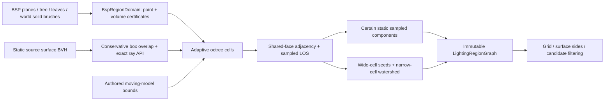

# Geometry-aware lighting region graph

`lightrecon/regions.h/.cpp` provides the immutable C++11
`org.openjk.lighting-region-graph` version 1 structural input. It contains no
irradiance, lights, fitted portals, GI weights or renderer resources. SP, MP and
standalone tools link the same implementation. Building a graph is explicit;
map loading, visibility, fog and lighting consumers do not call it automatically.



## Data and meanings

| Record | Meaning |
| --- | --- |
| `RegionCell` | Adaptive integer-lattice cell, full-volume classification, representative, region membership, sampled BSP leaf/cluster/area and bounded boundary-surface IDs |
| `LightingRegion` | Room-like **candidate grouping**, member CSR, loose bounds and an actual certified free-cell representative; separate static-component ID |
| `CellConnection` | Shared-face geometric adjacency; finite centre-ray result and potential transport enum kept separately; sampled face rectangle, centre, axis and area |
| `RegionConnection` | Aggregation of cell faces between different candidate groups; clear/blocked/unknown sample counts, conditional dynamic state and provisional aperture metadata |
| `RegionBspLink` | Original leaf/cluster/area at member centres; sampled membership, not a claim that an entire coarse cell occupies one leaf |
| `RegionBoundary` | Region-side references to original visual surface IDs adjacent to unresolved boundary cells |
| `DynamicBoundary` | Explicit possible moving obstruction, model/source ID, authored bounds and whether its swept extent is actually known |

These concepts do not share a visibility boolean. A continuous corridor can
have many clusters and one candidate region. An open doorway can link two
candidate regions in the same static component. A potential connection is not
permanent runtime LOS. Even points in the same candidate region can have a wall
on their direct segment; `FilterPair` performs the actual ray test.

An aperture record is sampled free interface geometry. Its AABB can include
unsampled parts of an irregular opening. Detailed faces remain in
`CellConnections()`. It is not an exact opening polygon, optical transmission,
synthetic light portal, light shaft or emitter. Area has world-units squared;
positions, bounds, resolution and offsets use original world units.

## Spatial classification

`RegionDomain` separates a point query from a **uniform-volume certificate**.
Sampling corners or a lightgrid centre does not certify an entire cell as free.
The production CPU `BspRegionDomain` accepts bounded typed arrays, with no engine
globals or file operations. Its immutable snapshot contains normalized planes,
nodes, leaves, world-brush side spans and leaf-brush references. Construction
validates references, finite values, spans and cyclic/deep node traversal.

Point classification traverses the BSP tree and tests model-0 solid convex
brushes listed by the reached leaf. A containing brush gives Solid or Sky;
near-boundary results remain uncertain. A point outside the explicit world
bounds is Outside. A valid non-solid leaf can certify free space; cluster -1
without a containing solid brush stays Unknown. No style, RGB, lightgrid
direction, PVS bit or cluster equality is used as a free-space/transport proof.

Box classification visits all intersected BSP leaves. Plane/AABB intervals
exclude disjoint brushes; full containment certifies Solid/Sky. Any possible
solid intersection, unresolved leaf or partial world-bound overlap yields
Unknown. This deliberately errs toward uncertainty for convex intersections.
The snapshot assumes the supplied compiler leaf/brush indexing is spatially
consistent; validation is not a repair of arbitrary corrupt BSP geometry.

The visual BVH's new `OverlapBox` query conservatively intersects primitive
AABBs, including patch error envelopes. A miss certifies no **retained visual
geometry** in the cell; it does not certify absence of collision solid. A hit
can be a false positive for a diagonal triangle, so it causes refinement or
Unknown instead of declaring the entire box opaque. Bounded surface references
are sorted; truncation is explicitly flagged. Existing ray-query behaviour is
unchanged.

A free/exterior cell requires both the domain certificate and no visual
geometry overlap, with complete BVH coverage. Its centre is independently
classified before publication. Unsupported/incomplete geometry cannot silently
become free. Solid, outside, sky-volume and unresolved cells have region ID 0.
Explicit `Exterior` certificates are allowed; BSP clusters do not infer them.

## Segmentation and connections

The analysis bounds, coarse spacing and minimum spacing are explicit inputs,
independent of lightgrid dimensions. Their ratio must be a power of two <=1024.
Root cells use x-fastest order; mixed, geometry-touching or moving-bound cells
subdivide into eight children in fixed bit order. Homogeneous clear interiors
stay coarse. Unresolved cells at minimum resolution remain Unknown and record
`CellResolutionLimit`; they never bridge two rooms. A wall thinner than one cell
still intersects its box and blocks that cell from joining the free graph.

An octree face search finds positive-area neighbours across mixed resolutions,
without O(all-cells squared) comparisons. Every free-cell adjacency is checked
through the existing static ray API with known-free origin evidence and explicit
two-sided occluder policy. Only geometric Clear samples form certain static
component edges. Blocked and Unknown are distinct, as is ConditionalDynamic.
No PVS data are needed or consumed.

Room-like segmentation is a separate deterministic heuristic:

1. Wide certified cells (size >= `constrictionWorld`) seed connected groups.
2. Multi-source BFS assigns adjoining narrow cells over certain static edges.
3. A meet between different seed groups creates a candidate region boundary and
   sampled aperture edge; it does not cut the underlying static component.
4. A component with no wide seed falls back to one continuous group. This keeps
   a long narrow hall or open domain from becoming one room per probe/cluster.

This uses cell-size clearance certificates, not exact medial-axis distance or
semantic room names. Hop-count watershed over adaptive cells can oversegment
irregular geometry; changing resolution/threshold can change candidate groups.
Absence of a sampled connection does **not** prove photometric isolation: narrow
openings, alpha/glass transport, unresolved boundaries or paths outside the
analysis bounds can remain unrepresented. `RegionSampledTopology` is always set.

Moving/deformed geometry is absent from static optical geometry. Authored model
bounds refine and mark affected free cells; these form uncertain groups and
conditional connections, rather than permanent visibility. Unknown swept travel
is recorded. Every result is static-only even outside these bounds: current door
or elevator positions are not known, and the graph is not a gameplay navmesh.

Sky exposure uses up to 16 deterministic member-centre upward rays per region
(configurable 1..256). Only an actual geometric sky hit sets `RegionSkyObserved`.
No hit does not mean enclosed or prove outside/sky. Exterior grouping does not
partition outdoor points by cluster and does not manufacture sun direction.

## Queries, ownership and IDs

`LightingRegionGraph::Build` publishes a const shared snapshot only after all
stages succeed. Error/cancellation clears the output; no partial graph survives.
It owns octree nodes, cell/region/connection arrays, CSR indices and small
metadata. The domain and static BVH have strong immutable leases. There are no
world/hunk pointers, GPU handles, background jobs, per-frame allocations or
global pair caches. The build cancellation pointer is cleared before publication.
Queries use local scratch and require injected domains to be thread-safe.

- `Lookup`: point-domain check plus octree lookup, explicit Assigned/Solid/
  Outside/Sky/Unknown result. Region bounds alone are never a containment proof.
- `Find`, `Members`, `Neighbours`: binary-search region ID and const CSR views;
  retain the graph lease while accessing references.
- `AssignGrid`: original indexed cell association, independent of styles/RGB.
  The dataset+ordinal overload verifies source-map identity. Missing/invalid
  observations stay distinct from solid geometry. The bare `GridCell` overload
  has no map lease and is intended for already-validated caller records.
- `AssignSurface`: checks a pinned luxel geometry/map and unambiguous mapped
  position, then resolves positive/negative geometric-normal sides separately.
  `AssignSurfaceSides` is the lower-level position/normal/source-surface API.
  It probes a bounded distance (default 4 minimum cells), records actual side
  offsets, and validates each accepted side through the source-biased ray API.
  It cannot jump through another wall. Canonical positions/normals stay unchanged.
- `FilterPair`: reports same region, same static component, disconnected sampled
  graph or Unknown, **and** a separate real ray result. Only actual blockage can
  reject direct LOS; graph disconnection alone is not an optical rejection.
  A conditional group's zero static-component ID leaves this relation Unknown;
  it does not assert disconnection across a movable door.
- `DebugObj`: bounded text export of member centres, region names and connection
  polylines. Lines illustrate topology and are not claimed direct rays.

`InputDataset.regionGraph` and `InputReader::RegionGraph()` provide optional
read-only access. Constructing a reader does not build or query a graph. No
output-asset capability, cache key or `InputManifest.regions` is fabricated.

Cell IDs are leaf emission ordinal + 1. Static-component IDs are the lowest
stable free-cell ID in that sampled component. Region IDs are the lowest seed
cell ID (or fallback component/dynamic group ID). Ordered tree visits, sorted
maps/metadata and fixed BFS order make identical inputs/version/options produce
identical IDs and exports. Scope IDs to that graph revision, source-map hash,
domain/material/geometry interpretation and options; a new resolution or rebuilt
input can change them. A BSP hash alone is not a complete production cache key.
There is no graph disk codec in this change.

Default limits are 400,000 nodes, 350,000 cells, 2,000,000 adjacency records,
4,096 moving bounds, 128 MiB conservative build budget and 128 Mi structural work
units, with per-ray/per-box work limits. Memory charging reserves headroom for
vector growth, CSR/DSU/BFS and aggregation scratch. `ownedBytes` measures owned
vector capacities; `peakBuildBytes` is conservative accounting, not measured RSS.
Shared providers, caller input buffers and allocator/stack overhead are separate.
Queries never require a permanently expanded lightgrid-membership matrix.

## Validation and stock-map inspection (2026-10-24)

Both GCC 16.2 C++11 and MSVC 19.27 Release passed **13/13 CPU tests, 645,018
checks each**, including 82,746 region checks. SP and MP renderer targets compile.
Strict GCC `-Wall -Wextra -Wpedantic -Wconversion` checks emit no diagnostics.
Fourteen existing compatibility tests pass; 27 configurations / 51 preprocessed
GLSL stages have zero baseline differences. The shader audit used `--no-gpu`;
full GPU permutation compilation or new gameplay validation is not claimed.

Generated tests cover sealed rooms, open/fixed closed doors, a moving placeholder,
long multi-cluster hall, thin visual-only partition, two floors, courtyard,
skylight, solid/boundary/outside/unknown states, original grid cells inside walls,
both sides of a thin luxel surface, missing data, cyclic/bad BSP references,
non-finite input, cancellation/limits/errors, empty/all-solid domains, immutable
views and repeated deterministic exports.

The sealed fixture gives 2 static components and no aperture edge. Opening its
doorway gives 1 component, 2 candidate regions and 1 aperture edge; the moving
placeholder gives 3 groups with conditional links. A long corridor spanning >8
sampled clusters stays 1 region. The courtyard stays 1 region with actual sky
evidence. The complete synthetic suite took 1.024 s (GCC) / 0.336 s (MSVC) on
this host, including all assertions and repeated builds. Open-door graph owned
memory was 4,590,904 / 3,862,592 bytes respectively (STL capacities differ).

`tools/lightrecon_test/lightrecon_regions_inspect.cpp` is a bounded offline
**JA RBSP v1** adapter, separate from the CPU core. It reads at most 128 MiB,
copies validated typed BSP data and retains source surface IDs. It explicitly
excludes source-type nonpolygonal flares. It does not interpret shader scripts or
alpha masks: non-sky material optics remain Unknown. Its conservative patch
chord bound is minimum cell size / 4 (8 units for this inspection). This is
adequate for structural exclusion with expanded envelopes, not exact patch rays.
Worldspawn grid spacing/defaults reproduce original logical sample coordinates;
this inspection helper is not a replacement engine BSP/entity loader.

Licensed stock hoth3 was inspected within centre `(3320,700,123)`, radius 512,
coarse/minimum 128/32 units. The ROI is a bounded experiment, not a map-wide
room census. Source BSP SHA256:
`821e6413f10e1e4aca7b6a5fd1bc57a6731bce5d9075cb0175208915cee5cb32`.

| ROI statistic | Result |
| --- | ---: |
| Candidate regions / static components | 9 / 5 |
| Sampled connections / aperture candidates | 5 / 5 |
| Certified free / solid cells | 1,396 / 641 |
| Unknown / sky-volume cells | 24,850 / 0 |
| Possible moving-bound cells | 61 |
| Sky-observed regions | 0 (no sky claim) |
| Grid cells in ROI | 1,536 |
| Grid assigned / solid / unknown | 99 / 1 / 1,436 |
| Sampled BSP links / boundary references | 16 / 546 |
| Domain / geometry work tests | 5,003,078 / 1,128,241 |
| Explicit rays | 3,598 |
| Static BVH triangles | 153,443 |
| Nonpolygonal flares excluded / unparsed material records | 54 / 12,911 |

GCC inspected, built and exported in 1.671 s; MSVC in 0.610 s. Graph owned
memory was 7,041,342 / 5,666,254 bytes; conservative build accounting 23,787,742.
Separate BSP domain memory was 1,794,326 / 2,034,106 bytes, and the shared BVH
38,544,566 bytes. These exclude the offline raw BSP and source capture buffers.

Two GCC runs produced byte-identical OBJ and cell/edge TSVs. MSVC produced the
same bytes for all three. The XY slice at Z=123 was visually inspected: coloured
certified centres are sparse, grey unresolved boundary/geometry volumes dominate,
and authored moving bounds are orange outlines. This conservatism can miss
connections and needs finer/adaptive geometric refinement before claiming a
complete useful stock-level room model. There is no interpolation across grey.

Raw artifacts are under ignored `build/lightrecon-regions-offline/accepted-hoth3/`:
`regions-xy.png`, `first/hoth3.obj`, `first/hoth3-cells.tsv`,
`first/hoth3-edges.tsv`, logs and `result.json`; MSVC comparison is in
`build/lightrecon-regions-offline/accepted-msvc/`. No licensed BSP/PK3 or large debug
assets are committed. The small versioned
[`regions-validation.json`](../tools/rend2/lightrecon_baseline/regions-validation.json)
records source/build/log hashes, counts and export/image hashes.

## Reproduction and remaining work

From the repository root, with CMake/compiler/Python on PATH:

```powershell
cmake -S tools/lightrecon_test -B build/lightrecon-disk-standalone -G "MinGW Makefiles" -DCMAKE_BUILD_TYPE=Release
cmake --build build/lightrecon-disk-standalone --parallel 4
ctest --test-dir build/lightrecon-disk-standalone --output-on-failure -V

cmake --build build/lightrecon-core-renderers --config Release --parallel 4 --target rdsp-rend2_x86_64 rd-rend2_x86_64 lightrecon_test lightrecon_api_test lightrecon_core_test lightrecon_control_test lightrecon_disk_test lightrecon_lifecycle_test lightrecon_lightmaps_test lightrecon_decode_test lightrecon_lightgrid_test lightrecon_surfaces_test lightrecon_classification_test lightrecon_visibility_test lightrecon_regions_test lightrecon_regions_inspect
ctest --test-dir build/lightrecon-core-renderers -C Release --output-on-failure -V

g++ -std=c++11 -Wall -Wextra -Wpedantic -Wconversion -fsyntax-only -Ishared/rd-rend2 shared/rd-rend2/lightrecon/regions.cpp tools/lightrecon_test/lightrecon_regions_test.cpp tools/lightrecon_test/lightrecon_regions_inspect.cpp
python tools/rend2/test_lightrecon_contract.py
python tools/rend2/lightrecon_regression.py --no-gpu --output build/lightrecon-regions-shader-contract

python tools/rend2/test_lightrecon_regions_offline.py --installation "C:\Program Files (x86)\Steam\steamapps\common\Jedi Academy\GameData" --inspector build/lightrecon-disk-standalone/lightrecon_regions_inspect.exe --output build/lightrecon-regions-offline/accepted-hoth3
build/lightrecon-core-renderers/Release/lightrecon_regions_inspect.exe build/lightrecon-regions-offline/accepted-hoth3/hoth3.bsp build/lightrecon-regions-offline/accepted-msvc/hoth3 3320 700 123 512 128 32 16
```

Use fresh offline output directories; the comparison directory must exist.
The plotting helper needs Pillow only; CPU tests/inspector need standard C++11.
Local compiler/CMake binaries came from
`C:\Users\Keyten\Desktop\projects\OpenJK\build\toolchain\w64devkit\bin` on PATH;
Python was the bundled `codex-primary-runtime` interpreter. See the
[core build guide](rend2-reconstruction-core.md) for fresh MSVC configuration.

Changed implementation: `regions.h/.cpp`, additive BVH `OverlapBox`, optional
input-reader graph lease, shared/test CMake lists, synthetic tests, offline
inspector and plot/repeat helper. No active renderer/collision/fog source was
changed. Future work includes tighter triangle/box and brush intersection,
sub-resolution opening refinement, material-aware uncertain interfaces,
validated moving-model swept extents, better geometric/semantic segmentation,
full-map validation and explicit engine adapter/cache integration. A graph edge
still carries no baked or smoothed lighting and never becomes an emitter.
