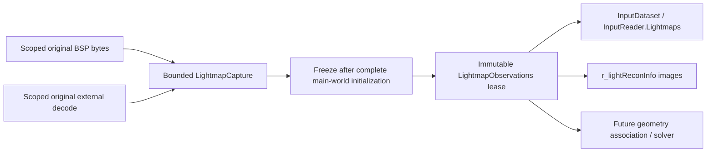

# Original CPU lightmap observations

`lightrecon/lightmaps.h/.cpp` owns original baked images as **reconstruction
inputs**, separate from the canonical reconstructed-lighting asset, GPU lightmap
atlases and fitted `SurfaceObservation` records. This adds capture and inspection;
it does not fit lights, evaluate irradiance or install a rendering consumer.

The [photometric decoding API](rend2-observation-decoding.md) now reads these
snapshots without modifying them, retaining channel censoring and explicit
source-transfer/calibration assumptions. No decode is run automatically during
map loading or observation acquisition.

## Capture points and representations

`RE_LoadWorldMap`'s `LightReconWorldLoad` begins a map-scoped capture alongside
the existing reconstructed-asset owner. `R_LoadBSP` creates a main-world-only
`LightReconBspCapture` **before header byte swapping**. It hashes original complete
BSP bytes with SHA-256, preserving VFS map identity and byte count.

Ordinary `FS_ReadFile` loads lend their exact-size buffer to this scoped adapter.
SP's collision-cache import exposes a pointer without an allocation length.
Rather than treating `Z_MemSize`'s aggregate tag total or the greatest lump offset
as that length, that case uses a bounded independent VFS read with one handle.
The original headers must agree. As with renderer map loading, resolved VFS
contents must remain immutable for the registration interval; live replacement
of a BSP during collision/renderer handoff is unsupported. The bounded reread
is hashed/captured directly, not retained as a permanent second BSP.

| Source | Capture location | Preserved representation |
| --- | --- | --- |
| Embedded BSP lump | `R_LoadLightmaps`, after original-index deluxe detection, before atlas allocation/upload | Every original 128×128 RGB8 image, including deluxe and embedded alternatives to HDR; absolute lump byte offset |
| External lighting | Immediately after existing HDR/LDR decode, before colour shifts, linearization, intensity visualization or half-float conversion | HDR: original decoded float RGB; LDR: unchanged decoded RGBA8, including alpha |
| External deluxe | Immediately after existing LDR decode, before `(0,0,0)` direction repair | Unchanged RGBA8; original `lm_XXXX` odd index or `dm_XXXX` lighting index plus distinct deluxe role |

HDR uses Rend2's existing Radiance RGBE decoder (`stb_image`), requesting three
float components without vertical flip. No half-float round-trip is involved.
External LDR uses the existing TGA/PNG/JPEG loader and its existing fallback
order. `R_LoadImageSource` reports the **actual successful VFS filename**, including
an extension fallback. The existing four-argument `R_LoadImage` is a wrapper around
that same implementation; its loading and pixel results are unchanged in SP/MP
and vanilla. `channels` describes the captured representation: embedded RGB=3,
decoded LDR RGBA=4, decoded HDR RGB=3. It does not claim the original compressed
container's channel count or retain JPEG/PNG/TGA container bytes.

When building inputs, an external deluxe image can be inspected with
`r_deluxeMapping 0`. The observation-only probe frees the decode and skips all
deluxe GPU creation/detection changes. It is absent on disabled/cache-only paths.
External HDR lighting follows the existing renderer source selection (`r_hdr`
and float-lightmap support); this is not an independent sidecar inventory.
When no external lighting image resolves, an explicit missing record is stored;
embedded fallback pixels, if present, remain separate records. Unrequested HDR
alternatives are not advertised as missing. Deluxe misses mean an attempted
lookup, rather than a fabricated black/direction texture.

## Identity, ordering and meaning

Each immutable image has original `logicalIndex`, lighting/deluxe role, encoding,
width/height/channels, source identity, embedded byte offset, missing flag and
SHA-256 of the preserved pixel representation. Every set owns one complete
source-map fingerprint. External images inherit that map association. This BSP
digest alone is **not** a complete reconstructed-asset cache key: sidecars,
lightgrid, materials, authored metadata, settings and calibration still need
complete dependency coverage. Current production cache keys stay `NotCacheable`.

Records sort by `(logicalIndex, role, encoding, source)` at publication. IDs are
independent of atlas page, texture size, texture slot, fat-packed UV or allocation
order. Embedded/external records sharing an index represent **alternative source
observations**, never additive light contributions. Source-role/encoding/path
are part of identity; duplicate full identities fail capture. Interleaved deluxe
images keep odd BSP indices; surface lightmaps keep even indices. Separate
`dm_XXXX` records use the associated original lighting index and deluxe role.

Samples are row-major in original embedded order or the existing unflipped
decoder's order, with increasing x within each row. Capture does not flip rows,
normalize directions, repair zeros, change gamma, apply overbright, infer
clipping or promote bright pixels to emitters. Historical RGB8 remains encoded,
quantized, **uncalibrated** data; it is not asserted to be scene-linear or measured
lux. HDR preserves finite decoded linear RGB values and the source's arbitrary
scale/colour convention; it does not establish physical calibration or Rec.709
primaries. Float bits (including finite signed zero) are preserved. NaN/Inf
causes an explicit failed capture; there is no silent repair.

## Ownership, policy and bounds



| Owner | Lifetime and release |
| --- | --- |
| Original BSP buffer / cached reread | Borrowed/scoped only through `R_LoadLightmaps`; `ReleaseSource` runs before `R_LoadSurfaces` and `FS_FreeFile` |
| Existing external decode | Borrowed for a capture call; existing loader frees it as before |
| Map `LightmapCapture` | Owns copied per-image buffers; all partial images discarded on capture error/abandoned load |
| Frozen set / pixel chunks | `shared_ptr<const ...>` leases, independent of world/hunk/image buffers; old readers remain safe after reset |
| Reconstruction plan | `InputDataset.lightmaps` carries the same immutable lease; no complete-array copy or file read on acquire/query |

Capture has a single synchronous owner/writer; publication/acquisition uses C++11
atomic shared-pointer operations. Reports are owner-thread-only. Frozen records
and pixel chunks can be read concurrently without mutation. No threads are started.

`NeedLightmapObservations(policy, validatedCacheHit)` is independent of all use
and consumer flags. Policies 0/1 allocate/hash/copy **no observations**. Policy 2
skips them for a confirmed valid hit; unknown/incomplete keys are not hits. Policy
3 requests observations regardless of an old cache. Current production cannot
validate a complete key before BSP capture, so policies 2/3 collect inputs and
still report `BuildRequired`, without a solver/session or lighting capability.
The explicit cache-hit suppression contract is CPU-tested; no real production
cache hit is claimed. Future preflight validation must use this gate before
creating the BSP capture, rather than collecting images to discover a hit.

The map owner retains captured inputs in that `BuildRequired` state for subsequent
CPU use/inspection, and drops them on map change, failed load, `vid_restart`,
renderer reset/shutdown, or a completed build/cache publication. Old leases can
deliberately extend CPU lifetime; release renderer-module leases before DLL unload.
No nontrivial STL object is placed in memset/hunk-owned `world_t`.

Defaults: 128 MiB total accounted storage, 32 MiB per image, 256 MiB source BSP,
8192 images, dimension ≤16384, path ≤4096 bytes. Image products, lump ranges,
record counts, exact buffer lengths and aggregate budgets are checked **before
capture allocation**. Bounds are configurable for offline hosts. Embedded images
require complete RGB8 strides and complete deluxe pairs. A budget/validation
failure discards the whole capture while leaving normal rendering operational.
Accounting conservatively includes record/vector growth/string/ownership overhead;
it is not allocator RSS. Pixel costs: 49,152 bytes per stock internal lightmap,
4 bytes per LDR pixel, 12 bytes per HDR pixel. The SP unknown-size fallback can
temporarily add up to 256 MiB through `R_LoadLightmaps`; ordinary BSP reads add
no full-file copy. Existing renderer image decoder/upload allocations are outside
the capture budget and are not redesigned here.

## Inspection and reproducible checks

`r_lightReconInfo` reports capture state, image/missing/encoding/deluxe counts,
pixels, pixel bytes, accounted bytes, capture error and original map hash.
`images` and `deluxe` count records including explicit misses; RGB8/RGBA8/HDR32F
count present images only. Missing records have zero dimensions/channels/pixels.
`r_lightReconInfo images` additionally prints each original index, source,
dimensions, role, offset and preserved-pixel hash. This command does no loading,
reconstruction, allocation of GPU resources or source mutation.

Standalone CPU tests (C++11, no GL/engine/runtime dependencies):

```powershell
$toolbin = 'C:\Users\Keyten\Desktop\projects\OpenJK\build\toolchain\w64devkit\bin'
$env:PATH = "$toolbin;$env:PATH"
& "$toolbin\cmake.exe" -S tools/lightrecon_test -B build/lightrecon-observations-cpu -G 'MinGW Makefiles' "-DCMAKE_MAKE_PROGRAM=$toolbin/make.exe" "-DCMAKE_CXX_COMPILER=$toolbin/g++.exe"
& "$toolbin\cmake.exe" --build build/lightrecon-observations-cpu --parallel 4
& "$toolbin\ctest.exe" --test-dir build/lightrecon-observations-cpu --output-on-failure -V
```

The existing standalone directory `build/lightrecon-disk-standalone` was also
rebuilt and tested. `lightrecon_lightmaps_test` covers empty sets, raw RGB8,
decoded HDR/RGBA fixtures, source identity/ordering, absent images, pinned leases,
capture policies/cache hits, reset/map changes, cancellation, overflow and memory
limits, NaN/Inf, incomplete lumps and atlas-independent original samples.

SP/MP and MSVC CPU targets, using the existing configured build:

```powershell
& "$toolbin\cmake.exe" --build build/lightrecon-core-renderers --config Release --parallel 4 --target rdsp-rend2_x86_64 rd-rend2_x86_64 lightrecon_test lightrecon_api_test lightrecon_core_test lightrecon_control_test lightrecon_disk_test lightrecon_lifecycle_test lightrecon_lightmaps_test
& "$toolbin\ctest.exe" --test-dir build/lightrecon-core-renderers -C Release --output-on-failure -V
$python = 'C:\Users\Keyten\.cache\codex-runtimes\codex-primary-runtime\dependencies\python\python.exe'
& $python tools/rend2/test_lightrecon_contract.py
& $python tools/rend2/lightrecon_regression.py --no-gpu --output build/lightrecon-observations-shader-contract
```

Actual SP map-load/byte validation, using private runtime/home directories:

```powershell
& $python tools/rend2/test_lightrecon_lifecycle_runtime.py --installation 'C:\Program Files (x86)\Steam\steamapps\common\Jedi Academy\GameData' --binaries build/ssr-msvc/RelWithDebInfo --renderer build/lightrecon-core-renderers/Release/rdsp-rend2_x86_64.dll --output build/lightrecon-visual-20261022 --label lightmaps-internal-final --timeout 600
& $python tools/rend2/test_lightrecon_lifecycle_runtime.py --installation 'C:\Program Files (x86)\Steam\steamapps\common\Jedi Academy\GameData' --binaries build/ssr-msvc/RelWithDebInfo --renderer build/lightrecon-core-renderers/Release/rdsp-rend2_x86_64.dll --output build/lightrecon-visual-20261022 --label lightmaps-sidecars-final --lightmap-fixtures --timeout 600
```

The second invocation creates tiny synthetic HDR/TGA sidecars only in its private
home, exercising the actual loaders, fallback filename resolution, missing-image
records and deluxe capture with rendering disabled. It explicitly sets the existing
`r_floatLightmap=1` (plus `r_hdr=1`) to exercise HDR, and forces external textures
for hoth2; compare its embedded hashes against the first invocation's internal
atlas path. Stock BSP samples/map hashes are checked independently from PK3 bytes.
No map/PK3 or proprietary game asset is committed. Runtime results and logs live
under those build directories. This validates loader data/lifetimes rather than
claiming a new screenshot comparison or MP gameplay run.

Use fresh labels when repeating runtime tests: the harness preserves prior output
and refuses to overwrite an existing runtime directory.

## Validation result (2026-10-23)

| Check | Result |
| --- | --- |
| SP and MP Rend2, MSVC Release | Both DLL targets compiled |
| MSVC C++11 CPU tests | 7/7 passed, 7852 checks; 522 lightmap checks |
| Independent GCC 16.2 C++11 CPU tests | 7/7 passed, same 7852 checks |
| Strict new-core syntax check | `-Wall -Wextra -Wpedantic -Wconversion`, clean |
| Regression detector | 12/12 tests passed |
| Controlled GLSL/binding baseline | 27 programs / 51 stages, zero differences; `--no-gpu`, no full-matrix GPU compile claimed |
| Actual SP stock hoth2/hoth3, Intel UHD | All seven lifecycle states checked; every embedded sample hash and entire BSP hash matched PK3 bytes |
| Actual SP HDR/TGA sidecars | Decoded HDR and LDR pixel hashes matched known fixture values, source paths/indices correct; deluxe capture with `r_deluxeMapping=0`; missing lookups explicit |
| Atlas independence | hoth2 internal atlas (one texture) versus HDR/external path (12 textures): all 12 embedded pixel hashes identical; hoth3's 38 hashes also identical across runs |
| Disabled/cache-only/unload/restart | No retained observations on 0/1, abandoned/unloaded contexts; active world observation sets rebuilt/cleared on map change and `vid_restart`; no solver steps/canonical cache writes |

Present pixel storage measured by diagnostic: hoth2 589,824 bytes (600,050
accounted); sidecar case 589,888 bytes (605,178 accounted); hoth3 1,867,776 bytes
(1,900,128 accounted). Missing deluxe records explain the higher record count;
they allocate no pixels. Full source BSPs were about 14 MB and their optional
SP reread buffers were released before surface loading.

Compact reproducible evidence is versioned in
`tools/rend2/lightrecon_baseline/lightmap-validation.json`, including binary/source
hashes, policies, observation counts, original sample hashes and atlas comparison.
Raw runtime logs/results/fixtures remain under `build/lightrecon-visual-20261022/`.
The first sidecar pilot correctly failed because its test settings had not enabled
`r_floatLightmap`; the accepted final run explicitly enabled it. HDR runtime fixtures
are square: existing renderer HDR upload row-index arithmetic is unchanged; capture
itself supports rectangular images and tests their exact samples on the CPU.

Touched implementation groups: new shared `lightmaps.h/.cpp`; `input.h` optional
input lease; shared core and test CMake targets; `tr_lightrecon.h/.cpp` map-scoped
adapter/ownership/diagnostics; `tr_bsp.cpp` capture hooks; SP/MP `tr_common.h` and
`tr_image_load.cpp` resolved-path reporting. Added CPU tests and extended existing
regression/runtime tooling, with documentation cross-links. No shader or lighting
formula changed. Existing renderer x64 `/arch:SSE2` ignored-option warnings remain.

## Remaining work

The subsequent [photometric decoder](rend2-observation-decoding.md) and
[indexed lightgrid snapshot](rend2-lightgrid-observations.md) extend the input
boundary. Original per-surface UV/material/geometry association, complete input
fingerprints, streaming spill-to-disk storage and a reconstruction solver remain
unavailable. This bounded per-image snapshot is a building block for those tasks.
It preserves logical image coordinates, but does not recover original UVs from
already fat-packed surfaces. Main-world JA BSP is supported; MP sub-BSPs remain
excluded from the single main-world input owner. Other BSP formats and unrequested
external formats beyond Rend2's existing decoders are unsupported. Original HDR
container headers/colour primaries and LDR compression/channel-container metadata
are not parsed into calibration claims. Large offline maps that exceed these
bounds need configured limits or a future chunk-backed observation provider.
