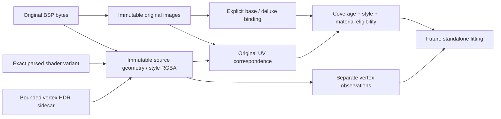

# Baked-lighting observation classification

`shared/rd-rend2/lightrecon/classification.h/.cpp` adds version 1 CPU evidence
classification to the original image, grid and surface snapshots. Surface input
schema `org.openjk.baked-surface-observations` version 2 introduced these fields;
version 3 adds source cull metadata for [static visibility](rend2-static-visibility.md). It preserves
original vertex RGBA, source drawVert identities, base texture UVs, vertex styles,
material facts and an optional independently owned vertex-HDR sidecar.

These are observations and fitting constraints, not reconstructed sources.
No renderer lighting, shader permutation, emissive effect, lightstyle animation,
atlas upload or inverse-lighting algorithm is replaced.



## Source formats and capture boundaries

| Source | Preserved representation and interpretation |
| --- | --- |
| Internal lightmap | Original RGB8, original logical page, BSP offset and map SHA256; historical relative lighting |
| Internal deluxe | Original RGB8 direction page with explicit `pairedLightingIndex`; interleaved detection follows the existing renderer's source convention |
| External LDR colour | Original decoded RGBA8 and resolved image path; external alternatives remain alternatives |
| External deluxe | Original decoded RGBA8 from the renderer's `lm_odd` or `dm_i` lookup, explicitly associated with its colour logical index |
| External colour HDR | Original decoded Radiance RGBE float RGB; uncalibrated relative magnitude; no direction interpretation |
| Vertex LDR | All four original style RGBA tuples, including alpha; original source drawVert ordinal and base UV |
| Vertex HDR | Optional `maps/<map>/vertlight.raw`, one original float RGB tuple per source drawVert; separate alternative, never added to LDR |
| Lightgrid | Existing indexed ambient/directed/style/direction observations remain unchanged; no style/brightness-based free-space classification is introduced |

Original surface/vertex fields are copied before the BSP lease is released.
`ParseFace`, `ParseMesh`, `ParseTriSurf` and `ParseFlare` return the exact shader
pointer already selected for that surface, before `r_singleShader` overrides its
drawing. The adapter copies bounded facts; it never retains that pointer in the
core. This avoids looking up an unrelated lightmap/vertex shader variant by name.
Source BSP surface/content flags are retained separately from the named core
signals inferred from parsed stages.

The vertex HDR hook borrows the renderer's loaded sidecar before it is freed.
When `r_hdr` is off, a bounded observation-only VFS read may capture that sidecar
under build policies 2/3. Disabled/cache-only/validated-hit policies do not perform
that read. Original RGBA and HDR values remain alternatives. A sidecar without
style IDs cannot establish a separate HDR value for every lightstyle: the API
keeps `hdrStyleAssociationKnown=false`. Missing, malformed or failed sidecars
have explicit states. Non-finite float tuples are retained for diagnostics and
rejected by the colour decoder, independently of valid original LDR data.

## Deluxe directions and correspondence

The actual `lightall.glsl` convention is:

```text
q = RGB / 255 - (0.5, 0.5, 0.5)
toSource = normalize(q)
```

The vector is **world-space receiver toward the dominant incoming light**,
consistent with `dot(N,L)`. It is not light propagation, a source position,
an exact sun direction, a normal map, tangent-space normal, or lightgrid direction.
It represents supplementary aggregate directional evidence from the bake.
No sRGB, gamma, overbright, exposure or physical intensity conversion is applied.
Alpha is preserved but does not affect the direction. Encoded magnitude is not
interpreted as calibrated intensity or confidence.

All-zero RGB is the renderer's missing-direction sentinel. The core reports
`ZeroSentinel` instead of applying the renderer's 127-grey repair. Near-neutral
quantization boxes containing zero report `Neutral`. For other vectors the
component step is `1/255`, with conservative unknown-rounding error
`delta=sqrt(3)/255` and angular bound `asin(delta/length(q))`. This deterministic
encoding bound is not a statistical reliability estimate; confidence stays unknown.

`pairedLightingIndex` is supplied at capture: odd internal/interleaved pages pair
with their even colour page; external `dm_i` pairs with colour page i. The core
never guesses adjacency or filename patterns. A binding pins its image snapshot.
Source representation matching prefers embedded directions for embedded colour,
or external directions for external colour, and records an alternative fallback.
Multiple equally suitable candidates report `Ambiguous`; callers can select an
explicit candidate ordinal. Missing pairs, unknown pair identity, unsupported
encoding and dimension mismatches have distinct states. Dimension mismatch is
not silently resampled into an exact per-texel correspondence.

Matched base/deluxe pixels use the same source `(x,y)` and original normalized
centre UV. The existing [world-space luxel mapper](rend2-luxel-observations.md)
supplies position, geometric normal, shading normal, area and coverage. A deluxe
page is never passed through the photometric RGB decoder, enumerated as another
lighting measurement, or counted as an additional unit of energy.

## Styles, observation paths and fitting decisions

`LightStyle` retains slot and original byte ID: 0 is static, 255 unused, and
1..254 is a separate styled channel whose animation is unknown. The extractor
does not sample the game's current animation or sum channels. The path is
`StaticLightmap`, `StyledLightmap`, `VertexColour`, `Other` or `Excluded`.
Vertex style IDs remain independent of lightmap style IDs.

| Category / condition | Default use and named reason |
| --- | --- |
| Ordinary, static diffuse lightmap with mapped centre | Relative `diffuseFitCandidate`; `RelativeBakedCandidate`, `UnknownBakeAlbedo`, `UncalibratedBakedScale` |
| Styled lightmap | Separate supplementary channel; no default static fit; `SeparateStyledChannel` |
| Vertex-lit source with no active source chart | Distinct vertex evidence; no dense luxels or unique invented vertex area/geometric normal; `VertexEvidenceOnly`, `VertexPaintOrLightingUnknown` |
| Glow/emissive or positive q3map surface light | Emitter hint; incident-light fit excluded; `EmissiveHintOnly` |
| Sky | Environment boundary evidence, excluded from diffuse measurements; `SkyBoundary` |
| Alpha test | Unknown per-texel material coverage; excluded; `AlphaCoverageUnknown` |
| Translucency | Unknown transmission/transport; excluded; `TranslucentTransport` |
| Unlit presentation | Excluded from diffuse incident-light fit; `UnlitPresentation` |
| Shader texture/RGB/alpha animation or entity dependence | Excluded from static fit; `AnimatedMaterial` |
| Brush model / deformation / unknown model ownership | Excluded from static visibility/fitting; distinct `MovingGeometry`, `DeformedGeometry`, `UnknownGeometryOwnership` |
| Missing or unsupported/multilayer material | Excluded; `MissingMaterial`, `UnsupportedMaterial` |
| Nodraw / explicitly excluded surface | `IntentionallyExcluded` |
| Padding or footprint whose centre is uncovered | `NoCoveredCentre`, no invented position |
| Overlap, normal seam or unsupported chart | `AmbiguousChart` / `UnsupportedChart` |
| Same page shared by multiple chart/style references | One energy observation, conservatively excluded from fitting; `MultipleChartReferences` |
| Missing image, invalid association or invalid colour | `MissingColourImage`, `InvalidSourceCombination`, `InvalidColourData` |

Geometric validity, path, material categories, uncertainty, supplementary evidence,
emitter hints and fit eligibility are separate fields. Nonexclusive material
signals can describe an animated, alpha-tested glow surface at once. A fit
candidate is conditional relative evidence, not a calibrated irradiance claim.
The raw observations remain inspectable even when fitting is excluded.
`ClassifySurface` describes source/material eligibility conditional on usable
image and geometry data. `ClassifyLuxel` additionally checks actual coverage,
association and colour validity before admitting a sampled observation.

Duplicate triangles still contribute area once. Duplicate geometric references
from different surfaces/style slots additionally carry `LuxelMultipleCharts` so
classification cannot silently select one style/material as an exact static
measurement. Extra shader lightstyle passes are not misclassified as translucent
material layers, and ordinary opaque lightmap multiplication is not alpha blending.

## Material evidence and photometric limits

`MaterialFacts` records parsed lightmap/vertex/emissive/sky/cutout/translucent,
unlit/animated/deformed/reflection/entity-dependent facts and source flags. It
preserves the primary base texture identity, original per-vertex texture UVs,
texture sRGB flag, available constant shader colour modulation, emission texture,
emission provenance and authoring hints. Additional base layers are counted and
marked uncertain/unsupported rather than reduced to a fabricated albedo.

`baseColourLinear` can hold a supplied linear Rec.709 texture candidate; even
when present it remains **unverified bake-time reflectance**. The current runtime
has no retained per-texel diffuse pixels, so that field stays explicitly unknown;
it retains texture identity/UV/modulation instead. No extra texture loading or
GPU readback is performed, and the renderer's bright-part SSR texture statistic
is not misrepresented as albedo. Multiple layers, texture transforms, missing
pixels and runtime shader interpretation carry separate uncertainty bits.

The current shader multiplies texture colour by a baked lighting factor, recorded
as `DiffuseModulationBakeUnknown`. That describes consumption, not the original
baker: material-dependent bounce, filtering, reflection, clipping and bake-time
shader interpretation remain unknown. RGB is never divided by texture RGB to
claim physical irradiance. The original geometric and source shading normals
remain separate, with the existing luxel coverage/precision diagnostics.

Glow texture/shader RGB is separate from incident baked RGB. `q3map_surfacelight`
and `q3map_lightRGB` retain legacy bake-tool values with unknown scale/transfer.
Only explicitly authored stage luminance retains cd/m2 metadata; inferred
emissive nits are not imported as authored physical measurements. Neither glow
nor authoring metadata automatically creates a physical emitter.

Vertex colours use the [canonical photometric decoder](rend2-observation-decoding.md)
with component `Vertex`. Its renderer-compatible candidate follows the existing
float colour-shift path (including HDR's black floor, float normalization and
forced linearization), without the LDR-lightmap grayscale presentation hack.
Source-decoded and renderer-compatible values remain separate. Source/HDR/LDR
scale, clipping and calibration metadata follow that decoder. No historical lux,
candela or scene calibration is inferred from geometry units or PBR presentation.

## Public CPU access and ownership

| API | Contract |
| --- | --- |
| `MaterialUncertaintyFlags` | Validate finite material fields/ranges without repairing raw evidence |
| `LightStyle` | Type one original style ID and slot |
| `ClassifySurface`, `ClassifyLuxel` | Pure classification with named reasons and independent use flags |
| `DecodeDeluxeRgb8` | Quantized world direction or explicit sentinel/neutral state |
| `BindDeluxe` | Read-only explicit correspondence and alternative selection |
| `ReadDeluxe`, `ReadLuxelDeluxe` | Bounded pixel read, pinned image/source identity, no I/O/GPU work |
| `ReadSurfaceObservation` | Existing complete geometry/RGB observation now also includes classification and deluxe evidence |
| `ReadVertexObservation` | Separate original vertex RGBA, optional HDR alternative, source/style/material identities and shading normal |
| `SummarizeObservations` | Metadata counts; optionally bounded explicit luxel scan |

Builders own mutation before publication. `SurfaceCapture::Material/VertexHdr`
copy inputs into its staged snapshot. Published geometry/image owners and the
leases in returned observations are const and can outlive map unload; release
all renderer-module leases before DLL unload. No `world_t`, shader/image pointer,
GPU handle, texture slot, per-frame state or engine allocator enters the core.
Observation inputs are separate from the serialized reconstructed-lighting asset.

Geometry uses its existing 64 MiB accounted capture limit, including added fields,
bounded strings and HDR payload; raw images have their separate 128 MiB budget.
The optional HDR sidecar is bounded before allocation. Classification keeps no
permanent per-map luxel matrix. Full scans choose one nonmissing colour image per
logical ID in stable snapshot order, process at most 4,194,304 texels and 8,192
image records by default, and release each 128x128 mapping tile. Vertex-summary
identity scratch is conservatively budgeted at 128 bytes per unique key against
the supplied `ReadContext.maxBytes`. Mapping retains its separate work/scratch
limits. Cancellation or failure clears the summary instead of publishing totals
from a partial scan. These budgets are not measurements of process RSS.

## Diagnostics and reproducible tests

Both SP and MP register:

```text
r_lightReconObservations
r_lightReconObservations scan
r_lightReconObservations surface <original-BSP-ordinal>
r_lightReconObservations direction <logical-colour-page> <x> <y>
```

The default command reports charts, styles, separate vertex samples, image/pair
counts, material categories and exclusions; luxel counts are explicitly unscanned.
`scan` requests potentially lengthy CPU coverage/eligibility/direction work.
`surface` prints source identities/material uncertainty and all lightmap/vertex
style-channel decisions/reasons. Master/consumer flags do not enable this command
or run scans implicitly. It requires observations captured under build policy 2/3.
`direction` prints the explicit pair state, original direction bytes, world-space
`toSource` vector and quantization bound; unavailable vectors are labelled by state.

Run from the repository root with the selected CMake/compiler/Python on PATH:

```powershell
cmake -S tools/lightrecon_test -B build/lightrecon-disk-standalone -G "MinGW Makefiles" -DCMAKE_BUILD_TYPE=Release
cmake --build build/lightrecon-disk-standalone --parallel 4
ctest --test-dir build/lightrecon-disk-standalone --output-on-failure -V

cmake --build build/lightrecon-core-renderers --config Release --parallel 4 --target rdsp-rend2_x86_64 rd-rend2_x86_64 lightrecon_test lightrecon_api_test lightrecon_core_test lightrecon_control_test lightrecon_disk_test lightrecon_lifecycle_test lightrecon_lightmaps_test lightrecon_decode_test lightrecon_lightgrid_test lightrecon_surfaces_test lightrecon_classification_test
ctest --test-dir build/lightrecon-core-renderers -C Release --output-on-failure -V

g++ -std=c++11 -Wall -Wextra -Wpedantic -Wconversion -fsyntax-only -Ishared/rd-rend2 shared/rd-rend2/lightrecon/classification.cpp tools/lightrecon_test/lightrecon_classification_test.cpp
python tools/rend2/test_lightrecon_contract.py
python tools/rend2/lightrecon_regression.py --no-gpu --output build/lightrecon-classification-shader-contract

python tools/rend2/test_lightrecon_classification_runtime.py --installation "C:\Program Files (x86)\Steam\steamapps\common\Jedi Academy\GameData" --binaries build/ssr-msvc/RelWithDebInfo --renderer build/lightrecon-core-renderers/Release/rdsp-rend2_x86_64.dll --label verified-stock
python tools/rend2/test_lightrecon_classification_runtime.py --installation "C:\Program Files (x86)\Steam\steamapps\common\Jedi Academy\GameData" --binaries build/ssr-msvc/RelWithDebInfo --renderer build/lightrecon-core-renderers/Release/rdsp-rend2_x86_64.dll --label confirmed-dm --external-dm-fixture
python tools/rend2/test_lightrecon_classification_runtime.py --installation "C:\Program Files (x86)\Steam\steamapps\common\Jedi Academy\GameData" --binaries build/ssr-msvc/RelWithDebInfo --renderer build/lightrecon-core-renderers/Release/rdsp-rend2_x86_64.dll --label confirmed-interleaved --external-dm-fixture --interleaved
```

Use fresh runtime labels. The SP helper, game DLL, SDL and licensed stock assets
are required only for the actual runtime tests; the eleven CPU tests need none.
The runtime harness reuses the existing isolated setup and image comparison,
scans stock hoth3/hoth2 and optionally a private external `lm_i`/`dm_i` or
interleaved `lm_even`/`lm_odd` fixture. The private BSP keeps source geometry/UVs,
removes its embedded lightmap lump and uses original colour pixels, with
**synthetic +Z** direction images and explicit zero/neutral test pixels. These
directions are test inputs, not reconstructed stock-map directions.
It checks recorded camera stability and exact unchanged frames before/after
read-only classification, failing on missing diagnostics or renderer errors.
Controls fix 960x540, FOV 80, manual exposure 0, master-use 0, build 3, no temporal
postprocessing, paused game/FX, hidden entities, and `r_we clear` in the private
runtime. Pausing/freezing weather alone did not stabilize outdoor GPU weather
history; clearing it makes this a static-surface comparison, not a weather or
entity animation regression test. Camera records are matched by explicit tags
because SP `writecam` can retain the previous map's destination filename.
Private maps/images/screenshots remain ignored build artifacts.

The new standalone fixtures cover cardinal directions and 2,048 deterministic
quantized sphere samples, internal/external pairing, missing/unpaired/ambiguous
directions, dimension mismatch, multiple styles, conflicting shared style images,
HDR alternatives, negative/non-finite data, vertex RGBA/alpha/styles, material
categories, known optional texture colour, unchanged baked RGB, unknown albedo,
cancel/limits/empty sets and leases surviving reset. The controlled GLSL audit
also detects removal of the original RGBA/style/HDR hooks and loss of exact
pre-override shader identity.

## Recorded results (2026-10-23)

SP and MP Release renderer targets built successfully with MSVC 19.27. The
standalone C++11 GCC 16.2 build and the MSVC build each passed **11/11 CPU tests,
541,352 assertions**, including 4,398 classification checks. The strict GCC
`-Wall -Wextra -Wpedantic -Wconversion` syntax check emitted no diagnostics.
Existing geometry fixtures still report maximum position error
`9.53674316e-7` world units and area error `6.25277607e-13` world units squared.
Fourteen contract/mutation tests passed; all 27 controlled configurations / 51
preprocessed GLSL stages match the existing baseline with zero differences.
The contract run used `--no-gpu`: full GPU permutation compilation was not run
as part of this task. The SP runtime itself compiled and rendered its used shaders.

| Count | Stock hoth3 | Stock hoth2 | Each external hoth3 fixture |
| --- | ---: | ---: | ---: |
| Surfaces | 12,911 | 7,421 | 12,911 |
| Lightmapped charts (all style 0) | 12,045 | 3,914 | 12,045 |
| Unique original vertex/style samples | 6,358 | 31,327 | 6,358 |
| Selected colour pages | 38 | 12 | 37 |
| Paired deluxe pages | 0 | 0 | 37 |
| Scanned colour texels | 622,592 | 196,608 | 606,208 |
| Geometrically valid luxels | 390,285 | 72,304 | 390,285 |
| Conditional relative static-fit candidates | 290,303 | 39,643 | 290,303 |
| Excluded texels (including uncovered) | 332,289 | 156,965 | 315,905 |
| Valid deluxe directions at mapped centres | 0 | 0 | 390,239 |
| Unavailable deluxe directions at mapped centres | 390,285 | 72,304 | 46 |
| Emissive-hint surfaces | 229 | 149 | 229 |
| Sky surfaces | 0 | 32 | 0 |
| Cutout surfaces | 0 | 6 | 0 |
| Translucent surfaces | 145 | 647 | 145 |
| Unlit surfaces | 787 | 351 | 787 |
| Moving surfaces | 94 | 229 | 94 |
| Animated material surfaces | 96 | 106 | 96 |
| Surfaces without supplementary acceptance | 2,472 | 2,038 | 2,472 |
| Accounted geometry bytes | 18,888,025 | 11,743,297 | 18,888,025 |

Category/reason counts are nonexclusive. A valid mapped centre can still be
excluded from fitting for material/style/ownership uncertainty. Stock maps here
contain no deluxe images and no vertex HDR sidecar; missing records are explicit.
Both maps reference odd-numbered **colour** pages, so oddness alone must not
identify a deluxe map. Nonzero styles and HDR alternatives were tested with CPU
fixtures, not claimed as stock-map runtime coverage.

The original hoth3 lump contains 38 pages, but only pages 0..36 are referenced.
The external renderer lookup covers those 37 pages; its unreferenced trailing
page is omitted from the private fixtures. Mapped luxels, fit candidates and
material counts agree across all three hoth3 layouts. Each fixture verifies the
original captured RGBA pixel hash of all 74 colour/direction images. Both layouts
report `ZeroSentinel`, `Neutral` and then `Available` at the three test pixels;
RGB `(128,128,255)` decodes to `(0.00392150832,0.00392150832,0.999984622)` with
angular bound `0.0135849211` radians, not an exact +Z measurement.

All four controlled before/after SP frame pairs match exactly: zero differing
pixels and zero maximum channel delta. Stock hoth3 camera was
`3320 700 123 / 0 90 0`; stock hoth2 was `1362 385 1059 / 0 288 0`, FOV 80.
Only paired views within a run are compared; cameras between fixture runs differ
slightly. The hoth2 view is fog-dominated and this check does not establish
complete map-wide visual coverage. Raw results and screenshots are at:

- `build/lightrecon-classification-runtime/verified-stock/result.json`,
  `hoth3-base.png`, `hoth3-repeat.png`, `hoth2-base.png`, `hoth2-repeat.png`.
- `build/lightrecon-classification-runtime/confirmed-dm/result.json`,
  `hoth3-base.png`, `hoth3-repeat.png`.
- `build/lightrecon-classification-runtime/confirmed-interleaved/result.json`,
  `hoth3-base.png`, `hoth3-repeat.png`.

The versioned compact witness is
[`classification-validation.json`](../tools/rend2/lightrecon_baseline/classification-validation.json).
It records normalized source hashes, DLL/result/image hashes, compiler/test
counts, exact settings/controls, map identities, category/style/exclusion counts
and fixture pixel-manifest hashes. No licensed map/image data enter Git.

Changed implementation groups are `classification.h/.cpp` (pure evidence API),
`surfaces.*` (source metadata/vertex HDR/lazy joins), `lightmaps.*` (explicit
pairs), `decode.*` (vertex component), `tr_lightrecon.*` / `tr_bsp.cpp` (bounded
capture and diagnostics), both `tr_init.cpp` command tables, the shared core/test
CMake lists, CPU/runtime/contract tests and the linked observation documentation.
MP compilation and registration passed; MP gameplay was not exercised.

## Limits and remaining interpretation

Full non-affine patch UV inversion and the previous geometry limitations remain
explicit Unsupported cases. There is no bake-time albedo recovery, automatic
alpha-mask sampling, shader script inversion, material multilayer transport,
animated-style fitting, point/spot/sun fitting, source visibility or new renderer
consumer. Source role detection follows the supported renderer format convention;
unknown exporter conventions need explicit metadata rather than a colour heuristic.
Complete production cache fingerprints remain unavailable, so observation capture
does not certify a cacheable reconstruction result.
