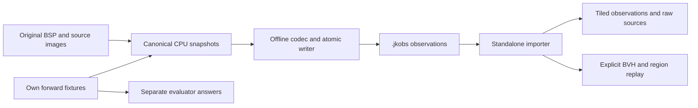

# Offline lighting observations and reproducible fixtures

`lightrecon/offline.h` defines `org.openjk.lighting-observations`, version **1.0**
(`.jkobs`). This is an archive of solver **inputs**, distinct from the reconstructed
lighting output asset/DDC described in `rend2-reconstruction-disk.md`. It contains
no fitted emitters, GPU resources, screenshots or shader binaries.



## Reproduce without the game

From the repository root, with CMake, a C++11 compiler and Python 3.10+:

```sh
cmake -S tools/lightrecon_test -B build/lightrecon-offline
cmake --build build/lightrecon-offline --config Release --parallel 4
ctest --test-dir build/lightrecon-offline -C Release --output-on-failure
python tools/rend2/datasets/run_pipeline.py --tool build/lightrecon-offline/Release/lightrecon_dataset_tool.exe --output build/offline-suite
```

For single-configuration generators, omit `Release/` from the executable path;
on Unix omit `.exe`. The Python workflow has no third-party dependencies. It
refuses an existing output directory, preserving previous evidence. It generates
all 11 datasets **twice**, checks identical bytes and answer files, imports,
inspects, re-decodes and remaps every stored luxel, checks grid correspondence,
and traces a wall and doorway. A failure exits nonzero. It writes:

```text
inputs/*.jkobs              only this directory is mounted for a blind solver
answers/*.json              evaluator-only CPU ground truth
answers/*.q3map-recipe.json evaluator-only compiler commands/source entities
authoring/base/maps/*.map   evaluator-only self-authored brush maps
authoring/base/shaders/     self-authored materials and shader list
authoring/base/textures/    generated constant TGA textures
repeat/{inputs,answers}/   second generation, checksum control
reports/                   inspection, validation and occlusion logs
manifest.json              tool binary SHA/version, file SHA/sizes, test outcomes
```

These generated sources, textures and data are GPL-2.0-or-later, like the fixture
generator; see the repository `LICENSE.txt`. No JA maps, textures or other stock
content are redistributed. Keep generated data under ignored `build/`.

Useful standalone commands:

```sh
lightrecon_dataset_tool version
lightrecon_dataset_tool list
lightrecon_dataset_tool inspect build/offline-suite/inputs/wall_leak.jkobs
lightrecon_dataset_tool validate build/offline-suite/inputs/wall_leak.jkobs
lightrecon_dataset_tool trace build/offline-suite/inputs/wall_leak.jkobs -80 0 80 80 0 80
lightrecon_dataset_tool samples build/offline-suite/inputs/point_room.jkobs train
```

`samples` emits a compact JSONL **diagnostic subset**, after full validation:
positions, normals, areas, material/style IDs, raw RGB8, source-relative candidate
and channel/classification flags. Its encoding/state fields must be read; raw RGB8
is not an HDR value, and an unavailable source stage is not black lighting. Use
the C++ importer for the complete raw/HDR/geometry/evidence contract.

## Real renderer export

The map loader already captures original BSP/external images before atlas packing,
colour shifts and upload; original surface vertices/UVs, lightgrid and parsed
material facts are separately owned CPU snapshots. This change captures the
original RBSP v1 nodes/leaves/planes/brushes and model bounds alongside them,
while original map bytes are still alive in `LightReconBspCapture`. No pointer
into those bytes survives release. Geometry/source evidence is frozen at the
existing main-world completion boundary. MP sub-BSP loading does not replace it.

The synchronous **explicit** command is registered in SP and MP:

```text
set r_lightReconUse 0
set r_lightReconBuild 3
devmap hoth3
r_lightReconExport hoth3_local 2 3320 700 123 256
```

Build policy 2/3 must have applied when loading the map. Policy 0, cache-only,
and released cache-hit captures cannot be exported; the command explains that
source snapshots are unavailable. No consumer needs enabling. The new command
neither starts a solver nor publishes a reconstructed-lighting asset.

Arguments: safe basename (letters, digits, `_`, `-`, maximum 64), number of
nonmissing colour images whose **derived** tiles to store (default 1, `0` all),
optional region ROI centre/radius in source world units. All original images,
lightgrid and source geometry are stored regardless of the derived prefix.
`derivedComplete=0` explicitly labels a prefix. Full derivation exceeding a limit
fails atomically; it never silently truncates. Remaining pages can be mapped
offline with the retained original geometry and images.

The region ROI defaults to the world-AABB centre, radius 256, with coarse/minimum
cell sizes 128/16. Region options, uncertainty, membership and links are stored.
The ROI may contain no certified free region: this is data, not success at room
recovery. Raw visual/collision geometry covers the whole map.

Output uses the supported per-user `fs_homepath` through `Disk::CacheRoot`:
`<fs_homepath>/rend2/lightrecon/v1/observations/<name>.jkobs`. It is outside
PK3/BSP archives and may be outside `fs_game`. Import metadata paths are labels,
never file paths automatically opened by the importer. Original assets are not
modified. No screenshot or GPU readback participates.

For an isolated stock-only SP run, with licensed locally installed assets:

```powershell
python tools/rend2/datasets/test_runtime_export.py --installation "C:\Program Files (x86)\Steam\steamapps\common\Jedi Academy\GameData" --binaries build/ssr-msvc/RelWithDebInfo --renderer build/lightrecon-core-renderers/Release/rdsp-rend2_x86_64.dll --tool build/lightrecon-disk-standalone/lightrecon_dataset_tool.exe --output build/offline-stock
```

An optional `--private-archives <existing stock-assets/base>` reuses private
read-only PK3 copies through hard links, avoiding redundant gigabytes. The script
loads hoth3/hoth2 with master use off and consumer requests on, exports each
twice, verifies SHA equality and validates both files without the game. Its
result records settings and renderer binary SHA. It refuses overlapping game
processes and missing binaries/assets. It is not an image-regression test.

## Contents and physical conventions

| Input | Preserved representation |
| --- | --- |
| Identity/provenance | Source map path, exact byte length/SHA256; producer schema/build compiler; known/unknown historical compiler, version, bake recipe/hash; split seed; coordinate/decoder versions |
| Original images | Stable logical page ID, dimensions/channels, embedded-lump offset or source label, RGB8/RGBA8 or losslessly decoded RGB32F; missing status and explicit deluxe pairing |
| Luxels | Original image index and texel centre/footprint, surface/style/material IDs, position, geometric/shading normals, tangent, world area and error bounds; coverage, classification, uncertainty and canonical four-stage decoding |
| Lightgrid | Layout, original raw 30-byte records, little-endian uint16 indirection, HDR state/source/float bits. Logical cells, toward-source direction and decoding are reproduced lazily by `Cell`, `DecodeGridLdr` and `DecodeGridHdr`, without duplicating a dense decoded array |
| Surfaces/materials | Original static/brush/unknown ownership, face/patch/soup, original normalized lightmap UVs, texture UVs, vertex colours/styles, optional vertex HDR, all parsed material facts and reflectance/emission uncertainties |
| Visibility input | Static visual geometry plus BSP nodes/leaves/planes, convex world brushes and side/leaf references; separate potentially moving model bounds; no PVS-as-visibility assumption |
| Region graph | Analysis bounds/resolution, cells, memberships, BSP links, boundary refs, adjacency/aperture/transport distinctions, report and uncertainty; no synthetic light portals |
| Emitter hints | Candidate/evidence IDs, geometry, source provenance, units and uncertainty; sun/sky declarations when genuinely present, according to hint policy |
| Calibration | Complete `Decode::Profile`: source transfer assumption, primaries, quantization, clipping, overbright/exposure knowledge; renderer-compatible settings; optional explicitly supplied scene-equivalent calibration |

Axes, handedness and origin are **unchanged JA world coordinates, Z up**. There
is no exporter rotation, unit scaling, gamma, exposure, albedo division or RGB
normalization. Positions/area are world units/world units squared. Metres require
the recorded `worldUnitsPerMeter`. Grid and deluxe directions point **toward the
source**; fixture spot axes and emitter outward normals describe **propagation**.
Deluxe is world-space supplementary evidence, never a tangent-space normal.

LDR source transfer and historical absolute scale may remain unknown. The
renderer-compatible stage is separately labelled and does not establish the
bake's transfer function. Neither `worldUnitsPerMeter` nor `physicalToScene`
recovers historical lux/candela. Saturated RGB8 remains censored/lower-bound,
per-channel flags survive, and invalid HDR grid bits remain raw diagnostic data.
Available decoded values must be finite and nonnegative; invalid/missing values
never become invented physical lighting. `BakedMeaning` and material uncertainty
survive: texture base colour is not certified bake-time albedo.

## Binary format 1.0

Scalar encoding is little-endian; float/double are IEEE754 binary32/binary64.
Enums are uint32, bool is exactly one byte 0/1, counts and `size_t` are uint64,
strings are uint64 byte count followed by bytes without a terminator. Vectors
start with a uint64 count; fixed arrays have no count. Structs use explicit
field-order codecs in `offline.cpp`, never compiler object layout/padding.
Observation sub-schemas are surface 4, evidence 1, region 1, decoder 1.

The 160-byte header is:

| Offset | Type/bytes | Meaning |
| ---: | --- | --- |
| 0 | 8 bytes | `JKOBS01\0` |
| 8 / 12 | uint32 each | format major / minor (1/0) |
| 16 / 20 | uint32 each | coordinate convention / photometric decoder version (1/1) |
| 24 / 28 | uint32 each | header bytes / section count |
| 32 / 40 / 48 | uint64 each | complete file bytes / directory offset / directory bytes |
| 56 | uint64 | reserved zero |
| 64 | 32 bytes | source-map SHA256 |
| 96 | 32 bytes | section-directory SHA256 |
| 128 | 32 bytes | SHA256 of header bytes [0,128) |

Payload sections start on 8-byte boundaries; intervening padding is under eight
bytes. The directory is last, exactly `count * 80` bytes. Each entry is
`kind:u32, flags:u32, id:u64, first:u64, count:u64, offset:u64, bytes:u64, sha256:32`.
Flag bit 0 means required semantics. Unknown optional sections are integrity
checked and skipped; unknown required sections or incompatible versions fail.
Unknown optional sections are not retained on re-export by this version.

| Kind | Section |
| ---: | --- |
| 1 | Metadata, summary, source-presence and sub-schema versions |
| 2 / 3 | Image descriptors / independently hashed pixel chunks keyed by image ordinal |
| 4 / 5 / 6 / 7 | Grid descriptor / raw records / raw indices / HDR float chunks |
| 8 / 9 / 10 | One original surface per section / vertex HDR descriptor / float chunks |
| 11 / 12 | Typed collision/BSP domain / dynamic model-bound hints |
| 13 / 14 | Region snapshot / source evidence and candidates |
| 15 | Independently loadable luxel tiles (default 16×16), including padding/invalid coverage |

Only populated source sections are present. Ordering follows stable original
image/surface/grid order, fixed chunk boundaries and row-major tiles; no clocks,
random state or native pointers enter the file. Identical source snapshots,
metadata, options and implementation produce identical bytes. Different compiler
build provenance intentionally changes bytes; bit-identical floating-point
results across arbitrary compilers/architectures are not promised.

`Open` validates versions, bounds, nonoverlap, contiguous raw chunks, counts,
header/directory and **every section** SHA256 using bounded reads. `Load` restores
typed immutable snapshots with source-reference/dimension/allocation checks.
`Validate(true)` additionally re-decodes original pixels and remaps source UVs,
checks material/style/deluxe/partition/region correspondence and every logical
grid index. Call it before accepting a dataset as a solver benchmark. Numerical
comparison uses relative tolerance 1e-5 and position absolute tolerance 0.002
world units. These are correspondence checks, not reconstruction error metrics.
SHA256 detects corruption and identifies content; it does not authenticate a
dataset author or establish complete DDC inputs.

Errors use `Core::Error`: `InvalidInput`, `UnsupportedSchema`, `MemoryLimit`,
`Cancelled`, `ProviderError`, or explicit unavailable source conditions. Success
is `bool(error)==true`, matching the existing core. Failed open/load publishes
no partial source snapshot. No import operation changes renderer state.

Native writes use an exclusively created adjacent temporary, invalid initial
header, final header only after all sections, flush/fsync and atomic replacement.
Failure/cancellation preserves an existing destination and deletes only the
owned temporary. Open readers keep the old file lease after replacement. On
POSIX the containing directory is not fsynced: power loss may lose the renamed
directory entry, although no valid-looking partial file is published.

## Ownership, limits and selective work

`Sources` owns strong immutable leases; no hunk memory, `world_t*` or GL objects
enter the codec. `Dataset` pins a random-access reader. `ReadLuxels` reads one
tile; source pixels, grid and HDR are chunked (at most 65,536 elements per raw
chunk). `Load` is explicit and restores source arrays once; it does not load all
derived tiles or silently build a BVH. `ReplayGeometry` explicitly builds a
reusable immutable BVH and graph using stored patch tolerance and graph options.
Re-export of an imported graph requires that replay, preventing lost region-side
assignments. Export never builds geometry implicitly. A `Sources` lease can
outlive its `Dataset`, map unload or file replacement.

Use separate readers or external serialization for concurrent file reads:
the native `Disk::FileReader` cursor is not shared-thread scratch storage.
After loading, the canonical immutable visibility structure supports parallel
queries as before. No background threads, ray-pair cache or disk-on-query
visibility provider is introduced.

Defaults: 1 GiB file, 256 MiB decoded/source accounting, 8 MiB section, 4,000,000
records/elements per raw array, 131,072 sections, 1 MiB string, 2,097,152 derived
texels. Counts, integer arithmetic and allocations are checked before resize.
The loader conservatively charges four times non-tile encoded payload, plus
per-section decoded allocation limits. These are conservative component budgets,
**not a process-RSS guarantee**. Caller-owned captures, BVH (renderer command
budget 128 MiB), graph build scratch, reader buffers and imported graph copies
also consume memory. Oversized sources/sections return clear limits. Regions,
collision tables and evidence currently each occupy a bounded single section;
very large ones require a future chunk extension or an explicit larger budget.

Compression is deliberately absent in v1: random access and exact original
samples are straightforward. Large derived matrices are optional tiled records,
not obligatory permanently resident arrays. A stock two-page export below has
only about 168 KiB of `Luxel` objects per 16×16 tile; wire/chunk/decoder scratch
and source snapshots are additional. `inspect` reports counts, bounds, coverage,
styles, missing data, candidate counts and region/tile memory estimates.

## Synthetic scenes and ground truth

The executable fixture baker lives only in the test/tool library, never in
SP/MP. It is a small forward reference, **not a reconstruction algorithm and not
q3map2**. Tiny scenes use an independent brute-force triangle intersection for
forward shadowing; exported visibility is rebuilt using the production BVH.

| Scene | Reference lighting / challenge |
| --- | --- |
| `point_room` | One point, 120 cd, position (-96,32,180) |
| `two_colour` | Red and blue points, distinct positions, 120 cd each |
| `overlap_whites` | Two overlapping white points, indistinguishable colour |
| `spot` | Known propagation axis from (64,-80,200) to (-32,64,0), 25° half cone |
| `panel` | Downward rectangle at Z=240, half sizes 72×32 world units, 50 cd/m² |
| `tube` | Finite length 160, radius 4, 100 cd/m², 12-segment projected-area approximation |
| `sun_sky` | Toward-source normalize(.4,.1,1), 1.4 lux reference sun plus separate sky |
| `skylight` | Same sun/sky, an actual opening in the ceiling |
| `door_occlusion` | Wall with finite doorway; occluded samples away from opening |
| `bounce_colour` | Coloured first-bounce wall approximation, uncertain reflectance metadata, HDR >1 and invalid HDR grid |
| `wall_leak` | Two separated volumes, thin partition, nonzero styled grid cells inside wall |

Reference point/spot transport uses inverse-square in metres at 32 units/metre;
area uses 4×4 Lambertian quadrature; tube uses a finite 12-segment approximation;
bounce uses 4×4 first-bounce wall quadrature, not converged GI. The measured
input is `RGB8(round(sRGB(clamp(E_reference * 0.35))))`. Encoding metadata records
the known transfer/gain, but its canonical absolute physical stage still stays
unknown. Black, 255 single-channel, fully saturated and 254 samples are injected;
grids are sparse, quantized, have styles 0/3, absent style despite colour, invalid
and missing indices. Base-colour metadata is uncertain/mismatched with the
reference wall reflectance. This is deliberately more demanding than perfect
linear observations. These fixtures do not certify realistic JA bake fidelity.

Ground truth (`org.openjk.synthetic-lighting-answer`, v1) is evaluator-only. It
includes positions, propagation axes, cones/dimensions, RGB, intensities/units,
sun/sky, reference quadrature, transfer/gain and style/sparse-grid assumptions.
The synthetic raw source buffer contains an answer-only sentinel, but the
archive exports selected original observation chunks, **never the source header
or complete original BSP/entity text**.

`BlindBenchmark` removes BSP light entities, authored JSON, surface-light and sun
declarations, verbatim source text, authored intensities and their aliases from
the evidence view. Material authored intensities are also stripped. Legitimate
visible glow geometry/colour and sky-boundary hints remain, with unknown units;
they are observations available to a solver, not secret point-light answers.
`ObservedPriors` intentionally preserves those original hints for real maps and
is **not a blind benchmark**. Synthetic export requires blind policy.

Partitions hash floor(world position / 128), with seed **20261024**, into
60% train / 20% validation / 20% held-out blocks. Grid positions can use the same
`Split` function. Shared chart edges/probes in one block share a partition;
unmapped records use train but are not fitting samples. Spatial blocks are not
a filesystem security boundary: a complete archive includes all observations.
The evaluator must expose only permitted samples/regions during fitting, keep
answers and authoring files outside solver mounts, and withhold held-out RGB
even from alternate grid/deluxe channels. Do not claim held-out accuracy after
letting the solver read the full archive. The JSONL subset is a convenience,
not a sandbox or a complete replacement for the typed importer.

### Optional q3map2 bake

The real compiler/SP validation has now been executed. See
[q3map2 validation](rend2-q3map2-validation.md) for the pinned installation,
reproduction commands, independent checks and compiler reproducibility limits.

Pass `--q3map2 <absolute compiler path>` to the Python workflow. It records the
compiler binary SHA, actual help/version output, exact command argv and stage
logs, and sets `executed=true` only after BSP, VIS and LIGHT succeed. The recipe is
JA RBSP, one thread, `-meta -samplesize 16`, `-vis`, then
`-light -deluxe -deluxemode 0 -gamma 1 -compensate 1 -exposure 0 -bounce 0`
(bounce 1 for the bounce scene). Consult the chosen compiler's supported options;
the reference source is NetRadiant's [JA game definition](https://github.com/xonotic/netradiant/blob/master/tools/quake3/q3map2/game_ja.h)
and [q3map2 option help](https://github.com/xonotic/netradiant/blob/master/tools/quake3/q3map2/help.c).

Generated `.map` light values are **legacy q3map units**, separately recorded in
`org.openjk.q3map-recipe` v1, not the CPU fixture's calibrated cd/nits. Its target
spot and thin surface-emitting tube approximation are explicit; no native
analytic tube support or identical numerical bake is claimed. Once compiled,
load those self-authored BSP/materials with Rend2 and export using the command
above. The standalone tool imports `.jkobs`, not arbitrary BSPs. Compiled-map
photometry, leaks, shader/toolchain interpretation and camera validation must be
checked before promoting a q3map bake to a ground-truth benchmark.

## Solver developer guide

1. Open with deliberate limits, compare the source SHA against a trusted manifest,
   run `Validate(true)` once at benchmark admission,
   and check producer/compiler/units/hint policy and `derivedComplete`.
2. Load source leases once; stream tiles. Join only known covered centres to
   surface/style/material IDs, area and uncertainty. Map additional pages
   explicitly if the archive stores a prefix. Keep styles separate.
3. Use source-relative decoder hypotheses as labelled. Respect channel censoring
   and missing transfer/calibration. Never turn unavailable stages into zero
   observations or divide baked RGB by an uncertain texture albedo.
4. Build the immutable visibility BVH once from original geometry/domain. Honour
   unknown optics/incomplete geometry; no-hit is not automatically sky. Use
   stored normals and ray-bias policy without moving the observed position.
5. Treat region IDs as map/schema/options scoped. Unknown/solid cells are not
   smoothing links. Candidate evidence is a geometric/provenance prior, not
   certified physical emitters or fitted intensity.
6. Keep evaluator answers inaccessible while fitting. Evaluate source position,
   direction and intensity in the correct backend/units, plus held-out RGB
   residual/censoring and occluded-wall leakage separately. No fitting or score
   implementation is introduced here.

## Local validation and limitations

See the small versioned witness `tools/rend2/datasets/validation.json` for final
compiler versions, checksums, commands and counts. Full datasets and licensed
stock artifacts stay under ignored `build/`. CPU tests cover round trips, exact
re-generation, empty sources, all scenes, material/style/grid/HDR/deluxe retention,
world position/area ground truth, blind answer isolation, wall/door rays,
unsupported versions, checksum/truncation/offset/count attacks, unknown optional
and required sections, tampered remapped positions, cancellation, atomic
replacement, missing/corrupt native files and leases after unload/replacement.

SP/MP builds use the same shared core; no GLSL, shader permutation, sampler,
runtime-light submission, existing colour transform or collision implementation
is changed. The only existing enum adjustment is the evidence issue name
`EvidenceUnsupportedGeometry` (same numeric bit), resolving its collision with
the ray-query issue when both headers are used together.

The current licensed stock exports store two derived pages and the full raw
sources. Historical compiler/absolute scale are explicitly unknown. Their first
page is conservatively unsupported by the existing mapper; nonpolygonal source
records without bounds also make the visibility snapshot incomplete. As a
result the bounded stock ROI graph has **zero certified free regions**, rather
than fabricated topology. Fixtures have nonempty certified region graphs. This
is an existing observation/visibility limitation to resolve before production
fitting, not a solved room reconstruction.

At the original validation revision, no q3map2 executable was available and
compiled-map bake/ground-truth tests were **not run**. That historical witness is
retained in `tools/rend2/datasets/validation.json`. The subsequent
[real q3map2 validation](rend2-q3map2-validation.md) records the completed bake,
actual SP exports and independent geometry/lighting checks separately. There is
no inverse solver, numerical light fitting or new runtime consumer.

### Results, 2026-10-25

GCC 16.2.0 and MSVC 19.27.29111 each passed **15/15 CPU executables,
665,064 assertions**, including **17,500** new offline checks. Maximum observed
position error for the generated floor luxels is **0 world units**; each mapped
fixture texel has independently asserted area 384 world units squared. The
existing broader geometry suite also passes. Both compilers generated all 11
datasets twice with identical bytes per compiler and disjoint/nonempty spatial
partitions. A complete generation totals 13,651,840 bytes (GCC) or 13,651,824
bytes (MSVC), including different compiler provenance; individual files range
from 1,163,712 to 1,295,192 bytes in GCC. Each has 256 floor luxels and 30 logical
grid cells, including one invalid and one missing index. No numerical equality
between the two compiler builds is inferred from these size totals.

Both SP and MP Release renderers compile. Six added CPU translation units pass
`g++ -std=c++11 -Wall -Wextra -Werror -pedantic -fsyntax-only`. No source warnings
were reported; MSVC retains the repository's existing ignored x64 `/arch:SSE2`
option warning. All 15 production/mutation contract tests pass; controlled GLSL
preprocessing compares 27 configurations / 51 stages with **zero differences**.
The GPU shader matrix was not compiled in that check.

Actual SP main-world loads and CPU exports completed for both licensed stock
maps, with master use 0 and all consumer requests 1. Each export was repeated
with byte-identical SHA, then loaded/remapped/validated offline:

| Statistic | hoth3 | hoth2 |
| --- | ---: | ---: |
| Original BSP bytes | 13,920,700 | 13,970,616 |
| Archive bytes | 45,932,880 | 40,996,016 |
| Colour images / missing deluxe descriptors | 38 / 38 | 12 / 12 |
| Original colour pixel bytes | 1,867,776 | 589,824 |
| Surfaces / original triangles | 12,911 / 53,221 | 7,421 / 37,062 |
| Unsupported source surface records | 54 | 98 |
| Emissive surfaces / candidates / evidence | 224 / 612 / 661 | 149 / 553 / 553 |
| Logical lightgrid cells | 229,068 | 1,044,126 |
| Stored derived samples (two-page prefix) | 32,768 | 32,768 |
| Mapped / footprint-only / padding | 11,542 / 493 / 3,981 | 3,489 / 564 / 2,349 |
| Ambiguous / unsupported luxels | 368 / 16,384 | 116 / 26,250 |
| ROI cells / certified regions | 31,340 / 0 | 29,604 / 0 |
| Source component memory accounting (not RSS) | 31,199,201 B | 26,150,055 B |
| Region snapshot / estimated graph build peak | 7,567,054 / 25,657,734 B | 7,568,782 / 24,242,374 B |
| Import validation records checked | 261,836 | 1,076,894 |

Both stock maps have static style 0 on the captured surfaces. The captured
deluxe descriptors are missing, not real directional coverage. hoth2 includes
the observed shader sun/sky hints; no default sun is inserted for hoth3. The
region/unsupported limitations above apply to these counts. Archives and all
raw runtime logs are local under `build/offline-stock-accepted/` and are not
versioned. The final fixture runs are `build/offline-final-{gcc,msvc}/`.

Commands used for accepted local validation (PowerShell, repository root):

```powershell
$env:PATH='C:\Users\Keyten\Desktop\projects\OpenJK\build\toolchain\w64devkit\bin;'+$env:PATH
cmake -S tools/lightrecon_test -B build/lightrecon-disk-standalone
cmake --build build/lightrecon-disk-standalone --parallel 4
ctest --test-dir build/lightrecon-disk-standalone --output-on-failure

# This renderer build was configured with the options in rend2-reconstruction-core.md.
$tests = [regex]::Matches((Get-Content tools/lightrecon_test/CMakeLists.txt -Raw), 'add_executable\((lightrecon_\w+)') | ForEach-Object { $_.Groups[1].Value }
cmake --build build/lightrecon-core-renderers --config Release --target rdsp-rend2_x86_64 rd-rend2_x86_64 $tests --parallel 4
ctest --test-dir build/lightrecon-core-renderers -C Release --output-on-failure -R lightrecon

python tools/rend2/datasets/run_pipeline.py --tool build/lightrecon-disk-standalone/lightrecon_dataset_tool.exe --output build/offline-final-gcc
python tools/rend2/datasets/run_pipeline.py --tool build/lightrecon-core-renderers/Release/lightrecon_dataset_tool.exe --output build/offline-final-msvc
python tools/rend2/datasets/test_runtime_export.py --installation "C:\Program Files (x86)\Steam\steamapps\common\Jedi Academy\GameData" --binaries build/ssr-msvc/RelWithDebInfo --renderer build/lightrecon-core-renderers/Release/rdsp-rend2_x86_64.dll --tool build/lightrecon-disk-standalone/lightrecon_dataset_tool.exe --output build/offline-stock-accepted --private-archives build/lightrecon-evidence-runtime/final-source/stock-assets/base

foreach ($src in @('shared/rd-rend2/lightrecon/offline.cpp','shared/rd-rend2/lightrecon/offline_bsp.cpp','shared/rd-rend2/lightrecon/offline_io.cpp','tools/lightrecon_test/offline_fixtures.cpp','tools/lightrecon_test/lightrecon_dataset_tool.cpp','tools/lightrecon_test/lightrecon_offline_test.cpp')) { g++ -std=c++11 -Wall -Wextra -Werror -pedantic -I shared/rd-rend2 -fsyntax-only $src }
python tools/rend2/test_lightrecon_contract.py
python tools/rend2/lightrecon_regression.py --no-gpu --output build/offline-regression-accepted
```

On this host `python` in the commands above was the bundled runtime at
`C:\Users\Keyten\.cache\codex-runtimes\codex-primary-runtime\dependencies\python\python.exe`;
CMake was 4.4.2. The witness includes exact binary and changed-code hashes.
The former `tools/rend2/static_lighting/export_grid.py` and obsolete algorithm
test in `tools/volrecon_test` were subsequently deleted with the failed grid
reconstructor. Their transformed `.vrg`/solver-specific contracts and old
style-based validity assumptions were never imported by this dataset format.
See [the removal report](rend2-grid-reconstruction-removal.md).

Touched file groups: `lightrecon/offline.{h,cpp}`, `offline_bsp.cpp`,
`offline_io.cpp`; immutable image/evidence restoration friendship and region
default constructors; evidence enum-name disambiguation; core/test CMake;
`tr_lightrecon` capture/lifetime/export adapter and public declarations; SP/MP
command tables; standalone inspector, fixture library and offline tests;
`tools/rend2/datasets/` workflow, runtime harness and witness; diagnostic-only
regression-fence registration and linked documentation.
