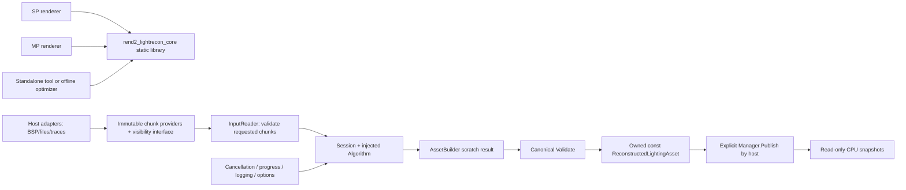

# Standalone reconstructed-lighting core

The C++11 static target `rend2_lightrecon_core` owns the CPU reconstruction
boundary shared by SP, MP and standalone tools. It contains the canonical
[output model](rend2-reconstructed-lighting.md), its validation and
[read-only API](rend2-reconstructed-lighting-api.md), plus the new input and
builder/session and build/use policy code under `shared/rd-rend2/lightrecon/`.

No inverse-lighting algorithm or full bake-time material adapter is installed.
[Original lightmap observations](rend2-lightmap-observations.md) now have a bounded,
immutable input module and main-world capture adapter; they remain uncalibrated
images rather than fitted surface/physical-light data.
[Original lightgrid observations](rend2-lightgrid-observations.md) similarly retain
indexed records, logical-cell coordinates, styles, quantized directions and HDR
alternatives without assuming geometric validity.
[Luxel correspondence](rend2-luxel-observations.md) now retains original static
surface geometry and maps supported source lightmap charts to positions,
normals, coverage and area through explicit bounded CPU tile queries.
[Observation classification](rend2-observation-classification.md) adds explicit
deluxe correspondence, separate style/vertex evidence and material eligibility
without treating texture colour as bake-time reflectance.
[Static visibility](rend2-static-visibility.md) adds explicit immutable CPU BVH
queries over these source surfaces, with optical/sky/domain uncertainty. BVH
construction and provider installation remain explicit; map loading does not run them.
The independent [versioned disk codec and cache adapter](rend2-reconstruction-disk.md)
are connected to the [main-world lifecycle owner](rend2-reconstruction-lifecycle.md).
Complete source fingerprint collection remains unavailable, so the renderer
reports NotCacheable instead of attempting an unsafe cache lookup.
The default session reports `Unavailable` and exposes no reconstruction result.
Neither `tr_staticlighting.cpp` nor `tr_volrecon.cpp` calls the new session.
Existing map loading, fog promotion, entity lighting, sun, area calibration,
shaders and physical-PBR mathematics remain unchanged.



Arrows describe dependencies/data flow, not automatic execution. Constructing
a reader/session does not read observations, trace visibility or start work.
Publishing a finished asset into the access API remains an explicit host step.
There is no connection from an empty/default session into renderer lighting.

## Layout and build boundary

| File | Responsibility |
| --- | --- |
| `lightrecon/input.h/.cpp` | Input schema, leased chunk sources, local validation and visibility adapters |
| `lightrecon/lightmaps.h/.cpp` | Original image observations, source-map identity, bounded capture and immutable pixel leases |
| `lightrecon/lightgrid.h/.cpp` | Original indexed JA grid evidence, bounded immutable capture, logical-cell and explicit decoder access |
| `lightrecon/surfaces.h/.cpp` | Original source UV/geometry capture and bounded luxel correspondence, coverage/area and explicit debug export |
| `lightrecon/classification.h/.cpp` | Read-only style/material eligibility, paired deluxe directions, distinct vertex observations and bounded statistics |
| `lightrecon/visibility.h/.cpp` | Explicit immutable static BVH, structured rays/batches, conservative optics/sky and optional point-domain provider |
| `lightrecon/decode.h/.cpp` | Explicit source transfer, renderer-compatible interpretation, censoring and optional scene-equivalent calibration ([contract](rend2-observation-decoding.md)) |
| `lightrecon/session.h/.cpp` | Builder, cooperative lifecycle, algorithm interface and host services |
| `lightrecon/control.h/.cpp` | Independent build/load policy and read-only consumer gates |
| `lightrecon/disk.h/.cpp`, `cache.h/.cpp` | Portable asset format, content keys, selective chunks and explicit native atomic cache I/O |
| `lightrecon/lifecycle.h/.cpp` | Main-world context, cache/session ownership, tickets and synchronous complete-only publication |
| `lightrecon/CMakeLists.txt` | Single static target containing these files and existing canonical types/API |
| `tools/lightrecon_test/lightrecon_core_test.cpp` | Synthetic standalone core tests |
| `tools/lightrecon_test/CMakeLists.txt` | Eleven CPU executables linking the same target |

`tr_lightrecon_types.*`, `tr_lightrecon_api.*` and `tr_lightrecon_manager.h` keep
their existing names/includes; moving them is unnecessary churn. The new core
groups input, session and policy rather than separate files for every interface.
Future algorithms implement `Core::Algorithm` in this module or an offline tool.

Root CMake adds the CPU target once before renderer subdirectories. SP and MP
link it; the former duplicated canonical/API source entries have been removed
from both renderer lists. The standalone test project adds the same core target
only if it does not already exist, and links all twelve test executables to it.
Each CPU translation unit compiles once per build/configuration, not separately
for each test and renderer. The static archive is PIC/hidden on platforms that
need those settings, has C++11 requirements and carries no renderer defines,
generated shader dependencies or OpenGL/engine libraries.

The renderer-specific `tr_lightrecon.cpp` owner/control adapter and
`tr_staticlighting.cpp` stay outside the archive.
The experimental `tr_volrecon.cpp` remains in its existing SP/MP targets and its
separate `tools/volrecon_test` harness. It is not wrapped or silently substituted
as the canonical solver.

## Input contract and ownership

`Core::InputDataset` contains a small `InputManifest` plus shared const providers.
The input schema is `org.openjk.lightrecon-input`, version 1. Unsupported names
or versions return `UnsupportedSchema`. A nonempty input needs lineage, immutable
revision/content identity, units and valid root provenance. Canonical provenance,
calibration, region/group metadata and external references seed output metadata;
they do not turn input observations into output fields.

Typed streams accept:

- `SurfaceObservation`: stable sample/surface/material identities, world position,
  optional unit receiver normal, optional footprint and observed lighting.
- `GridObservation`: world position, separate ambient/directed values and optional
  unit receiver-to-source direction. `GridMeaning` declares separate components,
  historical LDR maximum, historical HDR sum or unknown semantics.
- `Triangle`: finite nondegenerate world-space geometry, material/region IDs,
  stable identity and provenance. Winding is right-handed.
- `Material`: known/unknown/unsupported material support, linear base colour,
  metallic and perceptual roughness in `[0,1]`. Unsupported materials remain
  explicit; they do not acquire an invented BRDF.
- `SourceHint`: explicit physical-emitter/sun records, emissive surface hints or
  transport apertures. Surface/aperture hints refer to geometry and do not become
  physical emitters automatically. Emissive hints carry Nits/Relative photometry.

Observed RGB is finite, nonnegative linear Rec.709, in Lux-equivalent or explicitly
Relative units with calibration provenance. Known values need calibration.
Historical LDR bytes must be decoded/interpreted by an adapter and labelled
relative or documented legacy equivalents; the core never claims they are
physical measurements. Clipped, missing, quantized and unreliable evidence flags
are preserved independently. Unknown values are explicit. Normals point out of
the receiver; incoming/grid/sky directions point towards the source, opposite
photon travel. All positions and footprint geometry use JA world units; unit
conversions and emission semantics follow the canonical physical-PBR contract.

Providers implement `ChunkSource<T>::Read(first, count, context, out)`. Ordinals
are stable stream offsets, distinct from record IDs. A successful request must
return exactly the requested count, a const span and a non-null strong backing
lease. Zero-length reads need no provider call. IDs must be nonzero and strictly
increasing in stream order. The reader checks ordering inside each chunk and
across contiguous reads, without retaining every ID in a map. Random/repeated
reads are allowed; provider determinism across noncontiguous requests is a host
contract. The manifest/providers must stay frozen for the session's revision.

The reader owns provider references and metadata, not observation arrays. Each
`Chunk` owns a lease, so requested records stay alive if the reader/session is
destroyed. Raw pointers are valid only while that lease lives. `VectorChunk` is
a convenience for already-owned const vectors; a file adapter can instead lease
one decoded page. Retaining a chunk is explicit: the core neither prefetches nor
keeps a whole lightmap/grid/geometry stream in memory. Providers must freeze any
writable aliases to leased data. Their IO/caches/allocator belong to the host.

`ReadLimits` bounds records and fixed record-span bytes per request, with overflow
safe range checks. An oversized request returns `MemoryLimit` before invoking
the provider. `ReadContext` passes the byte limit and cancellation interface to
the provider so decoding can cooperate too. These are not a hard process-RSS or
allocator quota: manifest/output metadata, variable payloads (e.g. vectors inside
emitter hints), provider caches and caller-retained leases are separate memory.
Future algorithms must budget their own working sets explicitly; no unbounded
observation workspace is allocated by the current core. A host may implement
provider memory budgets/custom allocation behind the same ownership interface.

Manifest validation reads no records. Requested records receive finite/range,
direction/geometry, photometry, provenance and active hint-payload checks. Output
validation uses the canonical validator. Input surface/material/triangle foreign
keys are stable opaque IDs: a complete cross-stream geometry/material join is
not implemented, since that requires an explicit streaming/indexing pass. No
claim of exhaustive validation is made for unrequested observations or inactive
hint payloads. Geometry needs are declared by the algorithm, rather than making
an empty dataset invalid unconditionally.

## Lifecycle and injected operations

`Session` is a single-owner, noncopyable cooperative job. The host transfers one
`unique_ptr<Algorithm>` to it and injects optional cancellation, progress and
logging services. The session owns those service/provider references until
destruction. Calls to a particular reader/session must be serialized. Independent
sessions can share providers only when their host implementations support that.

1. Construction leaves the session `Created`, owns metadata/providers and reads
   no observation chunks. Ordinary metadata allocation during construction may
   throw `std::bad_alloc`.
2. `Begin()` validates metadata and algorithm requirements without observation
   reads. Missing required triangles yields `MissingGeometry`; missing material
   or visibility input yields `Unavailable` with a specific path/message. No
   installed algorithm yields terminal `Unavailable`, including for empty input.
3. A valid job becomes `Running`. `Step()` invokes one explicit work unit with
   `InputReader`, producer-only `AssetBuilder` and borrowed `AlgorithmContext`.
4. An algorithm returns Continue, Complete, Unavailable or an explicit error.
   Complete is accepted only after a copied output passes canonical validation,
   the progress sink accepts completion, and cancellation is checked again.
5. Only `Completed` exposes `Output()`, an owned `shared_ptr<const Asset>`.
   Unavailable, Cancelled and Failed have no output. Repeating Begin or stepping
   a non-running job returns `InvalidState` without changing a prior result.

`AssetBuilder::Draft()` is mutable producer scratch data. `Finish()` copies it
and validates the copy; retained writable draft references cannot change a
finished result. Failure clears its result output. The builder does not infer
physical sources from observations or automatically copy hints. Test algorithms
may explicitly copy manually populated hints; no such algorithm is installed in
production. A future algorithm can legitimately complete with a validated empty
asset, but the default core never reports a reconstruction success.

`VisibilityProvider` supplies structured rays via `Query` and compatibility
segment/sky transmittance `[0,1]` through explicit calls. Its defaults are
Unavailable, not clear. [StaticVisibility](rend2-static-visibility.md) implements
the structured contract with an immutable CPU BVH. Distinct finite endpoints and
unit sky directions are required. Failure, exception, no written value or invalid
transmittance is reported and leaves the caller's output unchanged. Region/PVS
connectivity is not fabricated as exact visibility. An OpenJK adapter may later
copy collision volumes for separate point-domain diagnostics; optical queries
use source render geometry, and the CPU core never calls collision APIs itself.

`Cancellation::IsCancelled()` is noexcept and can read a host-owned atomic flag.
It is checked before/after provider and algorithm calls and between validation
records. A long-running adapter/algorithm must poll it within its own work too;
the core cannot interrupt a blocking host call forcibly. Progress is structured
state/step count, not elapsed time. Progress callback errors abort publication.
`Logger::Write` is an injected noexcept error sink; there is no default console,
renderer log or hidden global logger.

Deterministic options contain `randomSeed` (default zero), positive read limits
and optional `maxSteps`. The core uses no RNG, clock, thread scheduling or ambient
random state. Algorithms receive the seed and zero-based step ordinal, must use
stable tie breaking and poll cancellation cooperatively. The same immutable
input revision, ordering, options and algorithm must reproduce results on the
same numerical platform. Cross-compiler floating-point identity is not promised.
`maxSteps=0` is unlimited caller-driven stepping; the counter never wraps.

`Error` carries `Code`, message, path, record ID and ordinal where known. Codes
distinguish invalid input/schema, missing geometry, unavailable data/algorithm,
provider failure, cancellation, memory/read or work limits, invalid lifecycle and
algorithm failure. Provider exceptions become ProviderError (bad allocation becomes
MemoryLimit), algorithm exceptions become AlgorithmError. Terminal errors clear
session output and reach the optional logger. There is no automatic retry that
could hide a failed visibility or input provider.

## Build and run

From the repository root with CMake on PATH, these exact commands were used
(Windows/MSVC 2019 x64; substitute your CMake executable path if needed):

```powershell
cmake -S tools/lightrecon_test -B build/lightrecon-standalone -G "Visual Studio 16 2019" -A x64
cmake --build build/lightrecon-standalone --config Release --parallel 4
ctest --test-dir build/lightrecon-standalone -C Release --output-on-failure
```

This standalone project enables only C++, adds the CPU archive and six test
executables. It does not configure OpenGL, SDL, engine targets, shaders or Boost.
For other platforms omit the Windows generator/platform arguments.

The exact renderer configuration used for validation:

```powershell
cmake -S . -B build/lightrecon-core-renderers -G "Visual Studio 16 2019" -A x64 `
  -DBuildSPEngine=OFF -DBuildSPGame=OFF -DBuildSPRdVanilla=OFF -DBuildSPRend2=ON `
  -DBuildMPEngine=OFF -DBuildMPDed=OFF -DBuildMPGame=OFF -DBuildMPCGame=OFF `
  -DBuildMPUI=OFF -DBuildMPRdVanilla=OFF -DBuildMPRend2=ON `
  -DBuildLightReconTests=ON -DBuildTests=OFF
cmake --build build/lightrecon-core-renderers --config Release --parallel 4 `
  --target rdsp-rend2_x86_64 rd-rend2_x86_64 lightrecon_test lightrecon_api_test lightrecon_core_test lightrecon_control_test lightrecon_disk_test lightrecon_lifecycle_test
ctest --test-dir build/lightrecon-core-renderers -C Release --output-on-failure
```

Core tests cover empty/huge declared datasets without eager reads, all typed
streams and synthetic emitter hints, unsupported materials/schema versions,
invalid records/order/leases, bounded requests, failed visibility, cancellation,
provider/algorithm/callback errors, deterministic seeds, immutable validated
output and repeated session construction/destruction. Existing canonical/API
tests link the same archive and remain part of CTest.

`control.h/.cpp` also provides the CPU build/load policy and read-only consumer
gates. The renderer adapter owns cvar registration and map-load invocation;
see [independent controls](rend2-reconstruction-controls.md). No canonical cache
backend, solver or consumption adapter is installed yet.

## Remaining work

Not implemented: BSP/lightmap extraction, disk formats/chunk cache, material/texture
evaluation, complete foreign-key joins, full-map observation validation, geometric
visibility construction, inverse fitting, sun/sky estimation, uncertainty estimation,
an offline CLI optimizer or renderer consumption of core results. The optional
algorithm interface and leased providers establish where those implementations
belong; they do not solve any of them. No map visual-quality improvement is claimed.
