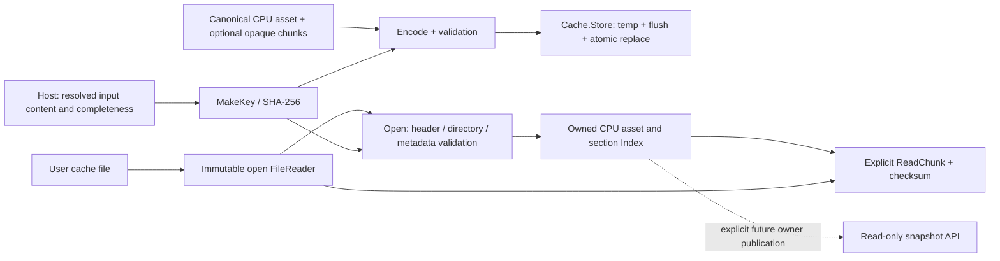

# Reconstructed-lighting disk assets, format 1.0

`shared/rd-rend2/lightrecon/disk.h/.cpp` implements a portable, deterministic
CPU codec for the [canonical asset](rend2-reconstructed-lighting.md).
`lightrecon/cache.h/.cpp` implements explicit native file reads and atomic writes.
Both belong to the single `rend2_lightrecon_core` library linked by SP, MP and
standalone tools. Neither includes engine headers, `tr_local.h` or graphics APIs.

This implements storage, validation and content-key construction. No solver,
production source dependency collector, map-load cache backend, evaluator or
rendering consumer is installed. `R_LoadReconstructedLighting()` keeps its existing
unavailable/missing behaviour. The only new renderer helper,
`R_LightReconCacheRoot()`, reads the supported `fs_homepath` cvar and returns a
path; it performs no I/O and is not called automatically.



## Byte representation and layout

All integers are **little endian**, with the stated width. Floats are finite
IEEE-754 binary32, stored by bits in little endian, including the sign of zero.
No struct padding, native `size_t`, pointer, C++ enum representation or host bool
representation is written. A bool is one byte, strictly 0 or 1. An enum is a
validated u32: ordinals match `tr_lightrecon_types.h` (zero-based except emitter
kinds: Point=1, Spot=2, Rectangle=3, Tube=4, Directional=5; extension kinds
>=65536 preserve their versioned extension key). An ID is u64; zero retains its
canonical absent-reference meaning.

Strings are u32 byte length followed by exactly those bytes, without a terminator.
They preserve producer text byte-for-byte; UTF-8 is recommended, not transcoded
or executed. Embedded NUL is preserved in metadata and never used as an OS path.
Nested lists are u64 count followed by records. Top-level section lists use the
directory's count and do not repeat it in the payload. All fields are tightly
packed within a section; **section starts are aligned to eight bytes**. Writers
zero alignment padding, which has no meaning and is not covered by a section
checksum. Readers never interpret padding.

The fixed **192-byte header** is followed immediately by `sectionCount` directory
entries of 80 bytes, then the aligned sections:

| Offset | Width | Meaning |
| --- | --- | --- |
| 0 | 8 | Magic bytes `4a 4b 52 4c 41 0d 0a 1a` (`JKRLA`) |
| 8 / 10 | u16 / u16 | Format major / minor, initially 1 / 0 |
| 12 | u32 | Header bytes = 192 |
| 16 | u32 | Canonical schema version = 1 |
| 20 | u32 | Coordinate/photometric convention version = 1 |
| 24 | u32 | Algorithm version; identity string is also in the fingerprint section |
| 28 | u32 | Directory entry count |
| 32 | u64 | Exact file length, including final padding |
| 40 | u64 | Directory offset = 192 |
| 48 | 32 | SHA-256 of the resolved source BSP bytes |
| 80 | 32 | Complete content/reconstruction key |
| 112 | 32 | SHA-256 of all directory bytes |
| 144 | 32 | SHA-256 of the entire header with this field zeroed |
| 176 | 16 | Reserved, must be zero |

Each directory entry:

| Offset | Width | Meaning |
| --- | --- | --- |
| 0 / 4 | u32 / u32 | Section type / flags (bit 0 = required; other bits unsupported) |
| 8 | u64 | Dataset ID for a chunk; zero for metadata |
| 16 | u64 | First logical element for a chunk; zero for metadata |
| 24 / 32 | u64 / u64 | Absolute file offset / stored byte count |
| 40 | u64 | Record/element count |
| 48 | 32 | SHA-256 of the exact section bytes |

Directory ordering is ascending `(type, dataset, firstElement)`. Entries must be
unique, physically ordered, aligned, nonempty and nonoverlapping, and lie after
the whole directory and inside the exact declared file size. Ranges and products
use checked arithmetic. Logical chunk ranges must also be nonoverlapping and fit
the referenced dataset's element count and maximum chunk size.

## Sections and canonical records

Sections 1 and 2 are mandatory, count=1. Empty optional vectors are omitted;
absence means missing metadata/capability, never invented zero illumination.
There is at most one section of each metadata type. Known metadata record order
and fields follow the canonical declaration, explicitly enumerated by the shared
`Fields` functions in `disk.cpp`; no reflection/native memory image is used.

| Type | Payload, in field order |
| --- | --- |
| 1 Metadata | schema string, schema version u32, lineage string, Units, root provenance ID |
| 2 Fingerprint | algorithm string, algorithm version u32, Units, nine completeness bools, nested list of InputContent |
| 3 Provenance | ID, kind, locator, contentHash, producer, method, parent ID list, observation issue bits u32, observationQuality ID |
| 4 Calibration | ID, kind, provenance ID, method |
| 5 Hypotheses | ID, description |
| 6 Emitters | Source, emitter kind, extensionType, Position, Frame, EmitterGeometry, Photometry, AngularDistribution, range Estimate |
| 7 Sun | directional emitter ID |
| 8 Environment | Source, mean-luminance Photometry, radiance dataset ID, SunCoverage |
| 9 Transport | Source, component, quantity, unit, calibration ID, Bounds, three u32 sample dimensions, dataset ID |
| 10 Regions | ID, provenance ID, key, Bounds, membership dataset ID |
| 11 Datasets | ID, purpose, layout, locator, contentHash, encoding, encoding version u32, element count u64, chunk-elements u64 |
| 12 Visibility | dataset ID, kind, source ID, region ID |
| 13 Contributions | dataset ID, sample-domain ID, source ID list, component, quantity, unit, calibration ID |
| 14 Diagnostics | severity, code, message, source ID, region ID, metric Estimate, metric-unit string |
| 100 Chunk | Opaque CPU encoding named/versioned by its canonical Dataset descriptor |

Nested records:

- `Vec3`: three f32, x/y/z. `Units`: worldUnitsPerMeter, physicalToScene f32.
- `Estimate`: known bool, value f32, bounded bool, lower/upper f32.
- `Position`: known, world Vec3, sigmaWorld Estimate.
- `Frame`: known, right/up/forward Vec3. `Bounds`: known, min/max Vec3.
- `Chromaticity`: known, RGB Vec3. `Photometry`: unit, intensity Estimate,
  Chromaticity, calibration ID.
- `Evidence`: physical-emitter confidence Estimate, transport confidence Estimate,
  issue bits u32, exact-light Suitability, approximate-irradiance Suitability.
- `Source`: ID, provenance ID, hypothesis-group ID, state, hypothesis-weight
  Estimate, region ID list, Evidence.
- `EmitterGeometry`: known, halfWidth/halfHeight/halfLength/radius f32 in world
  units, effective-radius Estimate, angular-radius Estimate, extension dataset ID.
- `AngularDistribution`: kind, cosInner/cosOuter f32, twoSided bool, dataset ID.
- `InputContent`: kind u32, semantic name string, byte count u64, SHA-256 bytes.

ID-bearing top-level records (including sun references) are sorted by numeric ID
for serialization. Visibility, contribution, diagnostic and nested reference lists
retain producer order: their order is explicitly part of an identical input.
Fingerprint inputs are sorted by `(kind, name)`; chunks by dataset/first element.
No timestamps, process-local snapshot generations, allocator state, engine/world
pointers, GPU vendor, texture handles, shader binaries, froxel dimensions or
consumer shadow indexes are serialized. Identical asset/fingerprint/chunks yield
identical bytes on supported IEEE hosts; ID-vector reordering is canonicalized.

Convention version 1 preserves JA right-handed world space, +Z up; spot/sun
forward is photon travel, incoming directions point towards sources. RGB remains
scene-linear Rec.709 D65, known emitter chromaticity has Y=1. Point/spot intensity
is candela, area/tube luminance is nits, directional illuminance is lux, or the
explicitly labelled relative alternative. Unit scales must exactly match the
fingerprint's policy. Legacy equivalents, physically authored calibration and
uncalibrated relative estimates, missing/clipped observations, uncertainty and
candidate hypotheses remain distinct. Transport is serialized separately from
physical emitters. No exposure or additional conversion is applied by the codec.

Incompatible majors, schema/convention versions and unknown required sections
are rejected. New same-major minors may add optional independent sections; an
unknown optional section is range-checked and skipped without allocation or
payload interpretation. It is not retained on re-encoding. Changing a known
record layout requires a format major/schema change, not appending unframed
fields. Unknown enum values are rejected except versioned emitter extensions.

## Content keys and invalidation

`MakeKey` hashes a domain marker `org.openjk.lightrecon-key/1`, format major,
canonical schema/convention versions and the canonical fingerprint bytes.
`Fingerprint` defaults to **incomplete**, algorithm version zero. All nine
coverage flags must be explicitly true; exactly one BSP record, and at least one
settings and unit/calibration record, are required. Every enumerated input needs
a unique `(kind, name)`, byte size and nonzero SHA-256 digest. Empty input *sets*
are allowed only with explicitly complete coverage. Empty file content uses the
actual SHA-256 of zero bytes. Hashing a filename or timestamp is not sufficient.

| Coverage category | Dependencies the future host collector must resolve/hash |
| --- | --- |
| BSP | Resolved main BSP bytes, including internal geometry/entity/shader lumps; include sub-BSP content in another relevant category/manifest when used |
| InternalLightmaps | Internal lightmap lump content and chosen interpretation/layout |
| ExternalLightmaps | Complete resolved external HDR/LDR lightmaps, replacement/absence/atlas policy |
| Lightgrid | Internal grid plus external replacement textures/sidecars and legacy HDR/LDR interpretation |
| DeluxeMaps | Internal/external directional/deluxe data and explicit absence |
| Materials | Ordered effective shader/material definitions, includes, override precedence, relevant textures and material-interpreter version/policy |
| AuthoredLighting | Emissive/source/sun/sky hints, environment/region/calibration sidecars and explicit absence policy |
| Settings | Effective reconstruction settings, input schema, random seed, quality/ordering policies; exclude consumer/GPU settings which do not affect estimation |
| UnitCalibration | Unit scales, color transfer/primaries, relative/physical calibration references and conversion policy versions |

The exact unit scale floats, algorithm identity and algorithm version additionally
participate directly in the key. Changing content, resolution precedence, relevant
interpretation/settings, unit policy, schema or algorithm produces a different
key. Recollect after VFS mounts/search order or overrides change. Hash the actual
resolved bytes and any ordered manifest of dependencies/absence, not a PK3 name
or only an archive mtime. `HashContent(Reader, digest, maxInputBytes)` streams
SHA-256 through fixed 64 KiB scratch; it does not require a full BSP/field buffer.

The format verifies the stored manifest hashes to the header key and the caller's
fresh expected key. It cannot discover a dependency omitted by a lying host.
**No production code currently marks these categories complete.** Until a host
collects them all, `MakeKey`, `Encode`, `Cache.Load` and `Cache.Store` return
`NotCacheable`; opening an incomplete key does not touch the reader. There is no
filename-only, old `InputManifest.revision`-only or BSP-only fallback. The new disk
adapter is deliberately not wired into the build-policy backend yet.

## Cache location, publication and lifetime

The explicit writable location is:

```text
<fs_homepath>/rend2/lightrecon/v1/<64-lowercase-SHA256-key>.jklr
```

`R_LightReconCacheRoot()` obtains `fs_homepath` using the SP/MP-supported
`ri.Cvar_VariableStringBuffer`. No refimport ABI changes are needed. Native tools
can provide an explicit absolute private cache root. Empty/relative/traversing
roots are rejected. Cache names contain only derived hex, not map names or
untrusted metadata locators. The cache is outside BSP/PK3 archives and uses no
VFS search/read fallback. Cross-mod entries can share a key only if the complete
resolved content and interpretation match.

`Cache.Store` first finishes encoding and validates the whole metadata product.
It creates missing cache directories, exclusively creates a same-directory
`<key>.jklr.tmp-<pid>-<serial>` file, writes all bytes, flushes, closes and publishes:

- Windows: `FlushFileBuffers`, `ReplaceFileW` for an existing file; for first
  publication, `MoveFileExW(..., MOVEFILE_WRITE_THROUGH)` without overwriting a
  concurrent new writer. Readers open with share-read/share-delete. Existing
  reader leases remain on the old file after replacement.
- POSIX: checked writes, `fsync`, `close`, atomic same-filesystem `rename`, then
  directory `fsync`. A directory-sync failure reports `IoError` even if a complete
  replacement has already become visible.

There is no delete-old-then-copy fallback. On failure the temporary is removed
when possible. A process crash may leave an ignored `.tmp-*`; cache lookup only
uses the final exact key filename. OS/power/storage durability ultimately depends
on the filesystem; a partial/corrupt final file still cannot pass validation.
Concurrent writers may return a safe I/O failure; no locking or automatic retries,
temporary-file garbage collection or cache eviction policy is implemented.

`Cache.Load` retains a single open immutable `FileReader`; decoding/indexing and
future chunk requests use that same file. Reader methods must be serialized.
Metadata owns all its strings/vectors, and the index owns its directory. Neither
borrows mapped bytes. `MemoryReader` instead borrows caller-owned immutable bytes.
`ReadChunk` returns an owned byte vector; retain/release it explicitly. Dataset
locators are opaque metadata and are never automatically opened, even if absolute
or malicious. Hashes provide integrity, not authenticity/signatures.

## Validation, limits and selective reads

`Open` checks the header and directory before any section decode, verifies every
known metadata checksum and record, validates the fingerprint and invokes the
canonical validator. It rejects truncated files, arithmetic overflow, duplicate
sections/IDs, overlapping ranges, invalid counts/enums/bools, NaN/Inf (even in
unknown estimates), invalid geometry/calibration, dangling source/region/dataset
references, provenance cycles and conflicting hypotheses. Trailing bytes within
known records are invalid. Decode/publication outputs remain unchanged on error.
No access operation publishes into `Manager`, starts a solver, allocates graphics
resources or changes renderer settings.

| Default limit | Value |
| --- | --- |
| File bytes | 256 MiB |
| Aggregate known metadata payload | 32 MiB |
| Decoded allocation/scratch accounting | 128 MiB |
| Single requested chunk | 8 MiB |
| Aggregate decoded records, including nested ID/input lists | 100000 |
| Allocation budget units | 1000000 |
| Directory entries | 4096 |
| Individual string | 1 MiB |

The byte/count limits are checked before corresponding file-controlled container
resizes or reads. Allocation accounting charges nonempty vectors/strings, section
buffers and directory storage, plus conservative scratch for fingerprint hashing
and canonical validation (1024 bytes / 16 allocation units per decoded record).
Accounting is cumulative, not refunded on freeing scratch, so combinations may
fail below an individual headline limit. Standard-library allocator bookkeeping,
internal reallocations, caller-owned input/output leases and native stream buffers
are not an exact process-RSS quota or intercepted global allocation counter.
`bad_alloc`/container length failures become `LimitExceeded`. Lower limits are
useful for untrusted offline imports. Raising one limit does not bypass others.

Large data uses independent **type-100 chunks in the same container**, indexed
by dataset ID and first logical element. `Open` loads all bounded *metadata*,
and no field/contribution/visibility chunk. `ReadChunk` requests exactly one
bounded stored chunk and verifies its checksum. Missing sparse ranges remain
unknown. No decompression or full contribution matrix is allocated. Descriptors
may instead refer to external datasets; this implementation does not follow them.

`Open` success means **validated metadata/index**, not validation of unrequested
payload bytes. Unknown optional payloads and chunk checksums are deferred. A
future CPU encoding decoder must validate its own numerical values, record
identities/source references and decoded-size limits before installing an
evaluator. The current core has no field encoding/evaluation algorithms; opaque
chunks do not imply `IndirectSampling` or visibility query support.

Encoding currently assembles a bounded file buffer and metadata-section buffers,
borrows caller chunks for the duration of the call, then validates through the
same decoder. Conservatively budget four file-size buffers for vector growth and
metadata staging, plus metadata decode/validation accounting,
plus caller-owned chunks/assets. This is an explicit offline/owner operation,
not a per-frame path. A future streaming writer can replace buffering without
changing the on-disk layout. Loading uses bounded metadata/index storage plus
validation scratch; each explicit chunk lease adds at most its requested bytes.

Public operations are `Hash`, `Hex`, `HashContent`, `MakeKey`, `Encode`, `Open`,
`ReadChunk`, `CacheRoot`, `FileReader.OpenFile`, `Cache.Load` and `Cache.Store`.
Errors distinguish `Missing`, `NotCacheable`, `Mismatch`, `Unsupported`, `Corrupt`,
`LimitExceeded`, `InvalidAsset`, `InvalidArgument` and `IoError` with a message.
The explicit owner chooses any miss fallback; this layer never builds on a miss.

## Reproducible tests and current results

The standalone project needs only a C++11 compiler/CMake and platform filesystem;
no game, OpenGL context, engine startup or proprietary assets:

```sh
cmake -S tools/lightrecon_test -B build/lightrecon-disk-standalone -DCMAKE_BUILD_TYPE=Release
cmake --build build/lightrecon-disk-standalone --parallel 4
ctest --test-dir build/lightrecon-disk-standalone --output-on-failure
```

On this Windows workspace the exact GCC commands include the bundled toolchain
on PATH (its recursive make invokes `make`):

```powershell
$toolbin = 'C:\Users\Keyten\Desktop\projects\OpenJK\build\toolchain\w64devkit\bin'
$env:PATH = "$toolbin;$env:PATH"
cmake -S tools/lightrecon_test -B build/lightrecon-disk-standalone -G 'MinGW Makefiles' `
  "-DCMAKE_CXX_COMPILER=$toolbin/g++.exe" "-DCMAKE_MAKE_PROGRAM=$toolbin/mingw32-make.exe" -DCMAKE_BUILD_TYPE=Release
cmake --build build/lightrecon-disk-standalone --parallel 4
ctest --test-dir build/lightrecon-disk-standalone --output-on-failure

# Existing SP+MP MSVC configuration; see the core build instructions.
cmake --build build/lightrecon-core-renderers --config Release --parallel 4 `
  --target rdsp-rend2_x86_64 rd-rend2_x86_64 lightrecon_test lightrecon_api_test lightrecon_core_test lightrecon_control_test lightrecon_disk_test
ctest --test-dir build/lightrecon-core-renderers -C Release --output-on-failure

$python = 'C:\Users\Keyten\.cache\codex-runtimes\codex-primary-runtime\dependencies\python\python.exe'
& $python tools/rend2/test_lightrecon_contract.py
& $python tools/rend2/lightrecon_regression.py --no-gpu --output build/lightrecon-disk-shader-contract
```

The new `lightrecon_disk_test` covers empty assets; all five physical emitter
kinds plus a versioned extension and incomplete relative source; sun/sky,
transport, regions, all dataset purposes, provenance/calibration/uncertainty,
visibility/contribution descriptors and selective chunks. It checks known SHA-256
vectors and streaming, deterministic bytes under record/chunk reorder, every
truncated-header length, longer truncations, versions, checksums, corrupt/overflowed
offsets/counts, NaN, dangling references, unknown optional/required sections,
compatible minor extensions, all allocation limits, read failures, key coverage
and mutations, deferred corrupt chunks, missing/corrupt native caches, ignored
interrupted temporaries and replacing a file while an old read lease survives.
A fixed-seed header mutation loop exercises 256 further corruptions. A separately
published `Manager` and its pinned snapshot remain unchanged throughout cache
successes and failures.

Final results on this workspace:

- MSVC 2019 x64 Release: both SP and MP Rend2 built; five CPU executables pass,
  **6982 checks**, including **1126 disk checks**.
- Independent GCC 16.2 C++11/MinGW build: the same five CPU executables and
  **6982 checks** pass without linking the engine or OpenGL.
- Both compilers match the empty synthetic file's fixed 1032-byte wire fixture:
  SHA-256 `d01e4f6115216cc2593717aa9dd571d39d6cd690eefc14dffd063041e731ac6c`.
  The fully populated fixture (seven emitters, transport/sky/regions and six
  chunks) is 6640 bytes / 20 directory entries. These are illustrative file
  costs, not an estimate of a fitted production map's field payload.
- `g++ -std=c++11 -Wall -Wextra -Wpedantic -Wconversion -fsyntax-only` on the new
  codec, adapter and test sources passes without diagnostics (include path
  `-Ishared/rd-rend2` for the test). MSVC retains the existing global x64
  `/arch:SSE2` warning; no new source warnings remain.
- Existing legacy protection: nine Python detector tests pass; the contract-only
  check compares 27 programs / 51 stages with **zero differences**, and the
  production dependency audit passes. GPU compilation was not repeated in this
  disk-format task (`gpu_compiled: false` is explicit in its report).

Local logs are `build/lightrecon-disk-build.log`, `build/lightrecon-disk-tests.log`,
`build/lightrecon-disk-standalone-build.log`,
`build/lightrecon-disk-standalone-tests.log` and
`build/lightrecon-disk-shader-contract/report.json`. Initial Windows tests exposed
`MoveFileEx` replacement failure with an open read lease; the final protocol uses
`ReplaceFileW` and passes that case. A first standalone configure without the
toolchain directory on PATH failed before compiler detection; the documented
commands include PATH and the final independent build passes.

Changed implementation files are `lightrecon/disk.h/.cpp`, `cache.h/.cpp` and
their shared CMake list; the renderer owner header/source only expose the unused
home-path helper. `tools/lightrecon_test/lightrecon_disk_test.cpp` and its CMake
target provide the tests. This document, the canonical/core overviews and map-load DDC
cross-reference describe the boundary. No SP/MP duplicate source implementation,
refimport ABI, renderer feature default or shader change is introduced.

Native filesystem validation here exercises Windows; the POSIX implementation
is provided but is not claimed to have run on a POSIX host. No runtime
reconstruction/cache loading or new visual integration is claimed. Existing
legacy shaders and lighting are unchanged.
