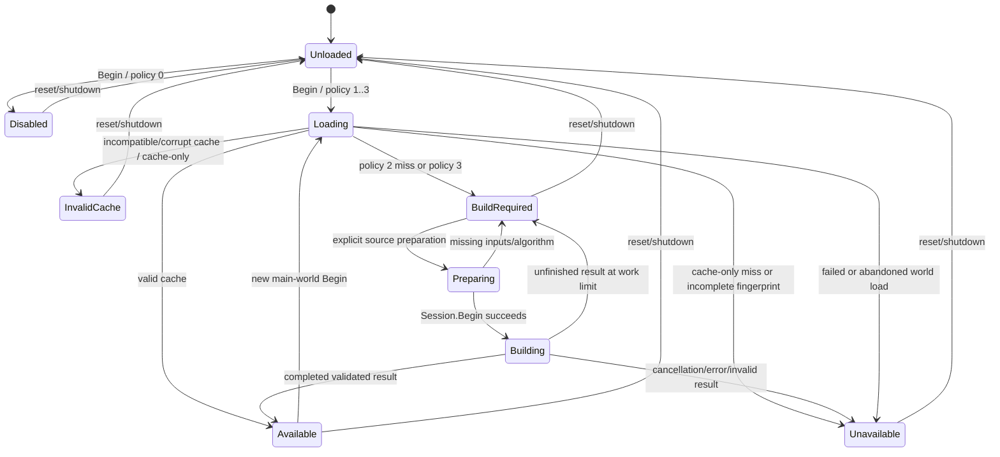

# Reconstructed-lighting main-world lifecycle

`lightrecon/lifecycle.h/.cpp` provides the single CPU `WorldLighting` owner.
`tr_lightrecon.cpp` contains exactly one instance for the renderer's current
**main** world. It publishes through the existing immutable snapshot API. The
owner has no `world_t`, BSP, hunk, renderer allocator or GPU dependency, and
does not consult master/consumer enable flags.

This integrates ownership and the cache/session boundary. It does **not** implement
a solver, immutable BSP observation exporter, complete production fingerprint
collector, numerical field decoder or reconstructed rendering consumer. In the
current renderer, nonzero policies explicitly report `NotCacheable`; policies
2/3 report `BuildRequired` because the input adapter/algorithm is unavailable.
No filename-only cache acceptance or successful empty placeholder substitutes
for those missing components. Synthetic CPU tests exercise real valid cache
hits, completed builds and atomic cache writes through the same owner.

## States and policy



`Preparing`/`Building` are synchronous intermediate states, observable to injected
callbacks/diagnostics, not background jobs. Every main-world `Begin` discards the
current publication, copies its map identity, samples build policy once and gets
a new ticket. Only `Complete` for that ticket and a fully initialized world may
load/build/publish. Stale completion/abort returns `StaleHandle`. Reentrant owner
mutation is rejected as `Pending`; callers serialize lifecycle writes on the
renderer/host thread. `Acquire` supports concurrent read-only snapshot access.

| Policy | Owner behaviour |
| --- | --- |
| 0 | `Disabled`; no source description, cache-root lookup, disk I/O, geometry/observation copies or session creation |
| 1 | Describe/check complete input key, try cache only; no `Prepare` or solver on any failure |
| 2 | Describe/check key, try cache if cacheable; prepare/build on a miss/failure; publish only a completed validated result |
| 3 | Describe inputs for possible later cache write, **skip cache reads**, prepare/build; never fall back to old cached lighting |

A complete fingerprint is mandatory for any cache read/write. An explicit host
can run an in-memory build with incomplete cache fingerprints if it supplies a
valid immutable `Core::InputDataset`; that result is never written to cache.
The renderer has no such production adapter yet and reports the limitation.
Input/output unit scales must match, and a cacheable job must match the key's
unit/calibration policy. `WorldSource` attests revision/content completeness;
the lifecycle does not invent missing dependencies.
The source receives the owner's copied world ID, and a cacheable BSP fingerprint
must name that exact ID. A source accidentally still bound to the previous map
is rejected as `NotCacheable` before cache access. Input/output scales are also
checked for in-memory builds even when the disk key is incomplete.

`WorldLimits.maxBuildSteps` defaults to 1024 and must be nonzero. The effective
step budget is the smaller of this and a nonzero plan limit. Each step follows
the core's cancellation/error checks. Incomplete/running, cancelled, failed,
invalid-schema, invalid-reference or invalid-output sessions publish no asset.
No partially built draft survives the call. Step count does not bound wall time:
future algorithms/providers must remain cooperative inside a step too.

Successful cache metadata or a completed valid CPU result publishes as API
`Ready` / lifecycle `Available`. This means a validated completed **asset**, not
that every source was identified or every lighting capability exists. Valid
empty/subset assets, unknown intensities and candidate hypotheses remain legal.
An empty asset does not imply usable lights, a black world or resolved sun.
No field evaluator is installed; metadata does not enable sampling capabilities.

Cache-only corrupt, mismatched, incompatible or over-limit files produce
`InvalidCache` and no asset. I/O/absent-key failures remain explicit unavailable
statuses; cache-only never builds. Policy 2 can recover by building while retaining
the original cache error in the report. Failure to write a completed valid build
is reported separately and does not invalidate the in-memory result. Exceptions
from source/cache/algorithm callbacks cannot publish a half product. There is no
retry loop, worker pool, detached thread or queued write.

## Renderer entry points and readiness

| Entry point | Action |
| --- | --- |
| `RE_LoadWorldMap` entry | Construct stack `LightReconWorldLoad` before BSP loading/redundant-world checks; unpublish old data and sample build policy |
| `R_LoadBSP` | No canonical lifecycle calls; retains ordinary BSP/lightmap/material/lightgrid loading |
| `R_LoadAreaLights` in `RE_LoadWorldMap` | Existing authored/automatic area-light loading stays in its original position |
| `R_BuildStaticLighting`, `R_CalibrateEntitySun` | Existing PBR calibration, grid, fog/proxy and sun behaviour stays in order; no longer owns/clears canonical data |
| End of `RE_LoadWorldMap` | After area lights, legacy initialization, weather/cubemap setup and prefetch flush, finish the guard with copied readiness/count facts and run the canonical owner |
| Failed return / `ri.Error(ERR_DROP)` | Guard destructor aborts the ticket without publishing; SP and MP throw the error, so normal C++ unwinding applies |
| SP/MP `R_ClearTr` | Unconditionally unload before renderer/world pointers are memset/reset, including cached-shader reset |
| SP/MP `RE_Shutdown` | Unconditionally unload before graphics teardown, including failed/partial initialization and `r_inited == false` |

The first geometry/material/lightgrid availability point is the end of
`R_LoadBSP`; authored area lights are available only after `R_LoadAreaLights` in
`RE_LoadWorldMap`. The selected completion point is later still, ensuring an
exception in subsequent legacy/world initialization cannot leave a newly
published canonical result. Expensive fitting is never inserted into `R_LoadBSP`.

`WorldFacts` are copied counters/readiness, **not observation providers**.
Missing lightgrid/lightmap textures are zero facts and do not invalidate a world
unconditionally. Algorithms declare their actual geometry/material requirements.
No grid reconstruction, guessed sun or synthetic emitter is used as a fallback.
The normal JA/legacy paths run regardless of canonical availability.

MP sub-BSPs use `R_LoadBSP(name, &bspIndex)` through model registration and never
enter the main-world guard. They cannot overwrite the main map ID, publication
or policy even though old renderer globals such as `tr.worldName` can change.
Canonical per-sub-BSP contexts/transforms are intentionally unsupported; future
support requires explicit separate ownership, not reuse of the main owner.

Changing `r_lightReconBuild` affects only the next `RE_LoadWorldMap`. Changing
`r_lightReconUse` or consumer flags starts no work and mutates no asset. A
`vid_restart` unloads the context; when the engine re-registers the active world,
that new main-world load applies the requested policy. Renderer init without a
world load leaves `Unloaded`. The cvar description reflects this distinction.

## Ownership, memory and references

| Resource | Owner / lifetime |
| --- | --- |
| Current immutable asset + CPU indexes | `WorldLighting`'s private `Manager`; one current publication; API snapshots/cursors/records hold explicit shared leases |
| Map identity, policy, ticket, status | Small value-owned `WorldReport`; no raw world pointer |
| Input geometry/material snapshots | Injected `BuildPlan.input` providers own immutable backing data; transferred into the local `Core::Session`, never naked hunk spans |
| Temporary observations / builder / algorithm | Local plan/session during `Complete`; destroyed on success, miss, exception, cancellation and unfinished result |
| Cache file/index/decode buffers | Local `NativeWorldCache.Load` / disk codec; closed/freed before return; no full lightmap/grid/field prefetch |
| Cache write buffers | Local bounded disk encoder / atomic writer, released before publication returns |
| Future decoded fields / evaluator | Must own CPU data and be prepared before snapshot publication; current owner installs no evaluator and loads no chunks |
| Renderer adapters / future GPU resources | Consumer-owned renderer resources with their own map/shutdown handling; absent from the canonical model and CPU owner |

`world_t` remains a plain hunk/memset-managed structure. No STL object or C++
destructor is placed in it. Canonical values use standard C++ ownership in the
existing shared CPU library; no hunk pointer is passed to `delete`, and no hunk
allocator is used for STL buffers. The one static renderer owner lives outside
`tr` and `s_worldData` and is explicitly reset at their lifetime boundaries.

Publication deep-copies once and validates/indexes before atomic visibility.
Old strong leases remain safe CPU snapshots after map switches/unload and never
point into a freed world. Source/region handles include API publication generation;
old handles cannot silently rebind in a newly acquired snapshot. Old snapshots
are historical views, not the current world. Weak leases expire after the last
strong holder releases them. Holding an old lease deliberately retains that old
metadata; the current owner does not keep a history of worlds.

Tickets/generations are in-memory identities, scoped to the loaded code/module;
they are never disk identities and must not be carried across DLL reload.
`R_ReconstructedLighting` is an internal renderer C++ API, not an exported
`refexport_t` ABI to game modules. Renderer consumers must release their C++ leases
before `RE_Shutdown` returns and DLL unloading occurs, as required by the existing
API. No cross-DLL deleter/module-pinning facility is introduced. Within a loaded
module, owner reset/destruction does not invalidate pinned CPU data.

`Manager.Reset()` supplies an allocation-free publication release before teardown.
Normal resets publish explicit `Unloaded`/`Disabled`/failure states. If allocating
that unavailable snapshot fails, the publication stays null (`Missing`) with no
old asset reachable from the current owner. This avoids retaining old world data
because an error message allocation failed.

Disk size/count/allocation limits remain those of the versioned codec (default
32 MiB metadata, 128 MiB decode accounting, 8 MiB requested chunk). Cache hit/miss
does not call the input factory. A completed or failed job releases all input
providers, algorithm and builder before `Complete` returns; tests use a weakly
observed 1 MiB owned provider to verify this. The source host may independently
retain a provider; that is explicit host ownership, not a manager leak.

`r_lightReconInfo` reports lifecycle state, world, ticket/generation, asset lineage,
cache/write status and complete key, requested/applied policy, cache/build
attempts, session/step counts, readiness facts and memory. `metadata-estimate`
counts current asset vectors/string capacities, including conservative SSO
overcount, excluding allocator overhead/API indexes/external leases. It is not
process RSS. Temporary/provider memory is explicitly unmeasured during work and
zero retained by the owner after return. No hundreds-of-megabytes observation
snapshot is held on a cache hit. `build-called` now means an explicit preparation
attempt, not proof that fitting ran; `session=0 steps=0` disambiguates this.

## Tests and reproducible commands

The standalone lifecycle executable uses only synthetic CPU assets/providers and
private cache files. It covers all policies, missing/corrupt/mismatched caches,
invalid data/schema, empty assets, no grid/lightmap facts, unfinished builds,
provider/algorithm exceptions, repeated worlds, stale tickets/handles, immutable
old leases, failed-load guard unwinding, reentrant mutation rejection, master/use
independence, cache write failure and deterministic temporary-provider release.
Native cache round trips use the production disk adapter. The existing source
regression audit now also checks the main guard/commit ordering, independent
legacy ownership, absence of sub-BSP hooks and unconditional SP/MP reset hooks.

```powershell
$toolbin = 'C:\Users\Keyten\Desktop\projects\OpenJK\build\toolchain\w64devkit\bin'
$env:PATH = "$toolbin;$env:PATH"
cmake --build build/lightrecon-core-renderers --config Release --parallel 4 `
  --target rdsp-rend2_x86_64 rd-rend2_x86_64 lightrecon_test lightrecon_api_test lightrecon_core_test lightrecon_control_test lightrecon_disk_test lightrecon_lifecycle_test
ctest --test-dir build/lightrecon-core-renderers -C Release --output-on-failure
cmake --build build/lightrecon-disk-standalone --parallel 4
ctest --test-dir build/lightrecon-disk-standalone --output-on-failure

$python = 'C:\Users\Keyten\.cache\codex-runtimes\codex-primary-runtime\dependencies\python\python.exe'
& $python tools/rend2/test_lightrecon_contract.py
& $python tools/rend2/lightrecon_regression.py --no-gpu --output build/lightrecon-lifecycle-shader-contract
& $python tools/rend2/test_lightrecon_lifecycle_runtime.py `
  --installation 'C:\Program Files (x86)\Steam\steamapps\common\Jedi Academy\GameData' `
  --binaries build/ssr-msvc/RelWithDebInfo `
  --renderer build/lightrecon-core-renderers/Release/rdsp-rend2_x86_64.dll `
  --output build/lightrecon-visual-20261022 --label ownership-final
```

Fresh build configuration is in the [core instructions](rend2-reconstruction-core.md#build-and-run)
and [standalone disk instructions](rend2-reconstruction-disk.md#reproducible-tests-and-current-results).
Both variants link the same CPU implementation; the new executable is the sixth
CTest target. No game assets are needed for CPU tests.

The actual SP smoke test reuses the existing stock-only runtime setup. It loads
`hoth3 -> hoth2 -> hoth3`, changes requested build policy on an already-loaded map,
then issues `vid_restart` and disconnect. It performs no movement, camera, FX or
image comparisons, pauses after client registration, keeps all consumer requests
on and checks that effective features stay off. Complete source hashing is
unavailable, so it explicitly checks zero cache reads/sessions/steps and no cache
files. Real cache hits and completed builds are certified only by synthetic CPU
tests. The fixed waits are registration-settle intervals inherited from the
existing map harness, not performance measurements. Missing/incomplete diagnostic
sections and renderer errors fail the test.

Final validation on 2026-10-23:

| Check | Result |
| --- | --- |
| SP + MP MSVC 2019 x64 Release | Both renderer targets compile/link |
| MSVC CPU tests | 6/6 passed; 7330 checks, including 347 lifecycle checks |
| Independent GCC 16.2 C++11 CPU build | 6/6 passed; same 7330 checks |
| Python detector tests | 11 passed, including missing lifecycle diagnostics and removed hook mutations |
| Controlled legacy shader contract | 27 programs / 51 stages, zero differences; GPU compilation explicitly not rerun |
| Actual SP / Intel UHD / `ownership-final` | All seven lifecycle observations and zero effective consumers verified |

The actual sequence was `Unloaded`, `Disabled(hoth3)`, unchanged
`Disabled(hoth3)` after requesting policy 3, `BuildRequired(hoth2)` under policy 3,
`Unavailable(hoth3)` under cache-only policy 1, `BuildRequired(hoth3)` after
`vid_restart` applied policy 2, and `Unloaded` after disconnect. The restart
actually unloaded/reloaded the renderer DLL: module-local ticket/generation
numbers restarted, and no C++ lease crosses that boundary. No canonical cache
file, observation session or solver step was created. All requested consumers
remained ineffective with the master on.

The bounded versioned witness, tested binary hash and relevant source hashes are
in [`lifecycle-validation.json`](../tools/rend2/lightrecon_baseline/lifecycle-validation.json).
The source base revision identifies the checkout before this change; the hashes
identify the tested working sources/binary. Full private logs/config/results
remain in `build/lightrecon-visual-20261022/lifecycle-ownership-final/`.
Build/test logs are `build/lightrecon-lifecycle-renderers.log`,
`build/lightrecon-lifecycle-cpu.log`, `build/lightrecon-lifecycle-standalone-build.log`,
`build/lightrecon-lifecycle-standalone-tests.log` and the shader-contract output
directory named in the commands above. Strict GCC syntax/warning checks on the
new CPU sources passed. The renderer retains its existing x64 `/arch:SSE2`
ignored-option warnings. The registration test was updated to assert the new
accurate main-world/vid_restart description, rather than its previous exact text.

The first `ownership-pilot` script queried after only two frames, raced deferred
client registration and eventually issued a redundant world load; it failed and
is not a lifecycle pass. The `ownership-settled` and final `ownership-final`
protocols wait for registration and pass each transition. No installed game
archive/config is modified or committed.

## Remaining integration work

The readiness point is installed, but safe source plumbing remains necessary:
hash original BSP bytes before header byte swaps/free, all internal/external
lighting replacements, effective material/shader interpretation, authored hints,
reconstruction options/seed and unit/calibration policy. Preserve original
observations before legacy grid calibration mutates them; counts or GPU textures
cannot stand in for this data. Until completeness is proven the real game must
continue to report `NotCacheable` and avoid disk lookup.

Future geometry/material providers must own immutable snapshots or bounded leased
pages independent of hunk/world lifetime. Future numerical field decoders must
validate their chunks, prepare CPU evaluators and define file/data leases before
publication; the metadata-only native adapter currently closes its file. Live
material/area-light override changes will need explicit input-revision invalidation.
Per-sub-BSP contexts, MP runtime smoke, GPU consumer resource teardown and external
cross-DLL lease pinning are not implemented/tested by this task. No fitting,
shader/fog/entity/sun integration or visual improvement is claimed.
