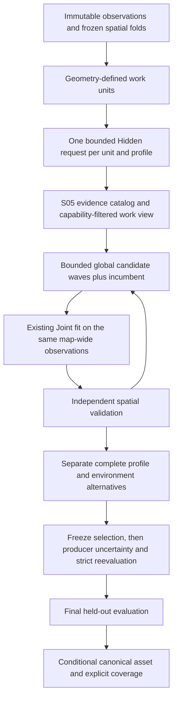

# X11: bounded scene-wide inverse-lighting orchestration

X11 removes the single-call 32-area admission barrier by invoking the existing
local provider in separate bounded jobs. It uses the existing S05 catalog and
Joint objective for combined scene models. **Completion of proposal work is not
recovery of original JA lights.** Stock compiler identity, source photometry and
physical ground truth remain unknown. No runtime consumer is added.

The input baseline is X10 commit `d9cfa13ec`, on `rend2-unified-wip`. The frozen
[manifest](../tools/rend2/scene_schedule/results/v1/manifest.json) records the
actual source/executable/BSP identities and numerical witnesses. The previous
[57-map audit](rend2-solver-stock-audit.md) remains historical evidence: 98
profile attempts on 49 maps stopped at the local-area limit. This task runs a
predeclared five-map scheduler regression, not a replacement 57-map recovery audit.

## Work graph and identity

`Core::SceneSchedule::Run` is a synchronous CPU entry point. A `Unit` has stable
map/geometry/profile/generation keys, source-search and receiver bounds, training
IDs, neighbour IDs, candidate/ray/work/memory allocations, completion status and
diagnostics. Neighbours are computational dependencies, never opaque-room or
PVS certificates. Region IDs remain optional context.

`Hidden::PlanAreas` exposes the existing geometry-driven cell construction
without running search or increasing `Hidden::Generate`'s local limit. Explicit
areas are accepted in sorted stable-ID order. Default cells use the declared
local scale and bounded source reach; the stock controller obtains that scale
from X10 footprint geometry. No validation or held-out RGB determines the cells.

Each local call has **one area and one profile**. Up to a bounded number of real
training receivers are selected by surface-balanced stable order. These are
distinct from the coarse global fitting subset. The X11 stock adapter retains
X10's larger training-only pool, rather than discarding every neighbourhood
outside its eight fitting jobs. It preserves the original folds and filtering
gaps. The initial pool itself remains bounded and geographically incomplete.

Local numerical generation hashes include selected geometry/RGB, material and
visibility interpretation, domain generation, profile features, source-search
bounds, trace rules, tolerances and local work policy. They exclude later Joint
optimizer settings and hidden targets. Unit IDs additionally distinguish the
declared profile/calibration/environment scope, while remaining unchanged under
amplitude-iteration setting changes. The whole graph/checkpoint key includes the
full producer dependency fingerprint and solver settings. Thus changing Joint
settings invalidates continuation but can reuse admissible local receipts.

Changes to a global static visibility generation invalidate its dependent
searches. This implementation does not pretend to have region-local geometry
dependency proofs when the supplied JA provider only has a whole-scene key.

## Local proposals, catalog and progressive selection

Local `Hidden::Result` leases preserve original evidence, candidate IDs, shape
alternatives, profile identity, support and incomplete-search reports. They are
aggregated in deterministic unit/record order into a stable provider namespace.
S05 consolidates explicit same-source attestations and identical source records.
Proximity/colour alone cannot merge two lamps. Coincident alternative proposals
without such evidence can remain separate; selection is not source certification.

Before consolidation, a bounded geometry/provider/class-stratified input pool
retains authored and generated evidence. Local source classes are interleaved;
authored providers get an independent share, rather than consuming every ticket
with area fragments. Original large immutable providers remain caller-owned.
Deferred input counts are explicit. Nothing constructs one enormous dense
source-by-luxel fitting matrix, and the stock adapter does not offer all emissive
fragments as simultaneous lights.

The canonical S05 catalog is preserved in diagnostics. A separate numerical
work view excludes models that the **existing** S05→Joint adapter cannot evaluate,
including transport-only records and multi-part fragment unions. Their evidence
is not converted into a point light. The derived view has its own key and retains
the original model IDs. Without this capability filter, a small wave budget can
be consumed completing unions that cannot enter Joint while usable lamps starve.

S05 cursors select profile-neutral and matching-profile candidates independently.
New tickets enter a wave with the preferred global incumbent. After every
source-count/type change, **the existing `Joint::Solve` refits and compares the
combined model**, including its black/boundary-only baseline. Retained sources
carry fitted values as warm starts, remain removable unless independently
protected, and are not summed with independently solved rooms.

Independent validation ranks waves using Joint's objective, geometry/material
priors, complexity and required-block gates. A predeclared bounded quota rule
requests remaining S05 candidates for positive validation blocks whose squared
error is at least half the black baseline. Public receiver bounds or certified
region context map this request to a work home. This is a scheduling heuristic,
not a calibrated probability or physical existence threshold. Final held-out
data cannot make these requests.

The first version expands **remaining catalog work**, not an unlimited new
target-dependent search. Deferred discovery can be run with a new explicit
local policy/area request and safe cache reuse. Automatic per-node continuation
inside an interrupted Hidden search, and an adaptive higher-resolution discovery
controller, remain unimplemented. These limits are reported, not called full
source-search convergence.

## Cross-region lighting and conditional components

Every wave uses the same admitted map-wide training and independent validation
geometry. A candidate's home affects scheduling only. All active sources are
evaluated against all admitted receivers using the existing forward/visibility
operators; no neighbour-list or region-ID mask clips illumination. The graph
therefore remains conservative when its optional neighbour index is incomplete.

A bounded influence diagnostic traces source-centre segments to representative
receivers in other units. It records visible/blocked/unknown outcomes with exact
geometry-query reliability. These rays are not a pruning mask, sky exposure
test, physical finite-source integral or substitute for strict fitting.

Profiles and mutually exclusive solar/environment scenarios are independent
`Producer::Request` branches, already scoped by `PrepareModelRequests` or explicit
caller priors. The scheduler never concatenates incompatible suns. The API can
compare branches on the same independent observations, retaining comparable
full-model alternatives. The stock adapter runs inverse-square and linear as
separate conditional trials; neither is the historical Raven default.

Optional sun/sky providers are handled before branch scheduling. A valid
direct-only conditional branch can run with unknown sun/GI. Absence of those
components is recorded as a model limitation, not verified physical zero.
Passive GI uses the supplied source-linked transfer/mapping and reflectance
contract. It is not recreated from observation folds or added as arbitrary patch
emission. Known boundary roots can support a positive no-local-lamp model.

Only after profile/model selection does the scheduler invoke the canonical
producer, retaining fitted values as starting candidates, strict reevaluation,
uncertainty and the final evaluation callback. There are no further parameter
updates after final evaluation. Comparable scope names and explicit per-unit
coverage limitations survive into `BuildAssessment`; an unresolved or partial
scene cannot certify the absence of lights elsewhere. Publication is data-only,
with existing consumer suitability gates unchanged.

`Producer::RebindProviders` retains the original immutable scoped provider
leases, outcomes and scenario diagnostics after source-value refitting. It
checks the original binding and pins observation, profile, calibration, root,
geometry and partition contracts; it cannot rerun an unavailable solar provider
or change its result to black. Source values, numerical budgets and contextual
coverage records can change under a new fingerprint. A publication regression
checks that provider assessments survive and that a changed scene is rejected.

## Correctness defects exposed by the integration

1. **Evidence index versus candidate index.** `Candidates::Model::primary` is an
   evidence reference. Producer previously used its index in the candidate array.
   Multi-evidence/compact catalogs can have more evidence than candidates. An
   initial hoth3 trial exited with access violation; vjun2 also exposed allocation
   failure in that experimental path. `Producer::MakeCandidate` now reads primary
   evidence through the canonical evidence reference and candidate aliases through
   a candidate-part reference, validating both spans. A controlled three-evidence/
   one-candidate regression checks the correct geometry and all provenance.
   The inferred out-of-bounds mechanism is independently demonstrated by those
   index domains; no completed debugger backtrace is claimed. A slow debugger
   replay was stopped after its bounded diagnostic attempt. Subsequent ordinary
   stock trials complete without the crash.
2. **Source-free shadow baseline.** Shadow association rejected an empty source
   set, so Joint's no-source baseline could fail before comparison. An empty set
   is now valid: eligible edges remain unassigned and pay the existing null
   association cost. Tests compare its loss with the all-zero-amplitude source
   case. It cannot erase observed positive light or edges.
3. **Blanket transport-only classification.** The old stock adapter set
   `transportSuspected=true` on every observation. Hidden then labelled all
   generated records transport-only. X11's dense training adapter leaves that
   flag false when there is no independent transport-only evidence. Since
   `directOnlyAttested` remains false, these hypotheses are explicitly
   `AmbiguousSourceOrTransport`, never verified emitters. Existing aperture
   evidence and explicitly supplied transport flags remain honoured. The frozen
   older audit is not rewritten.

`Producer` advances to version 3 for the contextual hypothesis/publication
identity, `Shadow` to version 2 for the baseline semantics, and the new scheduler
starts at version 1. Hidden's numerical search remains version 2; exposing area
planning/request identity does not change its formulas or raise its limit.
The raw `.jkobs` schema is unchanged.

## Budgets, continuation and limits

The general API bounds profile-expanded units (default 4,096), per-unit samples
(64), local candidates (12), catalog candidates (512), active proposal waves
(eight per branch), new candidates per wave (four), influence links (8,192),
neighbour links (16,384), GI links (65,536), retained memory, rays, forward calls
and deterministic work. One local job is active at a time. Existing Joint
source/observation/cache limits still apply independently. They are offline
numerical budgets, unrelated to Forward+, shadow maps or froxel allocation.

The frozen stock policy uses 48 local samples, an eight-node coarse Hidden
search, three proposals per unit, a 128-input catalog, two new candidates per
wave and four combined waves per profile. Joint's source capacity is eight and
candidate capacity 32; this small audit is explicitly not a full exhaustive
high-quality fit. Geometry/type/indirect refinement remain available in the
general Joint request, but the stock trial holds geometry fixed to isolate
orchestration and preserve a bounded comparable policy.

Core work/ray limits are deterministic. A separate accumulated wall-time guard
and the outer owned-process time/RSS watchdog are safety limits, not convergence
criteria. Actual peak process RSS is reported separately from conservative
container accounting. The outer policy is 600 seconds / 1 GiB per stock map;
only that exact owned child can be terminated. A hash-verified executable copy
prevents concurrent builds from replacing a running trial.

Opaque immutable checkpoints support cooperative continuation after unit
boundaries and cancellation, with accumulated work and completed receipts.
Changing map/profile/material/geometry/training or relevant settings rejects a
stale checkpoint. Only complete local searches and completed no-supported-evidence
admission decisions are reusable in the local cache; unavailable/partial
geometry does not become certified complete. A cached admission retains its
original incomplete physical-search coverage.

Resume/cache here are **in-process immutable leases**, not serialized
cross-process checkpoints or game map-load caches. Progress JSON survives an OS
kill for diagnosis, but cannot resume arbitrary internal optimizer/provider
state. There is no claim of persistent production game cache readiness.

## Controlled validation

The executable reuses the owned S10/S11/S13 geometry/forward/validation fixtures.
The positive source experiment is named `SuppliedFixedGeometrySceneSchedule`:
candidate XYZ/type are allowed inputs, RGB amplitudes and independent targets
are withheld. It demonstrates orchestration, not source-position discovery.

Tests include more than 32 jobs, before/after local-limit behaviour, two coloured
sources, an emitter visible from three computational units, known wall blockage,
same-source evidence from multiple providers, two nearby distinct authored
identities, stable IDs under ordering/optimizer changes, conflicting profile/gain
branches, unknown historical discovery profile, missing validation, work limits,
cancellation/restart and stale geometry. A prescribed sky-root/reflector case
has positive indirect-only receivers and requires no local physical lamp.
Canonical publication and payload validation occur only through the existing
producer; final callback reuse does not invoke final evaluation again.

Full assertion counts, measured amplitudes, interval error/black baseline and
resource records are in the [controlled witness](../tools/rend2/scene_schedule/results/v1/controlled.json)
and [check record](../tools/rend2/scene_schedule/results/v1/checks.json).

The final scheduler executable passes **235 assertions** twice identically.
The complete CPU suite passes **35/35 tests** in 287.73 seconds, including the
existing visibility, regions, bake forward, amplitude/position/shape fitting,
shadow, passive transport, joint, provider and publication regressions. Two
Python scheduler-report tests, four stock-audit tests and seven blind-view tests
pass. GCC Release standalone and both MSBuild SP/MP Rend2 Release DLL targets
build. Architecture auditing reports no forbidden renderer dependencies. No
game/GL visual test or new compiler rebake is claimed.

For the supplied-XYZ two-colour control, fitted relative RGB values are
`(3.2999382,0.0999112,0.2006225)` and `(0.1002248,0.3000665,2.0992136)`, against
withheld amplitudes `(3.3,0.1,0.2)` and `(0.1,0.3,2.1)`. RGB L2 errors are
`0.0006319` and `0.0008206`. Validation interval MSE is `1.53945e-8`, versus
black MSE `1.168505`. These are scene-linear relative values under the specified
physical-integral fixture, not candela or a numeric UnknownProfile bake law.
The broader control emits one global two-source fit over 50 units. A separate
three-unit positive visibility case verifies cross-unit illumination; distant
receivers behind the known room wall remain blocked. The measured complete
controlled executable took 0.734 seconds with 10.79 MiB actual peak RSS.

All frozen assertions, completed stock repeats and failed earlier attempts are
recorded separately. The initial stock crash and Windows executable-lock build
failure are not reclassified as passes. Final tests run after the fixes and the
scoped provider-diagnostic publication check.

## Stock experiment scope

The predeclared maps are `mp/duel4` (small MP), `t1_inter` (enclosed SP),
`t1_danger` (previously unavailable solar evidence), `hoth3` and `vjun2` (hundreds/
thousands of geometry-defined areas). Existing licensed all-pages archives,
original hashes and immutable X10 folds are reused. No game or new asset export
is needed. The JSON records every unit, local outcome, candidate count, strict
fit attempts/rejection reasons, deferred work, rays and resource counters.
Private unit TSVs retain receiver bounds. Proprietary geometry/target RGB are
not committed.

| Map | Previous audit stop (Joint not started) | Units per profile | Units proposing candidates | Candidate records isq / linear | Joint calls isq / linear | Accepted / final held-out |
|---|---|---:|---:|---:|---:|---:|
| mp/duel4 | Insufficient local observation support | 25 | 6 | 6 / 8 | 4 / 4 | 0 / not evaluated |
| t1_inter | Insufficient local observation support | 479 | 171 | 171 / 171 | 4 / 4 | 0 / not evaluated |
| t1_danger | Unavailable solar evidence | 89 | 38 | 39 / 39 | 4 / 4 | 0 / not evaluated |
| hoth3 | 32-area limit | 853 | 243 | 251 / 251 | 4 / 4 | 0 / not evaluated |
| vjun2 | 32-area limit | 2,381 | 393 | 474 / 441 | 4 / 4 | 0 / not evaluated |

The two trials share the same geometry/folds and differ only in the declared
conditional attenuation profile. All **3,827 units per profile** were attempted.
Local execution completion is not exhaustive search: the eight-node cap,
unsupported receivers and no-evidence admissions retain incomplete coverage.
The new X10 dense training pool differs from the old sparse audit; these are
stage comparisons, not a claim that sharding alone caused every improvement.
The controlled 50-unit test isolates the old/new area-limit behaviour with
identical input geometry and observations.

| Map | Local status counts: no evidence / unsupported / partial / produced (isq) | Total rays isq / linear | Deterministic work isq / linear | Wall seconds, repeated whole-map trials | Max process RSS MiB |
|---|---:|---:|---:|---:|---:|
| mp/duel4 | 19 / 0 / 6 / 0 | 370 / 370 | 57,562 / 57,562 | 11.422 / 7.500 | 30.34 |
| t1_inter | 308 / 0 / 171 / 0 | 14,117 / 14,121 | 3,904,269 / 3,904,757 | 13.719 / 12.297 | 30.56 |
| t1_danger | 45 / 6 / 37 / 1 | 1,887 / 1,887 | 502,398 / 502,398 | 60.218 / 45.515 | 42.63 |
| hoth3 | 607 / 3 / 231 / 12 | 11,803 / 11,800 | 6,260,832 / 6,260,607 | 38.297 / 36.609 | 101.64 |
| vjun2 | 1951 / 37 / 348 / 45 | 13,357 / 13,359 | 25,309,031 / 25,309,153 | 49.672 / 48.625 | 105.05 |

Wall/RSS include source import, X10 selection, transport preparation and both
profile trials. They are not isolated optimizer CPU times. Concurrent test/
build activity affects wall time; numerical work is the reproducible cost
measure. Both complete repeated runs have identical semantic outcomes.
Every profile branch ends `InsufficientSignal` with no supported preferred
model. Four baseline fits run, but the offered finite-source models fail
placement/support/path constraints (six rejections on duel4, eight on each
other map); duel4 additionally records two missing-comparable-coverage
rejections. Empty reason strings on baseline attempts mean valid numerical
baselines, not successful physical source recovery.

Deferred input/model work remains material: the isq branch reports
1,865 / 168 / 1,153 / 855 / 11,421 deferred records/models respectively.
These counters refer to different scheduling stages and must not be summed
as independent missing lamps. The S05 model count can exceed its input-row
budget because one input can have several explicit shape alternatives.
No final held-out values guide these negative model-selection outcomes.

No stock XYZ/source-count/SI accuracy is calculated without ground truth. A
completed local call, or merely reaching Joint, is not a completed physical fit.
Where no supported preferred model survives independent validation, final
held-out evaluation is **not performed** and no physical emitter is published.

## Reproduction and next engineering decisions

See the [standalone commands](../tools/rend2/scene_schedule/README.md), frozen
source/executable hashes and JSON verification. This is a CPU-only orchestration
layer; ordinary renderer loading does not call it.

Remaining bottlenecks must be diagnosed from the per-wave rejected models and
spatial coverage, rather than by disabling geometry checks or fitting black.
Useful next work includes geometry-aware admissible-candidate prioritization,
representative held-out support for those candidates, adaptive rediscovery of
deferred areas, persistent offline job storage and a larger, independently
frozen global-search budget. Unknown profiles/materials and unresolved GI remain
scientific limitations even after the area-count barrier is removed.
