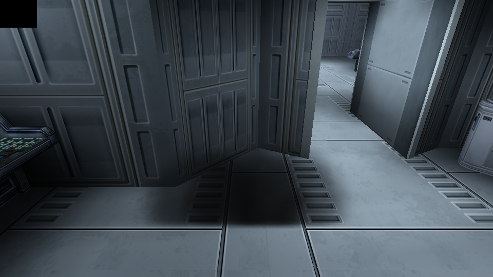
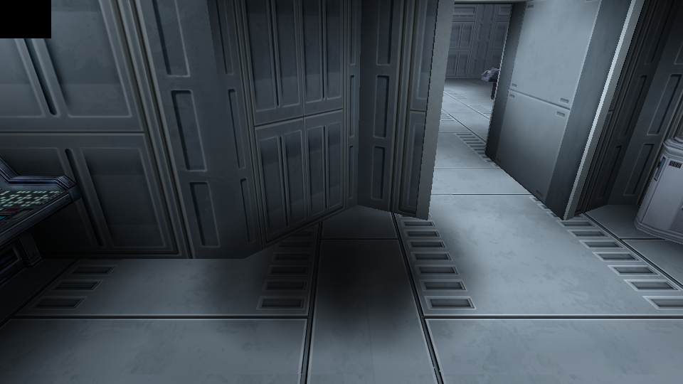
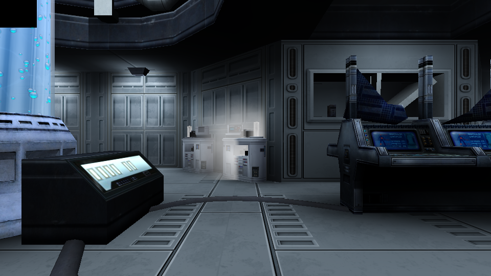
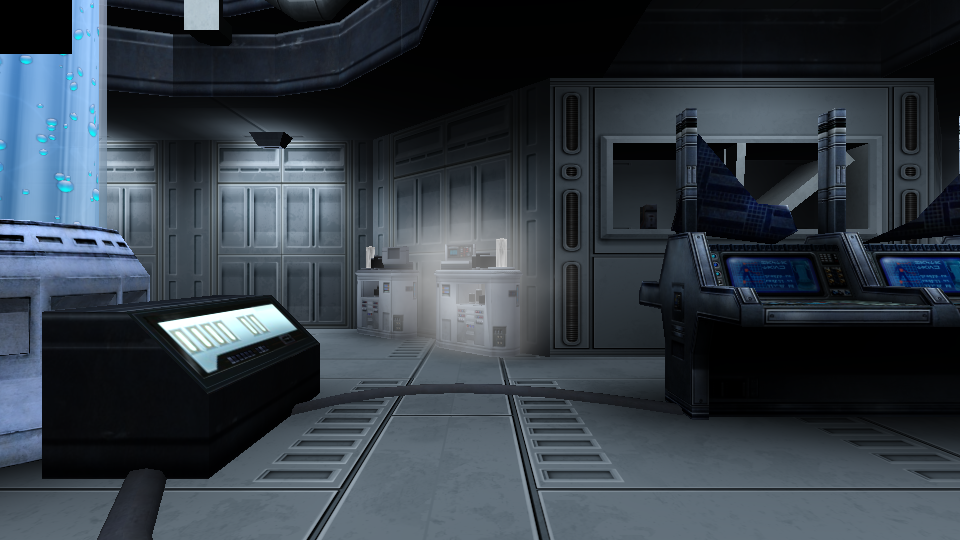
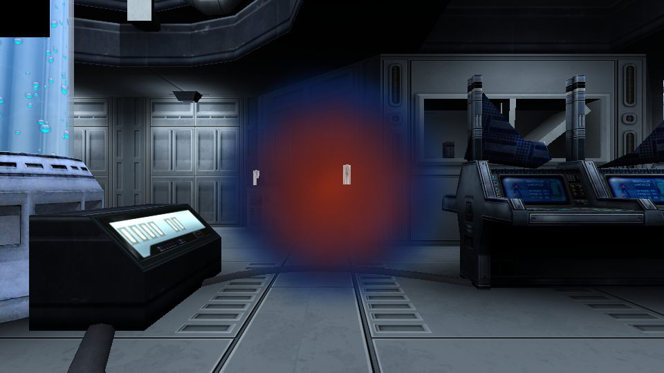
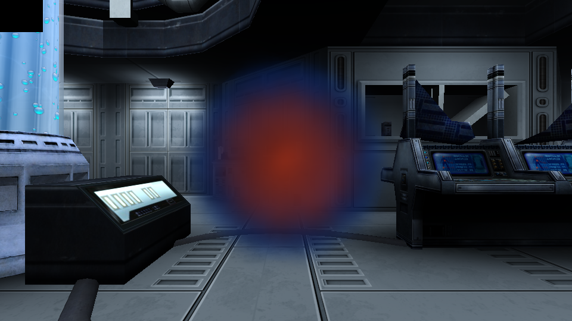

# Stock smoke contact and transparency: benchmark and visual report

The implementation was developed in `codex/ja-smoke-volume` and fast-forwarded
into `rend2-unified-wip`. It orders compatible glass and smoke as whole material
packets, adds a rounded view-depth contact approximation for simple stock
billboards, and makes all ten particle feature controls latched. Complex
materials keep their original UV streams and flat contact path.

The measurements and source hashes refer to FX snapshot `01c027c1b` on the
`d6d239a65` base. After measurement, the independent character-culling update
`0704783af` was integrated in `3bfcb4d16`. The combined SP/MP build, 25 character
culling checks, and native glass/mixed-quad scenes passed. The integrated run
also verified all ten latch transitions and a hidden, clean process exit.
These final integration checks are not additional performance measurements.

The subsequently committed rendering defaults `898a28649` were also preserved
in `3f2d9c624`. The final combined SP/MP build and the same two native scenes
passed again, including all ten latch transitions and a hidden clean exit.
Performance tables continue to describe the isolated FX snapshot above.

## Method

- Native JA SP, stock Hoth3 and assets0–3 only; isolated home for every variant.
  NVIDIA GeForce RTX 2060, Intel Core i7-10750H, Windows 10 build 19045.
- Release GCC C++14 build; both SP and MP engines/renderers compile. Native
  gameplay captures exercise SP. The unrelated relighting/volumetric edits in
  the original working tree were preserved and were not benchmark inputs.
- Each variant starts a separate hidden process with sound disabled and mouse
  input/capture disabled. The harness rejects any visible process-owned window.
- Exact developer camera; frozen FX simulation for measured frames; shader
  clock held at 1000 ms. Repeated full-frame screenshots must agree within one
  display code in at most 0.02% of pixels (0.05% for MSAA). Smoke must also measurably differ
  from a no-smoke control. Contact A/B requires ≥2000 pixels changed by ≥12.
- Per measured case: disable the game's frame cap while paused, warm up 600 waits,
  sample 640 waits and discard the first 30 records. **290 records remain**.
  The 60 FPS cap is restored for camera/FX setup and captures.
- GPU is the existing Main View timestamp interval, including the ordinary
  scene; CPU is main-pass recording + submission, not total game-frame time.
  The primary series uses **buffered CPU and GPU records** (`r_particleProfile 2`)
  and dumps complete lines only after sampling. Both per-frame console output
  and the engine's unbuffered log writes are absent from the measured loop.
  The bounded 1 MiB buffer reports overflow, which fails the capture check.
  GL API validation
  uses separate runs; its verbose debug callbacks can distort timing. The
  earlier streamed and combined MSAA debug/timing runs are retained as diagnostic datasets.
  The final MSAA timing table uses the release context. p95 is the sorted 95th percentile.
- GPU clocks are not locked. Read-only NVIDIA telemetry accompanies follow-up
  runs. Thermal/power-state changes can affect comparisons; percentages below
  must be read together with absolute times and repeats, not as an FPS promise.
- The first capped runs (`smoke-bench-540`, `smoke-bench-1080`) are retained as
  diagnostics, not the performance basis: even an unchanged empty 1080p view
  changed several-fold as the hidden, mostly idle GPU changed power state.
- One earlier streamed MSAA run reached the 300-second harness deadline after
  its final benchmark/end marker and all captures had been written. Its complete
  data were analyzed separately, retaining the timeout/monitor evidence. It is
  not counted as a clean process exit. All primary buffered runs exited normally.

`previous` retains the preceding 52c2cf8be feature settings (soft/near fade,
particle-only order, batching and demand depth). `flat` adds the glass packet
fix with the preceding fixed contact distance. `volume` uses all new defaults.
`legacy` switches all ten feature controls off, including the formerly
unconditional stable ties and entity-isolation changes. `adaptive` was also
visually checked in the diagnostic matrix, but is not a separate final table.
The primary series was collected on 2026-11-25. Earlier 2026-11-23 streamed
series are retained with their original status and protocol. A dash in a table
means that intermediate mode was not measured in that series.

## Cases

`empty` has no injected particles. `tiny64`/`tiny512` are 64/512 radius-2
sprites; `large64` is 64 radius-20 sprites; `fill128` is 128 radius-36 sprites
at distance 64 (deliberately extreme overdraw). `mixed` interleaves 48 colored
sprites, two materials and distinct depths. `glass` puts near red and far blue
clouds before the stock infirmary glass tubes. `wall` probes opaque contact;
`floor` uses 12 radius-28 puffs and `floor_detail` uses three. `floor_mix`
alternates sprites and oriented quads sharing one material. `near` exercises
near-plane fading; `additive` uses 128 stock flame sprites. `stock` and
`stock_clear` invoke unmodified `volumetric/black_smoke2.efx`; `stock_short`
invokes `volumetric/black_smoke.efx`. The long-lived stock effect rises toward
the dark ceiling, so it is a runtime workload, not the main visual evidence.
Diagnostic cloud colors and positions are controlled renderer fixtures; stock
textures/materials and the production draw path are retained.

## 960×540, no MSAA

| Case | Previous GPU ms | Glass fix + flat ms | Rounded GPU ms | Rounded delta | GPU p95 previous → rounded ms |
| --- | ---: | ---: | ---: | ---: | ---: |
| empty | 0.205 | — | 0.207 | +0.002 (+1.0%) | 0.208 → 0.211 |
| tiny64 | 0.248 | — | 0.256 | +0.008 (+3.2%) | 0.252 → 0.259 |
| tiny512 | 0.276 | — | 0.280 | +0.004 (+1.4%) | 0.280 → 0.284 |
| large64 | 0.507 | — | 0.511 | +0.004 (+0.8%) | 0.515 → 0.518 |
| fill128 | 2.548 | — | 2.645 | +0.097 (+3.8%) | 2.594 → 2.696 |
| mixed | 0.493 | — | 0.502 | +0.009 (+1.8%) | 0.500 → 0.512 |
| glass | 0.369 | — | 0.375 | +0.006 (+1.6%) | 0.375 → 0.381 |
| wall | 0.257 | — | 0.268 | +0.011 (+4.3%) | 0.262 → 0.271 |
| floor | 0.275 | — | 0.284 | +0.009 (+3.3%) | 0.279 → 0.289 |
| floor_mix | 0.276 | — | 0.287 | +0.011 (+4.0%) | 0.280 → 0.296 |
| near | 0.346 | — | 0.366 | +0.020 (+5.8%) | 0.350 → 0.383 |
| additive | 0.454 | — | 0.495 | +0.041 (+9.0%) | 0.463 → 0.508 |
| stock_short | 0.295 | — | 0.282 | -0.013 (-4.4%) | 0.302 → 0.306 |

| Case | CPU median previous → rounded ms | CPU p95 previous → rounded ms | Tagged particle draws | Depth copies |
| --- | ---: | ---: | ---: | ---: |
| empty | 0.251 → 0.294 | 0.294 → 0.363 | 0 → 0 | 0 → 0 |
| tiny64 | 0.300 → 0.362 | 0.337 → 0.415 | 1 → 1 | 1 → 1 |
| tiny512 | 0.419 → 0.465 | 0.460 → 0.510 | 3 → 3 | 1 → 1 |
| large64 | 0.321 → 0.374 | 0.369 → 0.424 | 1 → 1 | 1 → 1 |
| fill128 | 0.366 → 0.409 | 0.472 → 0.464 | 1 → 1 | 1 → 1 |
| mixed | 0.392 → 0.447 | 0.457 → 0.657 | 20 → 20 | 1 → 1 |
| glass | 0.343 → 0.372 | 0.405 → 0.472 | 2 → 2 | 1 → 1 |
| wall | 0.341 → 0.428 | 0.549 → 0.742 | 1 → 1 | 1 → 1 |
| floor | 0.358 → 0.435 | 0.428 → 0.512 | 1 → 1 | 1 → 1 |
| floor_mix | 0.363 → 0.429 | 0.421 → 0.582 | 1 → 2 | 1 → 1 |
| near | 0.425 → 0.450 | 0.698 → 0.612 | 1 → 1 | 1 → 1 |
| additive | 0.329 → 0.408 | 0.392 → 0.547 | 0 → 0 | 0 → 0 |
| stock_short | 0.400 → 0.415 | 0.583 → 0.546 | 1 → 1 | 1 → 1 |

## 1920×1080, no MSAA

| Case | Previous GPU ms | Glass fix + flat ms | Rounded GPU ms | Rounded delta | GPU p95 previous → rounded ms |
| --- | ---: | ---: | ---: | ---: | ---: |
| empty | 0.524 | — | 0.539 | +0.015 (+2.9%) | 0.532 → 0.545 |
| tiny512 | 0.772 | — | 0.782 | +0.010 (+1.3%) | 0.784 → 0.792 |
| fill128 | 8.867 | — | 9.003 | +0.136 (+1.5%) | 9.006 → 9.200 |
| mixed | 1.321 | — | 1.271 | -0.050 (-3.8%) | 1.436 → 1.283 |
| glass | 1.149 | — | 1.173 | +0.024 (+2.1%) | 1.176 → 1.195 |
| floor | 0.829 | — | 0.844 | +0.015 (+1.8%) | 0.842 → 0.881 |
| stock_short | 0.778 | — | 0.787 | +0.009 (+1.2%) | 0.793 → 0.807 |

| Case | CPU median previous → rounded ms | CPU p95 previous → rounded ms | Tagged particle draws | Depth copies |
| --- | ---: | ---: | ---: | ---: |
| empty | 0.351 → 0.263 | 0.582 → 0.301 | 0 → 0 | 0 → 0 |
| tiny512 | 0.494 → 0.521 | 0.665 → 0.642 | 3 → 3 | 1 → 1 |
| fill128 | 0.428 → 0.570 | 0.609 → 0.805 | 1 → 1 | 1 → 1 |
| mixed | 0.413 → 0.425 | 0.535 → 0.524 | 20 → 20 | 1 → 1 |
| glass | 0.396 → 0.381 | 0.537 → 0.542 | 2 → 2 | 1 → 1 |
| floor | 0.362 → 0.556 | 0.436 → 0.843 | 1 → 1 | 1 → 1 |
| stock_short | 0.337 → 0.469 | 0.411 → 0.648 | 1 → 1 | 1 → 1 |

## 960×540, MSAA 4×

| Case | Previous GPU ms | Glass fix + flat ms | Rounded GPU ms | Rounded delta | GPU p95 previous → rounded ms |
| --- | ---: | ---: | ---: | ---: | ---: |
| empty | 0.358 | — | 0.358 | +0.001 (+0.1%) | 0.361 → 0.362 |
| fill128 | 4.868 | — | 4.924 | +0.056 (+1.1%) | 5.247 → 5.252 |
| mixed | 0.848 | — | 0.854 | +0.006 (+0.7%) | 0.862 → 0.883 |
| glass | 0.742 | — | 0.764 | +0.022 (+3.0%) | 0.749 → 0.774 |
| floor_mix | 0.514 | — | 0.515 | +0.001 (+0.2%) | 0.524 → 0.526 |

| Case | CPU median previous → rounded ms | CPU p95 previous → rounded ms | Tagged particle draws | Depth copies |
| --- | ---: | ---: | ---: | ---: |
| empty | 0.301 → 0.274 | 0.338 → 0.304 | 0 → 0 | 0 → 0 |
| fill128 | 0.450 → 0.499 | 0.687 → 1.276 | 1 → 1 | 1 → 1 |
| mixed | 0.426 → 0.476 | 0.465 → 0.551 | 20 → 20 | 1 → 1 |
| glass | 0.375 → 0.411 | 0.406 → 0.455 | 2 → 2 | 1 → 1 |
| floor_mix | 0.406 → 0.465 | 0.466 → 0.503 | 1 → 2 | 1 → 1 |

## Repeated dense floor and fill cases

The earlier streamed matrix recorded a 1.163 ms rounded floor outlier versus
0.344 ms previously. A separate previous → volume → flat sequence tested the
same captures again with read-only GPU telemetry. These are exploratory data,
not the primary buffered series above. The original results are retained.

| Mode | Floor median / p95 ms | Three-puff floor median ms | Fill median / p95 ms |
| --- | ---: | ---: | ---: |
| previous | 0.286 / 0.289 | 0.248 | 2.732 / 3.160 |
| volume | 0.295 / 0.298 | 0.251 | 3.138 / 3.183 |
| flat | 0.287 / 0.291 | 0.259 | 3.216 / 3.270 |

## Optional existing froxel/media path

This is an integration check of the existing optional path, not a newly
introduced smoke simulator. The media preset enables existing froxel fog and
particle lighting plus explicit physicalization opt-in for the two stock smoke
effects. Temporal filtering is disabled for deterministic captures.

This earlier integration run streamed its records. Its timings are retained
for inspection; it is not the basis for the final performance comparison.

| Case | Flat GPU median / p95 ms | Rounded GPU median / p95 ms | CPU median flat → rounded ms |
| --- | ---: | ---: | ---: |
| floor | 4.278 / 20.335 | 5.688 / 15.847 | 1.004 → 1.115 |
| glass | 20.909 / 44.038 | 5.296 / 6.750 | 1.042 → 1.171 |
| stock_short | 4.269 / 6.414 | 5.668 / 21.803 | 0.993 → 1.135 |

## Shader optimization and repeats

The rounded path now bypasses square-root/division/optical conversion when the
whole interval is visible, and directly returns zero when fully occluded.
The partial-contact formula and raster proxy are unchanged. A separate
1920×1080 A/B/A sequence uses the preserved pre-optimization renderer, the new
renderer, then the preserved renderer again. These runs use the release GL
context and the same buffered profiler and batch-state fix; only the contact
shader differs. Their full-frame image differences are retained in the result JSON.

| Case | Before A GPU median / p95 ms | Optimized GPU median / p95 ms | Before B GPU median / p95 ms | Optimized repeat GPU median / p95 ms |
| --- | ---: | ---: | ---: | ---: |
| fill128 | 9.146 / 9.942 | 9.302 / 11.190 | 9.186 / 9.341 | 8.341 / 9.331 |
| mixed | 1.337 / 1.645 | 2.184 / 7.442 | 1.276 / 1.296 | 3.632 / 7.611 |
| floor | 0.896 / 0.913 | 1.138 / 1.262 | 0.893 / 0.908 | 0.725 / 1.422 |

The isolated optimization series was unstable: the new-shader process had
higher CPU times, and its repeat also varied. These measurements do **not**
establish a shader speedup. The fast interval paths remove redundant arithmetic
and retain the optical formula. In the primary old-feature/new-feature matrix,
the largest GPU increase was 0.136 ms and the largest CPU-main increase 0.194 ms.
No substantial default-path slowdown was reproduced in that matrix. This is a
statement about these controlled scenes, not a guarantee for all maps/hardware.

Full-frame buffered 1080p old/new images differ at one fixed screen pixel
(1796,972), by at most three display codes. The pixel already differs in the
no-smoke controls, and the old/old repeat changes it by one code. The counts and
bounding box are retained without masking. The earlier streamed shader
comparison was bit-identical in all three scenes. MSAA results are reported below.

NVIDIA telemetry was sampled approximately four times per second over the
begin/end window (including the final dump). Console timestamps have one-second
precision. These descriptive clock samples are not used to normalize GPU times.

| Shader run, fill128 | Graphics clock min / median / max MHz | Maximum temperature °C |
| --- | ---: | ---: |
| opt_before_a | 1230 / 1380 / 1680 | 86 |
| opt_after | 1005 / 1425 / 1680 | 87 |
| opt_before_b | 1350 / 1387.5 / 1815 | 86 |
| opt_new_repeat | 1230 / 1515 / 1845 | 86 |


The batch-state review also found that sprites using rounded contact could
merge with oriented quads requiring flat contact. The batch boundary now
includes that mode difference, including the legacy entity-merge fallback.
Nine native 4×MSAA fixtures compare batched and unbatched output. An initial
stress repeat changed 119 of 518,400 pixels by exactly one display code,
exceeding the former 0.02% bound; the MSAA-only bound is now 0.05%, with the
one-code maximum retained. The actual counts remain recorded. Contact A/B
visibility requirements are unchanged. Current batched/unbatched differences
are at most 101 one-code pixels; six old/new MSAA comparisons are at most 33.

## Legacy comparison with the original renderer

The legacy preset is compared against e29efa43b on nine complete frames,
including tiny/large sprites, dense overdraw, mixed materials/colors, glass,
near-plane and additive cases. The original renderer receives identical
capture-only scene inputs. The result table below reports full-frame changes,
not cropped regions.

| Case | Maximum channel delta | Changed pixels | Changed by ≥12 |
| --- | ---: | ---: | ---: |
| empty | 0 | 0 | 0 |
| tiny64 | 0 | 0 | 0 |
| tiny512 | 0 | 0 | 0 |
| large64 | 0 | 0 | 0 |
| fill128 | 0 | 0 | 0 |
| mixed | 0 | 0 | 0 |
| glass | 0 | 0 | 0 |
| near | 0 | 0 | 0 |
| additive | 0 | 0 | 0 |

## Visual evidence

These are unchanged native 960×540 screenshots. The floor/wall comparisons isolate
rounded contact (`adaptive` → `volume`, changing only `r_particleVolume`); the dark cloud is centered over the floor
panels. The wall comparison uses white stock smoke. The glass comparison uses
diagnostic red/blue smoke to expose the incorrectly late reflection pass. The
black patch at the upper left is the capture UI's uninitialized cursor handle,
common to controls, not a particle artifact.

Floor before:



Floor after:



Wall before / after:




Glass before / after:




The rounded path estimates thickness from the existing sprite radius and UVs.
It clips the view-depth interval against opaque depth and maps the visible
fraction through optical opacity, preserving fully visible authored alpha.
This improves contact appearance; it does not add ground-flow, pressure,
advection, collision response or true 3D density. Center sorting also cannot
solve arbitrary intersecting translucent meshes or cross authored render layers.

## Compatibility and validation

- All ten controls are archived and latched. The native test changes every
  value, verifies old active/new pending values and an unchanged frame, then
  checks that every new value applies after `vid_restart`.
- Legacy reference: separately built e29efa43b, before the first particle
  changes. Only hidden-window/no-dialog capture support, the fixed camera,
  diagnostic shader clock and identical test-cloud inputs were backported;
  renderer algorithms are original. The capture-only reference patch is retained.
- 68 production fragment-shader checks, 20,000 conservative visibility checks,
  and 2,000 shuffled/interleaved ordering sets pass. Native cases also exercise
  the production vertex proxy, uploads, batching and MSAA depth resolve.
- Full legacy and modern presets are in `docs/samples/particles-legacy.cfg`
  and `particles-modern.cfg`; restart is included. They control this particle
  feature set while other renderer options remain independent.

## Reproduction and raw results

Run `tools/rend2/capture_smoke_volume.py --help`. Supply a build containing the
SP EXE, game/renderer DLLs and GLSL compiler, plus a stock-only installation.
The harness creates isolated homes. For example:

```powershell
python tools/rend2/capture_smoke_volume.py --binaries <build> --installation <stock> --output build/smoke-check --variants previous flat volume legacy --benchmark --latch-check
```

Use `--width 1920 --height 1080` for 1080p, `--msaa 4` for MSAA, and
`--lighting media` for the optional integration path. `--cases` selects the
case list recorded above. Raw TGA captures, PNG repeats, autoexec scripts and
full `qconsole.log` records are retained under each `build/<dataset>/<variant>`.
Those unversioned directories are in the benchmark worktree
`C:/Users/Keyten/.codex/worktrees/ja-smoke-volume/OpenJK-rend2`, not the original
checkout. The versioned images and JSON remain available after the merge.
The versioned JSON below retains all reported medians, p95, draw counts,
presence/control deltas and latch results; image hashes refer to exact files.

[Machine-readable results](rend2-particle-benchmark-2026-11-25.json)

[Capture-only reference patch](rend2-particles-evidence/reference-capture.patch.zip)
