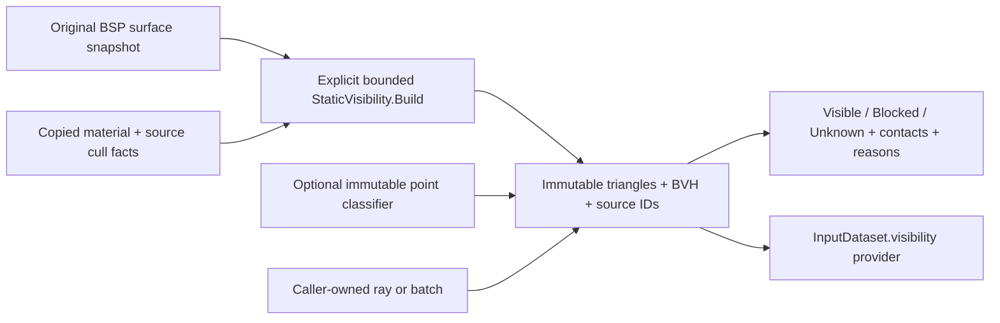

# Static geometry visibility for reconstruction

`shared/rd-rend2/lightrecon/visibility.h/.cpp` implements a C++11 CPU ray layer
over immutable original BSP surface snapshots. It is shared by SP, MP and the
standalone test target. Building it is an explicit synchronous operation; no map
load, lighting query, cvar or consumer automatically constructs a BVH. There is
no inverse solver, source fitting, gameplay collision replacement, new shadow
pass, GPU resource, disk read or global ray cache.



## Geometry authority and collision differences

Lighting intersection uses renderer-visible **model 0 source surfaces**: indexed
faces, triangle soups and quadratic patch control nets retained before the BSP
file is released. Brushes do not directly provide textured triangle geometry.
Static brush *faces* are already represented in this surface set. No camera,
atlas, lightmap availability, current patch LOD, runtime hunk pointer or dynamic
entity is needed. Visibility patches do not require affine lightmap UVs.

The inspected engine paths have different purposes:

| Existing structure/path | Why it is not the optical authority |
| --- | --- |
| `tr_staticlighting.cpp::R_StaticLightTrace` | Boolean collision test using `CONTENTS_SOLID`; no render surface/material identity or partial optical state |
| `R_StaticSkyTrace` | Requires collision `SURF_SKY`; still inherits collision geometry/contents |
| `R_SunVisibleFromPoint` / `R_StaticSunVisible` | Also accepts a completely unobstructed 65,536-unit collision trace as sun visibility; that does not prove a sky boundary |
| SP `R_StaticTrace` | Calls `SV_Trace`; the server trace can include solid entities, rather than being an immutable static surface query |
| MP `R_StaticTrace` | Calls model-0 `CM_BoxTrace`; collision brushes and patch facets still differ from drawing |
| `cm_load.cpp`, `cm_trace.cpp`, `cm_patch.cpp` | Content masks, convex brush sides, collision facets and collision-specific tolerances can omit visual detail, include invisible clips, or approximate patches differently |
| `R_LoadNodesAndLeafs` | Renderer nodes retain planes, marksurfaces, clusters and areas, not a complete solid-volume classification |
| `R_LoadVisibility` / shared PVS | Potential cluster visibility; an opaque wall can remain between two points in the same potentially visible set |

No PVS is consumed by the new API. A future conservative filter can reject work
only under a separately documented contract; it must never certify optical LOS.
Collision/brush contents can be injected for **origin-domain diagnostics**, kept
separate from renderer-triangle intersection. No existing collision or static
lighting function is modified or redirected to this module.

## Public API, errors and lifetime

| Entry point | Contract |
| --- | --- |
| `StaticVisibility::Build` | Validates and copies requested static geometry, builds one BVH, publishes `shared_ptr<const StaticVisibility>` only on success; clears output on failure |
| `VisibilityProvider::Query` / `StaticVisibility::Query` | One read-only structured ray; legacy providers default to `Unavailable` |
| `VisibilityProvider::Batch` (inherited by `StaticVisibility`) | Caller-owned arrays, no per-ray allocation; reports exact completed prefix on an error; zero-length batch is valid |
| `Report`, `GeometryIdentity`, `Surfaces` | Const metadata views; no new work or copying of geometry |
| `PointClassifier::Classify` | Optional injected immutable, thread-safe `Free/Solid/Boundary/Unknown` domain oracle |
| `Segment`, `Sky` | Compatibility with the existing scalar input provider; only a `Geometric` non-unknown answer becomes 0/1; otherwise `Unavailable` without changing the output scalar |

Assign the published scene to `InputDataset.visibility` to reuse it from a future
algorithm. This does not install it into renderer lighting or create an output
asset `VisibilityData` capability: it is an **input geometry query provider**.

Source surface IDs are original BSP ordinal + 1 (0 means unspecified); material
IDs are original shader-table indices (0 is a valid material). Triangle ID is
`(surfaceId << 32) | (localTriangleOrdinal + 1)`. BVH partition order does not
renumber triangles. Patch tessellation options change local triangle IDs. Scope
IDs to the retained scene and its source-map SHA256, module version and build
options; the BSP hash alone is not a complete material/reconstruction cache key.
Never reuse a previous scene's triangle ID to suppress a new map's intersection.

The scene owns triangle positions, minimal surface metadata, BVH nodes and map
identity. It releases its input geometry lease after construction, without
retaining source vertices, images, decoded lighting or texture pixels. It pins
only an optional caller-supplied domain provider. Query results contain values
and IDs, with no borrowed triangle/world pointers. Keep a scene lease while using
its metadata views; as with all module-owned STL leases, release it before a
renderer DLL unload. No hidden threads or shared mutable traversal scratch exist.
Each query uses a fixed local stack; independent threads may share the scene.
Injected classifiers must uphold the same lifetime/thread-safety contract.

Errors (`Error.code`) are distinct from an optically uncertain successful query:
`MissingGeometry`, `InvalidInput`, `MemoryLimit`, `WorkLimit`, `Cancelled`,
`ProviderError`, and base-provider `Unavailable`. Bad/throwing point providers
propagate failure. A failed query clears its result to `Unknown`; batch entries
after the completed prefix must not be consumed. No half-built BVH is published.

## Coordinates, contact and policies

Positions, distances, bias, patch tolerance and footprints use world units.
Geometry is right-handed; triangle normal is normalized
`cross(v1-v0,v2-v0)`. A ray points **receiver/start toward target/sky**, not in the
direction of light propagation. No RGB output or photometric conversion occurs.
Geometry metres policy therefore does not calibrate baked light or this query.

`RayPurpose` distinguishes Segment, Shadow, Sun, Sky and IrradianceProbe.
Segment/Shadow/Probe test the finite closed segment; Sun/Sky additionally require
an actual sky triangle before the supplied end. The scalar `Sky` adapter derives
a finite endpoint beyond this scene's bounds instead of using a guessed sun
distance. An empty scene can describe a clear finite segment when its origin is
known free, but **cannot establish sky**.

`RayResult` separates `Visible/Blocked/Unknown`, `SkyReach`, reliability, origin
domain and named `RayIssue` bits. `firstHit` is the nearest geometric event or
conservative candidate; `terminalHit` can be a later definite opaque/sky contact.
For example, a grate followed by an opaque wall is definitely blocked along the
straight ray; the first contact still identifies the uncertain grate. A sky
polygon is a boundary, not a portal permitting a segment to an arbitrary target
beyond it. Coincident sky/opaque contacts are explicitly uncertain.

For a triangle hit, `positionKnown=true`, `distanceWorld` is Euclidean distance
from the **original** start, and `parameter` is the fraction of the effective
(possibly biased) segment. A conservative AABB candidate has no invented exact
position, normal, distance or parameter; use its effective-origin near/far
interval, surface ID and uncertainty instead. Contacts are bounded value types.

| Surface policy | Default result when it determines LOS |
| --- | --- |
| Known opaque, including ordinary opaque emissive/unlit sheets | Blocked at the first accepted triangle |
| Sky | Reached only for a Sun/Sky purpose and an unobscured actual boundary |
| Alpha-tested grate/cutout | Unknown; no alpha texture coverage is fabricated |
| Translucent window/liquid | Unknown; no refraction, absorption or transmission coefficient is guessed |
| Combined cutout + translucent | Both policies must be explicitly addressed; ignoring one does not erase the other |
| Missing/invalid material | Unknown |
| Unknown-sided material | Unknown on contact under the material-facing policy |
| Unsupported but bounded geometry | Conservative BVH candidate gives Unknown if intersected |
| Unbounded unsupported source | Scene completeness is false; a clear/sky result becomes Unknown |
| Moving brush model, deformed geometry | Excluded from the deliberately static model; counted in build report |
| Nodraw | Excluded from visible optical geometry; collision contents remain a separate question |

`SurfaceCull` preserves source winding culling. The capture adapter maps
`CT_TWO_SIDED -> None`, `CT_FRONT_SIDED -> Front` and `CT_BACK_SIDED -> Back`,
matching `GL_Cull`'s choice of the culled face. `frontFace` means
`dot(geometricNormal, rayDirection)<0`. There is no use of shading normals or a
mirror view transform to flip the immutable source geometry. Callers may choose
`FacingPolicy::TwoSided` explicitly for a physical two-sided occluder model.

Per-query alpha/translucent `AssumeOpaque` or `Ignore` are explicit modelling
assumptions. Such results carry `PolicyAssumption` and `Assumed` reliability, and
the scalar adapter refuses them as exact transmittance. Default optical policies
remain Unknown. This layer does not read alpha masks or implement thin-glass optics.

## Solid origins and reproducible bias

An open or one-sided render mesh is not necessarily a closed solid, so parity
of arbitrary render triangles is not silently treated as point contents. By
default a clear/sky result requires either an injected `Free` classification or
the caller's explicit `originKnownFree` evidence. No provider and no evidence
gives `OriginUnclassified/Unknown`, even when no triangle was encountered.
Relaxing that requirement is an explicit `Assumed` result. A proved opaque wall
can still establish blockage from an unclassified origin. No lightgrid style,
RGB, PVS or lack of direction proves that an origin is outside solid geometry.

An oracle's `Solid` origin returns `Unknown + OriginInsideSolid` without a fake
first hit or automatic escape from the wall. A `Boundary` origin is reclassified
after an allowed offset; moving into solid remains Unknown. A solid target is
reported separately and cannot produce a clear answer. A host can later copy
validated convex BSP brush volumes into an independent domain provider; such a
renderer/engine adapter is intentionally not installed here.

Without a supplied source ID and unit geometric normal, the query does not
offset the origin. A zero-distance triangle contact remains an explicit boundary
ambiguity. With them, requested offset is

```text
e = absoluteWorld + relative * max(1, abs(start.x), abs(start.y), abs(start.z))
cap = min(maximumWorld, 0.01 * footprintWorld)   # footprint cap only when supplied
origin' = start + sign(dot(normal, end-start)) * e * normal
```

Defaults are `absoluteWorld=1e-5`, `relative=4*float_epsilon`,
`maximumWorld=.05`. If required precision exceeds the cap, return
`Unknown + PrecisionLimit` instead of making a large hidden jump. Offset must
be shorter than the ray. A tangent direction does not offset. Before tracing,
a short segment from original to biased origin checks for **other geometry**;
an obstruction gives `BiasObstructed/Unknown`. Only an identified source's
zero-distance contact (<=1e-10 world units) can be suppressed; the whole source
surface is never ignored. This avoids ignoring another fold of the same patch
or a neighbouring thin wall. Original observations remain unchanged.

Target tolerance defaults to zero and suppresses only the explicitly identified
target surface near the endpoint, never all hits in an endpoint epsilon. It must
be finite, nonnegative and shorter than the ray. Zero/<=1e-12-length rays,
non-finite endpoints, invalid enums/IDs/normals or negative tolerances are errors.
Parallel coplanar triangle/bounds encounters are conservative Unknown cases.

## Acceleration and curved surfaces

The BVH uses deterministic median partitions on the longest centroid axis, with
stable triangle-ID tie breaking and four primitives per leaf by default. Slab
tests use double precision; primitive intersections use double-precision
dominant-axis shear and consistent edge functions, including shared edges.
No epsilon widens triangle interiors or steps over arbitrary near intersections.
Traversal prunes beyond a proved opaque contact, uses a fixed 64-entry stack,
and enforces a configurable node+primitive-test work budget.

Patches are tensor-product quadratic Bezier segments, tessellated on a fixed
power-of-two parameter grid. This is independent of renderer LOD and original
lightmap UV layout. For each segment, bounds on second derivatives give

```text
C = (max|Puu| + max|Pvv| + 2*max|Puv|) / 2
chordError <= C / subdivisions^2
```

The chosen grid meets the configured `.01` world-unit analytic bound or fails
with WorkLimit when the subdivision cap (64 by default) is insufficient. Added
float-position rounding is recorded separately in each final `errorWorld`.
Bounds are expanded by that total error. Chord hits and envelope-only candidates
therefore never silently certify an exact curved result. Default patch contacts
are Unknown; `acceptPatchApproximation=true` permits chord blockage with
`Approximate` reliability and the explicit error. Envelope-only candidates remain
Unknown even under that policy. No-hit clear rays must miss the expanded bounds.
This conservative policy can produce false uncertainty near curved boundaries;
it does not claim an exact analytic ray/Bezier intersection or runtime LOD match.

Defaults limit construction to 1,048,576 primitives, 131,072 source surfaces,
256 MiB owned BVH budget and 128 Mi structural work units. Source validation/count
and emission are two passes to reserve bounded buffers before publishing.
Malformed indices/non-finite geometry fail or arrive as explicitly unsupported
capture records. Degenerate triangles are counted and retained as uncertain
bounds, not opaque area. A missing bound marks the scene incomplete.

`ownedBytes`/`peakBuildBytes` account the scene object, reserved triangle/node/
metadata buffers and identity path, excluding input leases, allocator overhead,
bounded recursion/sort stack, caller query/results arrays and external domain
providers. They are not process RSS. Construction also respects
`ReadContext.maxBytes`. Queries require a 4 KiB scratch allowance; batches charge
caller results plus that scratch. Every call has explicit cancellation; all
successful per-ray traversal state lives on that caller's stack.

## Tests and recorded results

`tools/lightrecon_test/lightrecon_visibility_test.cpp` creates:

- Two rooms, a solid separator, open doorway, fixed closed door, and excluded
  moving/deformed doors; same-cluster/PVS assumptions cannot bypass a wall.
- A roof opening/skylight, actual sky polygon, empty sky ray and coincident
  sky/opaque boundary.
- Alpha-tested grate, translucent window, combined categories, missing material,
  front/back/two-sided sheets and explicit optical assumptions.
- Curved patch with known centre/ground truth, expanded bounds and subdivision
  limits; diagonal thin triangle mesh, shared edges, degenerate and unsupported
  surfaces.
- Exact/near/coplanar surface starts, bias crossing a nearby thin sheet, solid
  and boundary starts via an independently defined closed-box classifier,
  unknown domains, target endpoints and scale-aware bias at coordinate 32,768.
- Empty/missing scenes, invalid and non-finite inputs, limits, cancellation,
  failing/throwing providers, partial batches, repeated builds/releases, leases,
  and four concurrent readers (4,096 exactly repeatable results).

An independent plane-intersection + Gram-matrix barycentric reference checks
1,024 deterministic rays against a 1,000-triangle irregular noncoplanar mesh,
then 512 selected rays in a 32,768-triangle scene. Fixture PRNG calls are sequenced
explicitly, with seed 1729; C++ argument evaluation order cannot change fixtures.
Visibility and nearest parameters agree. Maximum parameter error was
`1.9428902930940239e-15` for the irregular mesh and
`3.3306690738754696e-16` for the larger scene (assertion tolerance `1e-12`).

The 100,000-ray batch tested 3.761 primitives/ray on average, rather than scanning
all 32,768. The BVH has 16,383 nodes, depth 14, and accounts 8,519,978 bytes
(about 8.13 MiB). Local Release measurements, with no performance pass threshold:

| Build | Capture + BVH ms | Batch seconds | Rays/second |
| --- | ---: | ---: | ---: |
| MSVC 19.27 x64 | 91.871 | 0.163341 | 612,217 |
| GCC 16.2 C++11 x64 | 280.197 | 0.486275 | 205,645 |

These are generated-scene CPU measurements on this host, not a whole-map or GPU
performance promise. Versioned evidence and final counts are in
[`visibility-validation.json`](../tools/rend2/lightrecon_baseline/visibility-validation.json).
SP/MP Release targets and both CPU suites pass: 12/12 executables and 562,272
assertions per compiler, including 20,920 visibility checks. Strict GCC warning checks pass.
The shader dependency audit and 14 contract tests pass; 27 configurations / 51
preprocessed GLSL stages have zero baseline differences. `--no-gpu` does not
claim full GPU permutation compilation. Actual map ray overlays, gameplay and
CPU/renderer/collision agreement on licensed maps were not exercised for this
task; the generated scenes are the correctness evidence.

Exact commands from the repository root (CMake/compiler/Python on PATH):

```powershell
$env:PATH='C:\Users\Keyten\Desktop\projects\OpenJK\build\toolchain\w64devkit\bin;'+$env:PATH
cmake -S tools/lightrecon_test -B build/lightrecon-disk-standalone -G "MinGW Makefiles" -DCMAKE_BUILD_TYPE=Release
cmake --build build/lightrecon-disk-standalone --parallel 4
ctest --test-dir build/lightrecon-disk-standalone --output-on-failure -V

cmake --build build/lightrecon-core-renderers --config Release --parallel 4 --target rdsp-rend2_x86_64 rd-rend2_x86_64 lightrecon_test lightrecon_api_test lightrecon_core_test lightrecon_control_test lightrecon_disk_test lightrecon_lifecycle_test lightrecon_lightmaps_test lightrecon_decode_test lightrecon_lightgrid_test lightrecon_surfaces_test lightrecon_classification_test lightrecon_visibility_test
ctest --test-dir build/lightrecon-core-renderers -C Release --output-on-failure -V

g++ -std=c++11 -Wall -Wextra -Wpedantic -Wconversion -fsyntax-only -Ishared/rd-rend2 shared/rd-rend2/lightrecon/visibility.cpp tools/lightrecon_test/lightrecon_visibility_test.cpp
python tools/rend2/test_lightrecon_contract.py
python tools/rend2/lightrecon_regression.py --no-gpu --output build/lightrecon-visibility-shader-contract
```

The renderer build directory uses the existing repository MSVC configuration;
see [core build setup](rend2-reconstruction-core.md) for configuring it from scratch.
The new executable links only the shared CPU library and standard C++ threads.
No licensed game data are required or added to Git. Logs remain under ignored
`build/lightrecon-visibility-*.log`. Existing compatibility tests remain unchanged.

## Changes and remaining work

New files are `lightrecon/visibility.h/.cpp`, the standalone visibility test,
this report and its compact validation witness. The shared core/test CMake lists
compile one implementation for SP/MP/tests. `input.h` adds the structured provider
entry point; `classification.*` adds validated source cull metadata;
`surfaces.h` advances observation schema to version 3; `tr_lightrecon.cpp` copies
that parsed cull fact only during already-enabled observation capture. It does
not trace, build a BVH or change the selected shader. Related docs/README link
this contract. The previous version-2 classification witness remains historical.

Future work includes a validated immutable BSP solid-domain adapter, exact
alpha-mask sampling with bake-time UV/material provenance, optical transmission,
analytic patch refinement where needed, map-wide coverage validation and explicit
solver/manager integration. Moving geometry, entities, deformation and sub-BSP
instances are outside this immutable model. Unsupported source records without
bounds can make clear/sky queries globally Unknown until their geometry is
provided; no artificial lights, guessed sun or fabricated visibility fill the gap.
