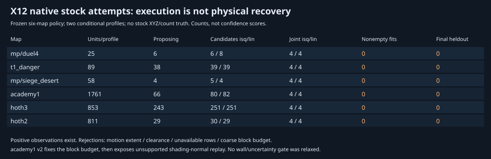

# X12: native stock joint-fit execution and new blocking witnesses

Follow-up [X13 bake occupancy](rend2-bake-occupancy-x13.md) separates source-placement
assumptions from runtime swept motion and preserves this frozen run. The new
four-map attempt reaches 16 source forward calls on hoth2/hoth3, but accepts no
stock source model; known local collisions and independent path-visibility
availability remain explicit blockers.

The native scheduler now reaches `Joint::Solve` on all six preselected stock
maps. **No stock source configuration completes fitting/validation, no final
stock prediction is accepted, and no recovered stock emitter is published.**
This is a reproducible negative result, not evidence that those maps have no
physical lights. Positive compiled fixed-XYZ amplitude fits still work.

X11 was committed first as `a83d663ff5a45e4ff629e95e94d655c433b1946b`.
The old 57-map inventory, original archive/BSP identities and
[v4 results](../tools/rend2/all_stock/results/v4/maps.json) are preserved. X12
does not replace the historical audit or claim a new successful 57-map run.

## Frozen protocol and meaning of completion

[v1 protocol](../tools/rend2/stock_joint_fits/results/v1/protocol.json) freezes
the six maps before new evaluation: `mp/duel4`, `t1_danger`, `mp/siege_desert`,
`academy1`, `hoth3`, `hoth2`. Selection covers small MP, old sampling/solar/
transport/scheduling failures, complex SP and an outdoor/sky control. Outdoor
selection is not proof of measurable sunlight. All have complete all-page
derived archives; no game was launched or asset recaptured in X12.

The two independent branches are explicitly assumed NetRadiant inverse-square
and linear recipes, with equal work/nuisance policies. Original stock profile,
transfer, primaries, absolute scale, light XYZ and source count remain unknown.
Profiles are never concatenated into one model. Sky/grid/deluxe hints do not
establish a stock recipe or known directional operator.
The preserved MP captures also retain their SP-capture/material-interpretation
limitation; MP optical semantics are not upgraded to verified by this audit.

Original folds are retained: seed 20261031, 256-WU blocks, origin (17,31,47),
60/20/20 split, footprint/filter gap `3 * radius + 1`. X10 chooses a bounded
whole-map fitting set and a denser training-only discovery pool. Final RGB is
owned by the trusted controller; neither target RGB nor answers determine
shards, source positions, profile rules or the coarse-budget correction below.
Readiness census statistics include aggregate evaluator signal; these are not
optimization feedback. The native adapter is a trusted controller, not an OS
sandbox. Separately mounted blind views are tested on compiled fixtures.

Budgets are unchanged from X11: one area/profile/local invocation, 48 rows,
eight coarse source nodes, no local refinement, 8,192 rays/one million work/
256 forward calls per local job; catalog input cap 128; two new candidates per
wave; four waves per profile. Each Joint call allows 12 models, two amplitude
sweeps, eight line steps, 400,000 rays/80 million work/12,000 evaluations.
Scene caps are 4,096 units, 384 MiB accounted memory, four million rays,
500 million work, 250,000 forward calls and a 240-second safety timer; outer
process caps are 600 seconds/1 GiB actual peak working set. These are bounded
attempts, not exhaustive full-map optimization. Deferred candidates remain.

Geometry/material refinement and merge/split are disabled in this frozen audit
to isolate orchestration/admission. Candidate activation/removal proposals,
amplitude fitting, automatic shadow diagnostics (weight .1), strict evaluation
and validation use production code. Passive transport is prepared, but the
whole-model fit is explicitly **conditional direct-only**: unmodelled GI,
sunlight and environment are unknown, not physically zero. No later stage is
claimed executed when an earlier source model is rejected.

## Actual stages before and after

| Map | Historical v4 stop, before Joint | Local units/profile | Units proposing | Candidate records isq/linear | Real Joint calls isq/linear | Completed nonempty fits | Final heldout |
|---|---|---:|---:|---:|---:|---:|---:|
| mp/duel4 | Insufficient local support | 25 | 6 | 6/8 | 4/4 | 0 | 0 |
| t1_danger | Solar validation unavailable | 89 | 38 | 39/39 | 4/4 | 0 | 0 |
| mp/siege_desert | Coincident transport quadrature | 58 | 4 | 5/4 | 4/4 | 0 | 0 |
| academy1 | More than 32 areas | 1,761 | 66 | 80/82 | 4/4 | 0 | 0 |
| hoth3 | More than 32 areas | 853 | 243 | 251/251 | 4/4 | 0 | 0 |
| hoth2 | More than 32 areas | 811 | 29 | 30/29 | 4/4 | 0 | 0 |

These are **48 real Joint calls** in the frozen six-map attempt. Completing a
black/no-source numerical baseline is distinct from completing a nonempty
source fit. There are 12 attempted structural models per profile/map, including
baselines and rejected source proposals; this is not 12 recovered lamps.
Generated records can be correlated alternatives from overlapping jobs. Their
counts are not emitter recall or physical source count. S05 deferral and
capability filtering remain visible in the JSON. Search completeness is false
on every map, even after every scheduled unit has been attempted.

[v1 results](../tools/rend2/stock_joint_fits/results/v1/stock.json) contain all
attempt/rejection summaries, source IDs, unit status distributions, profiles,
fold identities, resources and private debug hashes. The native aggregate status
`NoSupportedEvidence`/`InsufficientSignal` must be read as **no admitted winning
model**, not absence of positive input signal or physical lights.

## Observation readiness and independent geometry

| Map | Colour pages | Derived texels | Mapped luxels | Eligible planar luxels | Eligible/mapped chart area | Training rows/positive | Validation rows/positive | Heldout rows/positive |
|---|---:|---:|---:|---:|---:|---:|---:|---:|
| mp/duel4 | 2 | 32,768 | 19,842 | 10,962 | 69.48% | 113/98 | 93/81 | 72/70 |
| t1_danger | 94 | 1,540,096 | 654,675 | 19,647 | 5.70% | 244/244 | 105/105 | 66/66 |
| mp/siege_desert | 26 | 425,984 | 227,302 | 132,387 | 70.38% | 123/123 | 74/74 | 48/48 |
| academy1 | 24 | 393,216 | 235,581 | 224,303 | 95.37% | 474/474 | 145/145 | 159/159 |
| hoth3 | 38 | 622,592 | 403,084 | 202,558 | 53.88% | 412/266 | 239/177 | 227/186 |
| hoth2 | 12 | 196,608 | 79,565 | 41,347 | 57.06% | 189/121 | 157/112 | 173/139 |

Positive means at least one channel >=8 encoded codes, a readiness proxy under
unknown transfer, not physical direct-light attribution. The area denominator is
mapped original chart area, possibly duplicated in original geometry, **not
unique physical reflector area**. Eligibility is the adapter's planar screening,
not a guarantee of forward capability. Uncovered, footprint-only, ambiguous and
unsupported categories stay separate in `census.coverage` (enum order from
`surfaces.h`); none is counted as a successful dark prediction.

All three folds contain six major normal-axis bins. Distinct spatial blocks
(train/validation/heldout) are 28/15/11, 25/14/9, 52/26/19, 67/49/51,
43/78/51 and 48/41/45 respectively. Joint's grouping also includes region and
channel; academy1 therefore has **69 mandatory evidence tuples**, not 67.
Sample normal diversity and positive pixels alone do not establish localization
information. Saturation counts, material/geography counts, grid index coverage,
page statistics and unsupported normals remain in the machine-readable census.
No grid ambient/directed fitting or stock SI photometric comparison is claimed.

An older diagnostic field `represented_stratum_area` actually summed X10's
dimensionless correlation weights. The public collector explicitly relabels it
`statistical_weight_mass`; original private file hashes are preserved. It is
never reused as transport patch area. `selected_actual_area` remains separate.

## Precise blockers and controlled witnesses

1. **Global unknown dynamic swept extent.** `CaptureBspSpace()` captures every
   non-world BSP model's current bounds, but cannot establish its complete
   motion. `PointRefine::Scene::Check()` returns `Dynamic` if any boundary lacks
   known swept extent. Joint requires `Free`. All tested activation proposals on
   t1_danger, siege_desert, hoth3 and hoth2 stop at boundary 1, with unknown extent.
   Their unknown motion record counts are **86, 94, 88 and 124**. This is broader
   than a local static obstruction and currently prevents every source placement
   certificate on those maps. Merely using a distant current bound as its whole
   trajectory would invent evidence.

   New diagnostic fields retain the first boundary ID and unknown-extent flag.
   Joint errors now distinguish centre/path, extent and rim checks. A controlled
   positive-lamp witness accepts the original scene and a distant **known** swept
   bound, but rejects the same distant **unknown** swept extent. It reports the
   exact boundary ID and no certified lamp-absence assertion. Existing known
   overlapping motion bounds still reject placement. Numerical physics is not
   weakened to obtain a stock fit.

2. **Adapter coarse-budget error, repaired.** academy1 v1's 64-row coarse limit
   could not retain its 69 required `(channel, region, block)` groups. All models
   failed before objective evaluation; validation calls were zero. The adapter
   now uses `max(64, number of training geometry groups)`. It preserves all groups,
   target values, fold gaps, source budgets and objective thresholds.

   [v2 protocol](../tools/rend2/stock_joint_fits/results/v2/protocol.json) was
   frozen before the follow-up. Both profiles now execute four validation calls.
   The first follow-up's generic error and the second's enriched diagnostics are
   separately retained as `v2/initial.json` and `v2/stock.json`. This is a geometry
   input correction, not heldout-guided tuning or a relaxed acceptance gate.

3. **Observation admission does not imply formula support.** After the coarse
   correction, academy1 records six per-profile source-model failures at a batch
   receiver with differing geometric/shading normals: sample
   `7804426648716081`, source surface 308. `Bake::Capability()` correctly says
   compiler interpolation/push for this class is unverified. The batch
   `Prepare()` operation previously hid that reason behind `Unsupported factor
   operation`; it now retains capability reason and receiver IDs. Two more
   proposals fail `UnknownGeometry`; four no-source baselines finish. No
   nonempty model completes.

   A new positive-factor test appends one receiver with a valid but different
   shading normal. The original batch works; the mixed batch returns
   `Unavailable`, clears prepared factors and identifies the unsupported receiver.
   This is not a successful black prediction. Do not replace the original normal
   by the geometric normal to manufacture compiler agreement.

4. **mp/duel4 finite-source support and comparable coverage.** Six source-model
   attempts fail `Clearance`; latest-wave witnesses include authored rectangle
   and tube alternatives. Two source-model attempts reach a 64-row coarse
   evaluation but only 55 rows are comparable (nine unavailable). No candidate
   may win by silently dropping those nine. A source positioned on an emitting
   boundary needs an explicitly supported material-side/fixture contract; the
   present vacuum clearance test does not establish one. This does not prove
   those authored lamps are physically impossible.

## Geometry, shadows and passive transport

| Map | Captured-ROI Free/Solid/Unknown cells | ROI regions/components/apertures | Fixture-centre rays visible/blocked/unknown | Transport patches | Known-positive / retained links | Mapped selected observation area |
|---|---:|---:|---:|---:|---:|---:|
| mp/duel4 | 1684/1735/19262 | 19/19/0 | 51/148/313 | 1616 | 22/159 | 6.775% |
| t1_danger | 304/1280/3072 | 1/1/0 | 0/40/472 | 2939 | 0/14881 | 0% |
| mp/siege_desert | 1560/3475/5746 | 1/1/0 | 0/63/449 | 3167 | 0/13815 | 0% |
| academy1 | 5028/1280/8316 | 5/5/0 | unavailable: no fixture-centre hints | 524 | 34/354 | 2.381% |
| hoth3 | 2212/2958/22747 | 3/2/1 | 0/70/442 | 1488 | 0/11998 | 0.086% |
| hoth2 | 1333/2601/3788 | 1/1/0 | 0/141/371 | 1652 | 0/12710 | 2.971% |

Cell counts describe the archive's original bounded ROI, not full-map free
volume. Fixture-centre rays test unverified evidence locations; they are not
fitted-source ray accuracy or a geometric ground-truth audit. Region IDs do not
block local rays. Known opaque blocking remains distinct from unknown optics.
No accepted stock model exists on which to score false-wall illumination; that
metric is unavailable, not zero measured violations.

All six disjoint topology/transfer builds return success with explicit local
incompleteness. The old siege_desert singular-node abort is gone. Every transfer
hits its local 128-million-work budget and has incomplete pair support; unknown
links do not become positive transport. Materials and bake physics remain
conditional. A complete physical GI field is not available. The table's area
denominator is selected observation footprint area; it is not whole-map coverage.

Detected baked gradients/possible edges are 0/0, 3/3, 0/0, 0/0, 3/3, 1/1. Stock
transfer/filtering is unknown, so these preserve alternative explanations and
are not verified source/caster correspondences. No stock localization improvement,
direct/GI attribution or shadow association accuracy is asserted.

## Independent known-compiler controls

The actual native `Joint::Solve -> Producer` blind harness was rerun on original
pinned `point_room`, `two_colour`, `door_occlusion`, each with correct and wrong
profiles. Only fixed candidate XYZ and the selected public recipe are supplied;
true RGB, evaluator RGB and source answers remain with the external controller.
Every prediction during fitting comes from production C++. Training initialization
is RGB (64,64,64), with nonnegative bounded Q; no source XYZ is inferred.

| Fixture | Train/validation/heldout rows | Fitted compiler Q RGB | Relative source RGB error | Heldout interval MSE | Black MSE |
|---|---:|---|---:|---:|---:|
| point_room | 18/15/15 | (299.8549,299.8549,299.8549) | 0.04836% | 0 | 2495.8889 |
| two_colour, source 1 | 18/15/15 | (287.1586,27.5553,6.3052) | 5.1619% | 0.222869 | 1170.6019 |
| two_colour, source 2 | same observations | (26.7347,69.7120,303.2982) | 5.8636% | same joint prediction | same |
| door_occlusion | 18/15/15 | (299.8549,299.8549,299.8549) | 0.04836% | 0 | 2495.8889 |

Check the frozen JSON for exact fold counts; these are the geometry-selected
subsets, not whole-fixture observation completeness. Interval error respects
truncation, censoring and shared-peak encoding. Good RGB prediction does not make
the two-colour allocation exact. These conditional sources remain unresolved
for physical existence/calibration. Wrong-profile cases return no admitted
preferred model rather than a fake zero error. All three correct cases complete
canonical payload validation and cache/load/publication into a data-only snapshot;
runtime consumers remain unavailable. Repeated two_colour archives are byte
identical. XYZ/type/count discovery accuracy is not supplied by this protocol.
The selected Joint results are `Partial` within the bounded numerical schedule;
`Producer::Completed` records conditional workflow/publication completion, not
unlimited-iteration convergence or recovered physical-source truth.

The 22 original production-forward/compiler comparisons were also rerun:
20 supported recipe scopes pass their frozen tolerances; `colour_clip` has the
predeclared one-code maximum, all other supported floor cases zero. The scoped
`multi_sun` compiler replay matches all **1,225** samples, including the former
35 boundary samples. Its difference from the older Python analytic prediction
still reaches 28 codes; that is not a C++/compiler mismatch. Bounce1/bouncegrid1
remain **UnsupportedBounceReplay**, direct-only discrepancy max six codes, and
are not relabelled successful full-bounce predictions. Wrong-profile RGB RMSE
14.4776 (wrong falloff with angular rule held fixed: 17.7202) and black RMSE
24.9112 defeat vacuous acceptance.

The analytical/CPU suites separately cover geometry, types, source ambiguity,
walls/openings, passive energy, cancellation, corrupt caches and blind access.
The existing 50-unit scheduler fixture remains an analytical supplied-geometry
test; it is not a newly compiled large-scale recovery benchmark. **No new complex
compiled bridge map or private stock rebake was produced in X12.** Large compiled
source-discovery accuracy remains an unperformed check, not inferred from compact
fixed-XYZ controls. This task demonstrates precise supportedness blockers rather
than claiming the requested first positive stock fit.

## Resource results and repeatability

| Map | Whole process seconds | Actual peak RSS MiB | Scene rays isq/linear | Scene work isq | Separate GI-preparation rays |
|---|---:|---:|---:|---:|---:|
| mp/duel4 | 6.219 | 30.28 | 370/370 | 57,562 | 789,137 |
| t1_danger | 37.469 | 42.95 | 1887/1887 | 502,398 | 519,939 |
| mp/siege_desert | 16.422 | 58.88 | 92/92 | 26,694 | 449,548 |
| academy1 v1 | 22.563 | 39.18 | 2771/2771 | 17,410,429 | 921,793 |
| hoth3 | 26.188 | 101.77 | 11803/11800 | 6,260,832 | 407,038 |
| hoth2 | 12.625 | 65.98 | 1933/1933 | 2,560,125 | 430,172 |

Use JSON as the exact counter witness. Wall/RSS include import, sample selection,
geometry, transport preparation, both profile branches and diagnostics. RSS is OS
peak working set, not summed STL capacity. CPU seconds are not separately
instrumented. Scene counters exclude the separately reported GI preparation and
debug rays; failed partially prepared factor batches can do work before their
error without exporting all counters. Thus counters are a lower bound on total
numerical work, not an exact trace census. Process measurements include failures.
No source-dependent strict batch count is inferred from a baseline score call.

duel4, danger and hoth3 were repeated with the exact frozen executable. All
semantic outputs, stable IDs, alternatives/failures, graph keys and debug TSV
hashes match; timing/RSS are excluded. academy1 v2 takes 23.641 seconds/44.64 MiB
in the enriched diagnostic attempt. Its coarse change legitimately changes
the settings/graph identity. Diagnostic-only changes do not alter formulas,
certification keys or `.jkobs`/canonical schemas.

## Publication boundary, acceptance and next work

The solver still terminates at `ReconstructedLightingAsset` plus data payloads.
The dependency audit finds no Forward+/shadow-map/froxel/cvar/GL dependency in
numerical modules. Physical admissibility precedes observation ranking; uncertainty
assessment precedes publication; offline budgets are independent of renderer
capacity. A low validation residual is not a physical configuration oracle.

No stock result reaches source uncertainty probes, final heldout callback or
canonical publication. Therefore source-removal, wrong-position/type/count,
ambient-versus-source and direct-versus-GI **final stock model comparisons are
unavailable**. It would be misleading to manufacture a fit for those tables.
Original-versus-predicted stock lightmap images and source uncertainty markers
are likewise not produced. Useful private debug data do exist: selected geometry,
candidate placement TSVs, attempted-unit bounds, transport OBJ/patch/mapping TSVs,
ray states and overlap/contact witnesses. Only aggregate results/hashes and the
count SVG are committed; licensed BSPs/lightmaps stay outside the repository.

The next implementation priorities are specific:

1. Separate bake-state occupancy and runtime swept-motion evidence. Establish
   explicit conditional bake-state hypotheses or authored motion bounds; retain
   unknown dynamic visibility. Do not delete motion records or mark unknown free.
2. Freeze a geometry-only common supported receiver set for each profile/operator
   before fitting, including normals/placement/style capability. Report excluded
   area and preserve independent folds. Do not change admission as XYZ/RGB changes
   to let a model win by dropping receivers.
3. Provide fixture-side source support for surface emission and improve bounded
   admissible-candidate scheduling. Preserve distinct nearby lamps and deferred
   discovery rather than repeatedly spending the small wave budget on inadmissible
   alternatives. A generic no-accepted-model state needs clearer cause semantics.
4. Then increase joint search/refinement scope under a new frozen protocol, add the
   independently compiled larger blind discovery bridge, and evaluate full source
   ablations/transport alternatives. Unknown profile/material/absolute scale and
   incomplete GI remain separate scientific limitations.

See [commands and validation records](../tools/rend2/stock_joint_fits/README.md).
The final native regression is **35/35 passed** (290.89 seconds); SP/MP Release
builds and 23 Python checks pass. All 27 disabled-path shader programs compile;
the input-revision comparison has zero source/binding differences. The old
historical shader baseline still fails with its pre-existing 3,870 diff lines;
it was not rewritten. Compiled native child peaks are about 5.8–6.8 MiB;
correct-case wall times are 1.043/6.668/.424 seconds for point/two-colour/doorway
on this concurrent host. Build-driver/CTest RSS is explicitly not compiler/test
process peak RSS. Exact OS measurements and test log hashes are sealed in
`results/v1/checks.json` and `compiled-resources.json`.

The report's conclusion is **native end-to-end fixed-geometry compiler fitting is
operational; original stock lamp discovery/reconstruction is still blocked**.

## X15 follow-up: receiver capability and fixed comparison domains

The frozen X12 observations and failures above are preserved. The
[X15 report](rend2-receiver-support-x15.md) reproduces the academy1 normal witness
and mp/duel4's 55/64 result, then introduces predeclared common receiver support.
Seven of the original nine MP failures are fixed-origin exclusions (four solid,
three boundary); two remain uncertain patch paths. New coarse schedules do not
silently retain only easy observations: remaining unavailable predictions still
reject a candidate. No stock physical source recovery or historical profile
identity is established by this follow-up.

## X17 follow-up: direct visibility uses the declared bake scene

The [separate X17 eight-map audit](rend2-source-path-support-x17.md) repairs the
downstream coupling between conditional source placement and the passive-GI
runtime-motion path guard. Supported historical direct rays now use the same
static geometry/bake-state interpretation as placement; Transfer and uncertain
GI links retain their original scope. hoth3 reaches 63/64 mandatory coarse rows,
and coverage also improves on hoth2, kor1 and yavin1b. The remaining missing paths
still reject the entire source-bearing model. No receiver normal, target fold,
positive-light gate, known blocker or stock physical-source certificate is
relaxed. No accepted nonempty stock fit is claimed.
