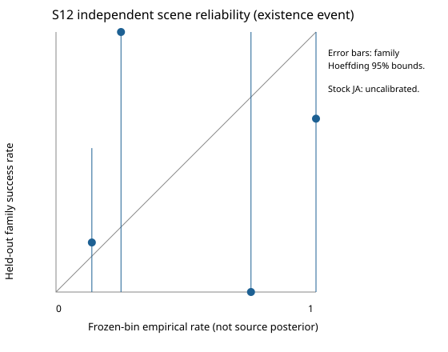

# S12: conditional uncertainty and independently calibrated event rates

Date: 2026-10-31. Previous S10/S11 implementation committed as `3e6644819`,
now `3b8d4721f` after the user's pull/rebase; the two committed trees are identical.
CPU/offline only. This stage does not publish sources, change a source to
`Resolved`, modify renderer lighting, or establish stock JA physical ground truth.

## Implemented boundary

`Core::Uncertainty::Analyze` consumes a sealed `Joint::Result`, its original
training request and optionally the existing aggregate validation controller.
It calls the production `Joint::Refit` and `Joint::AssessHypothesis`, which use
the same strict forward operator, visibility and passive source-linked transport
as S11. It never accepts a held-out target reader or source-answer reader.

`Refit` changes only the declared nuisance/geometry parameter block. `AssessHypothesis`
evaluates a proposed value without fitting and seals it against the **original**
training policy. This distinction is necessary: fitting a subsampled result again
on all observations would erase the very instability being measured. Both APIs
support input/output aliasing, preserve work on failures, reject changed geometry
generations, and clear inherited existence/identifiability claims.

The shared owned test scene/answer generator was extracted to
`tools/lightrecon_test/joint_test_scene.h`; S11 and S12 reuse it. It is not linked
into the production library. No new third-party numerical dependency was added.

## Meaning of each uncertainty output

| Output | Meaning | Claims it does not support |
|---|---|---|
| Complete configuration witness | One strict, geometrically admissible joint source/RGB/material/profile/gain configuration satisfying the frozen regret policy | Exhaustive feasible set, posterior sample or source certification |
| `complete` | The requested finite probe/refit schedule finished | Entire map supported or global uniqueness proved |
| `globalSearchComplete` | Always false in this sampled implementation | A finite search radius is not proof of a bounded physical source region |
| Relative peak bounds | Min/max of `max(Q)` among retained configurations | Independent Cartesian RGB bounds, candela or a statistical confidence interval |
| Peak-colour bounds | Coordinate projections of `Q/max(Q)`; unknown when zero amplitude makes colour undefined | Rec.709 physical chromaticity when primaries/profile are unknown |
| XYZ scatter | Full symmetric sample scatter, including off-diagonal terms, of retained configuration centres | Posterior/error covariance or `Position.sigmaWorld` |
| Angular spread | Maximum separation of retained travel directions or tube axes | Unique sun direction or calibrated angular coverage |
| Cause/status records | Thirteen distinct evidence limitations, each with an explicit reason | Arbitrary products of heuristic confidence factors |
| Ranking | Bounded transform of independent validation removal regret | Existence probability |
| Empirical bin rate | Equal-family event success rate under an identified frozen calibration protocol/population | Individual-source Bayesian posterior, historical compiler identity or stock-map calibration |
| Exact/field suitability | Separate conservative admission hints; no renderer adapter is invoked | Automatic runtime activation |

The configuration contains complete source parameters, historical spot parameters,
relative amplitudes, passive material hypotheses and fixed observation gain.
Its key pins the original training, geometry, transfer and evaluation policy.
Replaying it still requires those immutable dataset/transfer dependencies; this
metadata record is not a replacement for the observation archive.

`SourceUncertainty` separately records existence, type, position, orientation,
dimensions, relative colour, absolute scale, bake profile, material response,
visibility, shadow association, direct/indirect attribution and numerical scope.
Unknown absolute scale has **no finite physical intensity bound**. A zero relative
amplitude does not establish source absence. A valid empty model is not recovered
lighting.

## Conditional profiling and correlated alternatives

For a structural/profile hypothesis `h`, continuous parameters `theta` and nuisance
parameters `eta`, the sampled accepted set is

```
W = { (h,theta,eta) from the declared probes:
        L_train(h,theta,eta) <= L_train_best + tau_train,
        L_validation(h,theta,eta) <= L_validation_best + tau_validation,
        strict supported coverage and required spatial blocks pass }.
```

These are **regret thresholds**, not a log-likelihood ratio. No Wilks/chi-square
coverage or arbitrary 95% XYZ interval is attached. Validation is a model-selection
fold, not the untouched final test set. The full joint configurations are retained;
the mean of disconnected positions is only a descriptive scatter reference and
never becomes an emitter centre.

The deterministic schedule includes supplied structural alternatives, source
removal/refit, signed axis and diagonal XYZ profiles, individual bounded RGB
coordinates, frame and finite-dimension probes, passive material-bound endpoints,
delete-one-spatial-block tests, block subsampling, and amplitude restarts. Other
source nuisance parameters are refitted within the same bounds. Values are then
assessed strictly on the original observations. Geometry moves invalidate the
production source-dependent visibility factors.

Spatial blocks are subsampled **without replacement**. S11 separately normalizes
each channel/region/block; multiplying every area in a block by a bootstrap
multiplicity would cancel and would not implement a proper cluster bootstrap.
This implementation therefore reports subsampling stability, not bootstrap
coverage. A future statistically calibrated bootstrap requires explicit group
multiplicity weights throughout both nonlinear and linear-coordinate objectives.

Track association uses stable candidate identities and explicitly mutually
exclusive provider family IDs. Spatial proximity alone never merges neighbouring
sources. Same-family models can retain different shapes. Unrelated IDs remain
separate tracks unless the provider supplied the identity relation; S12 does not
guess a unique permutation for coincident lamps. Count alternatives survive as
complete configurations, not as averaged/summed sources.

The default limits are 96 attempts, 64 witnesses/refits, 100,000 training rows,
100,000 evaluations, 4,000,000 rays, 400,000,000 traversal/arithmetic work and 128 MiB
accounted analysis memory. Production operators have their own per-operation caps.
The validation callback retains its own operator caps and is checked cumulatively
after each call. Cancellation, bad input, work/memory exhaustion and truncated
probe schedules are explicit; an incomplete result cannot pass exact suitability.
Accounted memory excludes caller-owned immutable geometry and is not process RSS.

## Calibration protocol

For one frozen event and ranking bin, family `f` contributes

```
z_f = mean(known binary outcomes in family f and this bin)
p_bin = mean_f(z_f)
epsilon = sqrt(log(2/alpha) / (2 * number_of_independent_families))
rate interval = [max(0,p_bin-epsilon), min(1,p_bin+epsilon)]
```

This is a Hoeffding interval for the population bin mean under independent bounded
family draws. It is deliberately wider than treating correlated candidates or
luxels as independent Bernoulli trials. It is not a positional confidence region.
The interval is pointwise for a frozen bin; simultaneous inspection of many bins
does not acquire joint 95% coverage. Family independence is an explicit controller
attestation, not something the library can infer from strings.

`Calibrate` sorts and hashes the frozen protocol, bins, population and event labels;
rejects duplicate trials; counts unknown labels separately; bounds allocation;
and gives each family equal weight. `CalibratedRate` rejects reuse of a calibration
family for evaluation, insufficient independent families and population mismatch.
Known zero empirical success remains different from `Unknown`. No normalized
ranking is silently converted to a probability. `Analyze` never trains calibration.

Events are separately named: source within the declared matching region, correct
type conditional on detection, exact-light use within declared tolerances, and
held-out field usefulness. Exact use requires its **own** calibration, physical
scale, complete work, no competing retained pose/type/count mode and appropriate
source/material support. Its default required lower rate bound is .95. Field
usefulness uses a separate event and lower bound (.5 by default); it may remain
useful when a physical source is not localized. These are frozen admission policies,
not estimates of uncertainty or claims of universal safe thresholds.

The included calibration population supplies point candidate positions. It cannot
calibrate arbitrary discovered XYZ, spot/area/tube classification, historical
Raven profiles, sun/sky, unknown stock optics or absolute photometry. Positive
exact-use calibration is not established here. Those outputs remain unavailable
outside the stated support; stock maps retain `UnknownProfile` and unknown scale.

## Canonical asset and cache changes

Canonical semantic schema **3** adds `LightingConfiguration` and `SourceUncertainty`.
Disk envelope 1.0 gains sections 15/16. Old schema-1/2 assets and keys are rejected;
the independently versioned `.jkobs` observation archive is unchanged.

`Attach` is an explicit metadata-only, atomic operation with track-to-existing-source
bindings. It creates no physical source, does not move or rescale one, never writes
sample scatter into `sigmaWorld`, and rejects authored/resolved source replacement.
Source evidence can carry empirical probabilities only with their typed calibration
records. Canonical validation rejects inconsistent compatibility evidence, missing
track/configuration/provenance references, malformed cause lists, non-finite values,
non-PSD scatter and unsupported probability claims. Normal renderer consumers remain
independent and unmodified.

## Ground-truth checks and reproducibility

The production CPU suite includes unique multi-normal support; single-plane
disconnected positions; distance/intensity ambiguity from one receiver; an opaque
wall breaking that symmetry; point/broad-spot alternatives; coincident same-colour
count/allocation ambiguity; censored channels; material/profile/GI/scale alternatives;
sun/sky ambiguity; zero signal; missing geometry; immutable conflicting authored data;
corrupt streams, held-out-role access, changed geometry, cancellation and budgets.
Single-datum ambiguity tests intentionally reuse a scalar constraint to demonstrate
non-identifiability; they are not independent positive-light recovery benchmarks.

The population controller freezes the first 32 independent procedural room draws
for calibration and the last 16 for final evaluation. Geometry scale, source layout,
brightness, candidate offsets and missing-source controls are generated without
looking at final labels. Three strata (floor-only, multiple normals, partial
doorway wall) are crossed with three intensity levels. Geometry hashes are distinct.
Source matching uses a bounded exact injective assignment, not IDs, with radius
`.16 * generated scene scale`. This is a declared compact-fixture localization
tolerance, not a stock-map threshold. False candidates and missed/abstained truth
remain in reliability and risk–coverage denominators.

Only training/validation-admitted positive scenes contribute calibration trials;
29 of the 32 calibration draws pass that rule. Zero-signal draws and their false
candidates remain in the census, and `Analyze` abstains on them. Calibration and
deployment admission must match. An earlier controller included those zero-signal
rows in calibration despite production abstention; that protocol mismatch and its
metrics are preserved as `results/admission-diagnostic.json`, labelled superseded.
The corrected protocol did not change frozen bins, matching radii or thresholds,
and uses no final held-out RGB to decide admission.

The Python runner only controls C++ processes and computes metrics. It uses the
existing evaluation framework, reports family-weighted reliability separately from
row-weighted Brier/ECE, produces CSV/SVG, records actual peak Windows working set,
and runs both C++ programs twice. Time/RSS are separate from deterministic witnesses.
Exact commands and final measured results are recorded in
`tools/rend2/uncertainty/README.md` and its versioned `results/`.

## Measured results

The 81 C++ assertions pass. Both production-C++ programs were executed twice;
their semantic JSON outputs are identical. The assertion suite has 11 recorded
scenarios, including the incomplete-budget case.

| Owned scenario | Retained joint configurations | What the result demonstrates |
|---|---:|---|
| Multiple receiver normals | 1 | Tested perturbations rejected; this is not global uniqueness |
| One receiver plane, two symmetric centres | 2 | Both `x=-.5` and `x=+.5` survive; no midpoint lamp is created |
| Same geometry plus opaque partition | 1 | The blocked alternative fails supported spatial-block evidence |
| One compact receiver | 25 | Relative peak spans 1.1911–3.1916; XYZ scatter has nonzero off-diagonal terms |
| Weak censored observations | 7 | Relative peak projections span .4–6; colour/scale are not precise |
| Coincident same-colour count models | 3 | One/two-source models and RGB allocation alternatives survive |
| Point / broad spot | 2 | Both type hypotheses retained under the supplied family relation |
| Profile / material / bounce / gain alternatives | 4 | Relative peak spans .9757–2; absolute scale remains unknown |
| Single-datum sun / sky | 2 | Different root explanations retained; no confident sun is invented |
| Zero signal | 2 diagnostic models | Overall `Unknown`, no existence probability or field admission |
| Truncated schedule | 1 partial witness | `complete=false`; no completeness claim from a small work budget |

For the single-receiver example, the upper-triangular descriptive scatter is
approximately `[.01875,.0046875,.0046875,.01875,.0046875,.01875]` world-units squared.
It describes the sampled configuration cloud, not a calibrated confidence ellipsoid.
The symmetric example has `xx=.5`; the descriptive mean at zero is never published
as an emitter. Individual configuration coordinates and RGB remain coupled.

Final evaluation covers **16** independent room draws, **17** true emitters and
**46** supplied candidate records. Eleven truths have a candidate within the
declared matching radius; **six are missed**, and **35 candidates are false**.
This is candidate truth coverage 11/17 (64.7%), not a claim that the solver discovered
those XYZ. Complete joint matching covers 9/14 nonempty-truth scenes. Unknown and
unmatched cases remain in denominators. Six candidate records have no calibrated
rate due to zero positive evidence.

| Frozen removal-ranking bin | Independent calibration families | Empirical success rate | Calibration-bin 95% bound | Final family-weighted rate |
|---|---:|---:|---|---:|
| [0,.02) | 29 | .1379 | [0,.3901] | .1905 (14 families) |
| [.02,.2) | 4 | .25 | [0,.9291] | 1 (1 family) |
| [.2,.6) | 4 | 1 | [.3209,1] | .6667 (3 families) |
| [.6,1] | 4 | .75 | [.0709,1] | 0 (1 family) |

The row-weighted compatibility metrics over 40 admitted known-label records are
Brier **.21460** and ECE **.14181**. These are diagnostics, not evidence of good
calibration. A point-rate cutoff .9 admits three candidates, including **one false
source**, and recalls only 2/17 truths. A lower-rate-bound cutoff .5 admits none;
all 17 truths are missed or abstained. Empty selection risk is **unavailable**, not
zero. These results expose the weakness of the small bins and coarse removal score.
They do not justify physical-light deployment. No positive exact-use physical-scale
calibration is available, and no tested source is admitted for exact lighting.



Candidate misses by geometry stratum are 3/5 (floor-only), 1/6 (multiple normals)
and 2/6 (partial doorway). Those are errors of supplied candidate coverage; they
must not be interpreted as confidence-interval failures or stock-map source recall.

The final population run takes 7.41–7.70 seconds wall time, 7.39–7.69 CPU seconds,
and 5.56 MiB peak process working set. The assertion run takes 5.18–5.37 seconds,
5.17–5.35 CPU seconds, at most 5.75 MiB RSS. The largest recorded analysis-owned
span is 79,104 bytes in the single-receiver profile test; immutable geometry and
library allocations are represented by actual process RSS instead. The 48-scene
population accounts for 188,248 rays and 16,783 evaluations, including attempted
models, nuisance fits, strict assessments and trusted held-out ablations. The
population JSON is 150,135 bytes. CPU times are measured with Windows process times;
these small fixtures are not a large-map scalability benchmark.

Validation performed:

- GCC 16.2.0 Release: all standalone tools build; **28/28 CTest** cases pass in
  250.10 seconds (existing S07 point refinement accounts for 250.06 seconds).
- MSVC Release: SP `rdsp-rend2_x86_64` and MP `rd-rend2_x86_64` build; three targeted
  uncertainty/disk/joint CTest cases pass in 18.32 seconds. Existing `/arch:SSE2`
  x64 option warnings are unchanged.
- Final suitability-policy identity/validation changes were followed by SP/MP
  rebuilds and targeted uncertainty/disk/joint checks: GCC 3/3 (13.20 seconds),
  MSVC 3/3 (19.15 seconds). Final test-only optics additions also pass under MSVC
  (1/1, 6.02 seconds). Suitability thresholds affect the result key and invalid
  rates outside [0,1] are rejected.
- Existing evaluator metrics: **39** Python tests; X05 acceptance: **16** tests;
  S12 dashboard: **5** negative tests. All pass.
- Schema-3 asset round trip, corruption/limits and obsolete schema-1/2 rejection;
  the intentional empty-format SHA witness is `bdf7dceb...87e35ef`.
- Disabled-path shader-input comparison against `3e6644819`: **27 programs / 51
  stages unchanged**. This is a source/binding comparison, not GPU compilation.

Exact commands, source/executable hashes, intermediate failures and log hashes
are in `results/validation.json` and `results/numerical.json`. Legacy Python tests
require their `unittest discover -s ...` invocation; an initial module-style call
failed their existing local imports, then the documented discovery commands passed.
No game, fresh q3map2 bake or stock confidence calibration was executed in S12.
Existing compiled-control and production forward tests were reused. Build success
is not reported as visual runtime validation.

## Remaining limits

This is bounded sensitivity and empirical calibration infrastructure. It does not
enumerate all physically feasible source layouts, prove continuous uniqueness,
implement calibrated likelihood-ratio regions, or establish map-to-map domain
adaptation. Sparse sampling can miss remote modes; the explicit domain-limited
status and alternative configurations must survive. Local amplitude singular
values from S11 remain useful conditioning diagnostics, not existence probability.

Uncertain material, profile, scale and transport can be correlated; their separate
cause records must not be multiplied as independent probabilities. Missing geometry
still makes affected predictions unavailable. Sun/sky and GI uncertainty is
conditional on the supplied root/profile/material alternatives, not a complete
spectral/environment posterior. More diverse independently compiled and calibrated
families are required before production exact-light admission on real maps.
