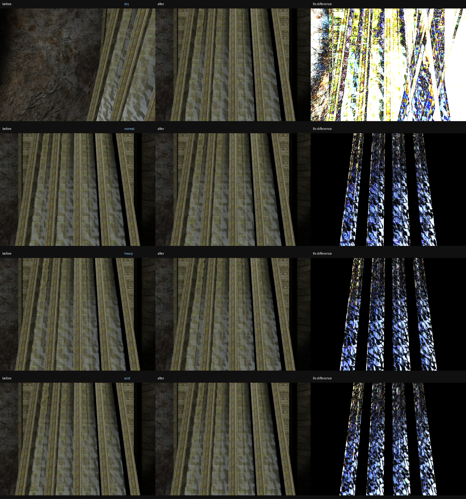

# Unified precipitation state

The renderer resolves one `precipitationState_t` for each render scene before
surface generation. The value lives in `trRefdef_t`, so draw and post-process
commands receive a scene-owned snapshot. Portal, mirror, shadow and main views
do not share a mutable exposure result. `weatherSystem_t::mainPrecipitation` is
an explicitly owned, main-view-only diagnostic snapshot; render consumers do
not read it.

The weather commands (`r_we` and map world-effect commands) remain the source
of truth. Per-pixel rain exposure remains the weather-depth texture lookup in
the material shaders and is intentionally not part of this CPU state.

## Dependency graph

Before:

```text
weatherSystem globals
  |-- weather particles: active/count/color + wind
  |-- splashes: rain slot + depth map + cvars
  |-- wetness: rain active + depth map
  |    |-- puddles: independent count/2000 intensity mapping
  |    `-- runoff: direct wind
  |-- lens water: subtype + count/5000 + wind + R_IsOutside(view)
  `-- water response: subtype + wind + R_IsOutside(body)
```

After:

```text
r_we / map world-effect commands
            |
            v
R_ResolvePrecipitationState (once per scene)
            |
            v
trRefdef_t::precipitation (scene-owned value)
  |-- weather particles / rain streak volume
  |-- splashes
  |-- wetness -> puddles / runoff
  |-- lens water
  `-- water wind/rain response

weather depth texture ----------------> per-pixel material exposure
```

## Compatibility invariants

- `lightrain`, `rain`, `acidrain` and `heavyrain` keep their stock counts of
  1000, 2000, 2000 and 5000 particles.
- `normalizedIntensity` is the existing lens mapping:
  `clamp(rawParticleCount / 5000, 0, 2)`.
- Puddle ripple occupancy remains exactly
  `clamp(0.3, 1, rawParticleCount / 2000)`, expressed as
  `clamp(0.3, 1, normalizedIntensity * 2.5)`.
- The light/normal/heavy/acid lens profiles retain the existing subtype map.
- With optional consumers disabled, the particle count, tint, fall velocity
  and additive legacy particle path are unchanged.

## Debug command

`r_precipitationInfo` prints the last resolved main scene: subtype, raw particle
count, normalized intensity, wind, tint, current/outside/exposed state and the
active consumer list.

## Regression captures

The deterministic `t3_hevil` lens-water capture harness was run before and
after the cleanup at the same camera and renderer settings. The contact sheet
contains the source before/after images and an 8x-amplified difference view.



Individual sources are under `precipitation-state-captures/before` and
`precipitation-state-captures/after`.
